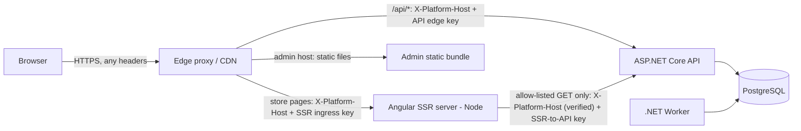

# White-Label E-commerce Platform — Architecture Decisions (Phase 4)

| | |
|---|---|
| **Status** | **ADR-01–03, ADR-05–11 and cross-cutting conventions approved (2026-10-18).** **ADR-04 revision 4 approved 2026-10-18** (commit `849fe35`, merged to `main` in `c9edca5`). ADR-12 deferred. *Architecture approval is not implementation: nothing is built yet.* |
| **Last updated** | 2026-10-18 (revision 4: ADR-04 credential separation; decisions recorded) |
| **Phase** | 4 — Architecture |
| **Based on** | [requirements.md](requirements.md) v1.9 (approved 2026-10-18), [domain-model.md](domain-model.md), [system-behavior.md](system-behavior.md) |

> **How to read this document.** Each decision (ADR) states the constraints it must satisfy from the approved documents, the options considered, a **recommendation**, and its consequences for MVP complexity, operations, security, scalability, and testing. The **Status** column of the summary shows which ADRs are approved; for approved ADRs the recommendation is the decision. Nothing here has been implemented or installed.
>
> **Fixed inputs (not reopened):**
> - Requirements §24: one Angular workspace with `storefront` and `admin`; Angular SSR for public storefront pages; client-only admin; host-based tenant resolution; separate admin host; same-origin `/api`.
> - **Backend language and platform: C# on modern .NET with ASP.NET Core** (product-owner direction, 2026-10-18). Node.js/NestJS and Next.js are not options. Angular stays the frontend.

**Revision 2 (2026-10-18):** the first draft recommended Node.js + NestJS. That recommendation is **withdrawn**. ADR-01 is rewritten for .NET, and every ADR that depended on the backend language was revised — see [What changed in revision 2](#what-changed-in-revision-2).

**Revision 3 (2026-10-18, architecture review):** ADR-04 now specifies the complete trusted-host flow (edge, SSR, API, keys, diagnostics, tests TH-1–TH-10); ADR-03 names the exact contract generator and drift check; ADR-11 adds the toolchain baseline and reproducible installs.

**Review decisions (2026-10-18):** revision 3 approved **except ADR-04**, which was rejected as written because the SSR server received the same edge key the API accepted for all routes.

**Revision 4 (2026-10-18):** ADR-04 corrected — three separate credentials (API edge key, SSR ingress key, SSR-to-API key), credential-to-network binding, tests TH-11–TH-14. ADR-11's Node/Angular selection rule updated per review.

---

## Summary

| ADR | Decision | Recommendation / decision | Status | Needed by |
|---|---|---|---|---|
| [01](#adr-01-backend-platform-and-application-structure) | Backend platform and application structure | **.NET 10 (LTS), C# 14, ASP.NET Core 10**; Minimal APIs; modular monolith with one project per domain | **Approved** 2026-10-18 | M0 |
| [02](#adr-02-database-and-data-access) | Database and data access | **PostgreSQL**; **EF Core 10 + Npgsql**, with explicit SQL for locks and idempotent inserts; EF Core migrations reviewed as SQL | **Approved** 2026-10-18 | M0 |
| [03](#adr-03-repository-layout-and-api-contracts) | Repository layout and API contracts | One repo: Angular workspace + .NET solution; **code-first OpenAPI** (built-in) → generated TypeScript contract types for Angular | **Approved** 2026-10-18 | M0 |
| [04](#adr-04-request-topology-host-resolution-and-public-caching) | Request topology, host trust, public caching | Edge deletes client host and credential headers, sets `X-Platform-Host`, and adds **one credential per route**: API edge key (edge→API), SSR ingress key (edge→SSR); SSR calls the API with a separate **SSR-to-API key** limited to public `GET`s; each credential bound to its source network; the API is the only store resolver | **Revision 4 approved** 2026-10-18 (revision 3 rejected); production capability open (U-5) | M0 (flow) / M1 (resolution) |
| [05](#adr-05-authentication-sessions-and-csrf) | Authentication, sessions, CSRF | **Custom session authentication handler** (PostgreSQL sessions, token hash); **no ASP.NET Core Identity**; permission-based authorization policies; **ASP.NET Core Antiforgery** bound to the session; `Origin` check | **Approved** 2026-10-18 | M2 (hashing: M1) |
| [06](#adr-06-rate-limiting) | Rate limiting | Built-in rate-limiting middleware for per-IP limits + PostgreSQL counters for identifier lockouts | **Approved** 2026-10-18 | M2 |
| [07](#adr-07-background-jobs-and-the-outbox) | Background jobs and outbox | .NET **Worker Service**; outbox dispatcher as a `BackgroundService` using `SKIP LOCKED`; **Quartz.NET** (PostgreSQL job store, clustered) for schedules; operator alerts via error log + email (U-2) | **Approved** 2026-10-18 | M2 |
| [08](#adr-08-email) | Email | **MailKit** SMTP for development (**Mailpit**); provider adapter in production (chosen with hosting); templates as Razor components rendered with `HtmlRenderer` | **Approved** 2026-10-18 (production provider chosen with ADR-12) | M2 (dev) / first shared env (prod) |
| [09](#adr-09-media-storage) | Media storage | `IMediaStorage` abstraction; **S3-compatible** default (MinIO locally) or Azure Blob if hosting is Azure; uploads through the backend; separate media host | **Approved** 2026-10-18 | M3 |
| [10](#adr-10-image-processing-and-resizing) | Image processing and resizing | **NetVips** (libvips) at upload; MediaAsset renditions added to the domain model | **Approved** 2026-10-18 | M3 |
| [11](#adr-11-testing-and-local-development) | Testing and local development | **xUnit v3**, `WebApplicationFactory`, **Testcontainers for .NET** (PostgreSQL), Respawn; architecture tests; Playwright E2E; **Aspire** locally; GitHub Actions; reproducible toolchain | **Approved** 2026-10-18 | M0 |
| [12](#adr-12-hosting-and-deployment-deferred) | Hosting and deployment | **Deferred** — decide before the first shared environment; Azure is a natural candidate | Deferred | Before first deploy |
| [X](#cross-cutting-conventions) | Cross-cutting conventions | Problem Details errors, UUID v4, money, time, options validation, user secrets, redacted logging, OpenTelemetry | **Approved** 2026-10-18 | M0 |

**Concurrency spike assessment:** [still not required](#concurrency-spike-assessment) with PostgreSQL; two EF Core–specific points are covered by M1/M5 integration tests.

---

## ADR-01 Backend platform and application structure

**Constraints from approved documents**
- Transaction-heavy domain logic with explicit locks and conditional updates (system-behavior §5).
- Server-side sessions, CSRF, Argon2id or bcrypt hashing (domain-model §5.4–5.5).
- **Acyclic domain dependencies** (system-behavior §1) and a read layer that owns no business rules.
- Permission declared per admin endpoint, evaluated per request (domain-model §1.7).
- A shared library of **API contract types** in the Angular workspace (requirements §24).

### 1a. .NET version

| Option | Support | Assessment |
|---|---|---|
| **.NET 10 (LTS)** | Released November 2025; supported until **November 2028** | **Recommended.** Current LTS; ASP.NET Core 10 and EF Core 10; C# 14. |
| .NET 11 (STS) | Expected November 2026 (24-month support policy) | Not yet released at the time of writing; no MVP feature requires it. Re-evaluate at M0 if it has shipped. |
| .NET 8 (LTS) | Ends November 2026 | Rejected — end of support during the MVP. |

**Upgrade policy:** stay on LTS releases; plan the move to the next LTS (.NET 12, expected November 2027) as a routine task.

### 1b. API style

| Option | For | Against |
|---|---|---|
| **Minimal APIs, organized by feature** | First-class in .NET 10 (built-in validation, OpenAPI, endpoint filters, route groups); endpoint filters are a natural place for "requires permission X", CSRF validation, and store resolution; little ceremony | Conventions (grouping, naming) must be agreed explicitly |
| MVC controllers | Familiar; attribute-based filters | More ceremony; feature code tends to spread across controller, service, and DTO folders |

**Recommendation: Minimal APIs** with route groups per area (`/api/storefront`, `/api/cart`, `/api/admin/stores/{storeId}`), endpoint filters for cross-cutting checks, and handlers in the owning domain module.

### 1c. Application structure

| Option | For | Against |
|---|---|---|
| **Modular monolith: one class library per domain** (`Store`, `Media`, `Catalog`, `Inventory`, `Customers`, `Cart`, `Ordering`) plus `ReadModels`, `Infrastructure`, and hosts (`Api`, `Worker`, `Cli`) | **The compiler enforces the acyclic dependency rule** — project references cannot form cycles, and the allowed graph mirrors system-behavior §1 | More projects to manage |
| Single project with folders per domain | Simplest | Dependency rules enforced only by architecture tests |
| Clean Architecture layers (Domain / Application / Infrastructure / Api) per solution | Familiar template | Splits each domain across four layers; does not express domain-to-domain dependencies |

**Recommendation:** modular monolith, one project per domain, plus architecture tests (ADR-11) as a second check. One deployable API, one worker, one operator CLI — all from the same solution.

**Solution conventions:** `.slnx` solution format; central package management (`Directory.Packages.props`); nullable reference types on; warnings as errors; .NET analyzers enabled.

**Hosts**

| Host | Purpose |
|---|---|
| `Api` (ASP.NET Core) | Storefront and admin HTTP APIs |
| `Worker` (Worker Service) | Outbox dispatcher and scheduled jobs (ADR-07) |
| `Cli` (console app) | Operator commands: provision, activate, suspend, staff reset, reconciliation trigger — no HTTP surface (requirements §3: no super-admin UI) |

**Note on Node.js:** Node remains in the stack **only** for the Angular toolchain and the Angular SSR server, which requires it. No backend logic runs in Node.

**Consequences**

| Aspect | Implication |
|---|---|
| MVP complexity | Moderate; strong typing and mature tooling across the backend. |
| Operations | Three .NET processes (API, worker, CLI on demand) + the Angular SSR Node process. Container images built from the official .NET runtime images. |
| Security | Mature security primitives in the base class library (`RandomNumberGenerator`, `SHA256`, `HMACSHA256`, `CryptographicOperations.FixedTimeEquals`, Data Protection). |
| Scalability | Stateless API (sessions in the database) scales horizontally; MVP scale fits one instance. |
| Testing | `WebApplicationFactory` in-memory hosting; real PostgreSQL via Testcontainers (ADR-11). |
| Cross-language cost | Contracts can no longer be shared as code with Angular; ADR-03 replaces that with generated types. |

---

## ADR-02 Database and data access

**Constraints from approved documents** (system-behavior §5, RA-8)
- Shared and exclusive **row locks** (placement: shared locks on organization and store rows; status changes: exclusive).
- **Conditional updates** (`committed + qty ≤ onHand` at write time).
- **Unique constraints in the same transaction**, where concurrent duplicates wait and then observe the first result.
- Read-only **consistent-snapshot** transactions (reconciliation).
- Partial uniqueness (one `Active` cart per owner), case-insensitive SKU uniqueness, `LocalizedText`.

### 2a. Database

| Option | For | Against |
|---|---|---|
| **PostgreSQL** | `FOR SHARE` / `FOR NO KEY UPDATE`; conditional `UPDATE … WHERE` re-checked on the latest row version under READ COMMITTED; `INSERT … ON CONFLICT` waits for a concurrent duplicate; partial and expression unique indexes; `REPEATABLE READ READ ONLY`; JSONB; `SKIP LOCKED`; excellent EF Core provider (Npgsql); no license cost | — |
| SQL Server / Azure SQL | First-class in .NET; filtered unique indexes; snapshot isolation; `UPDLOCK`/`HOLDLOCK`/`READPAST` hints | License cost (or Azure SQL pricing); lock-hint semantics differ from the design's shared/exclusive model and need separate reasoning; JSON support less mature than JSONB |
| MySQL 8 | Row locks, `SKIP LOCKED` | No partial indexes; gap-lock behavior; weaker .NET ecosystem |

**Recommendation: PostgreSQL** (current major supported by the chosen host). If hosting ends up on Azure, **Azure Database for PostgreSQL** keeps this decision intact.

### 2b. Data access

| Option | For | Against |
|---|---|---|
| **EF Core 10 + Npgsql, with explicit SQL where needed** | Migrations, change tracking for aggregate saves (the product unit, domain-model C2); `ExecuteUpdateAsync` performs **conditional updates natively** and returns the affected row count; global query filters; JSON mapping for `LocalizedText`; optimistic concurrency tokens | No LINQ operator for `FOR SHARE`/`FOR UPDATE` or `ON CONFLICT` — those few statements use parameterized SQL (`FromSql`, `ExecuteSql`) on the same connection and transaction |
| Dapper + SQL migrations (e.g., DbUp) | Full SQL control, very fast | Hand-written mapping and change handling for the complex product aggregate |
| EF Core for writes + Dapper for read layer | Fast read queries | Two data-access styles from day one; can be added later if a read query needs it |

**Recommendation: EF Core 10 with Npgsql.**
- **Locks and idempotency inserts:** a small set of explicit SQL statements (placement locks, `ON CONFLICT` idempotency records), wrapped in named repository methods and covered by concurrency tests.
- **Conditional stock updates:** `ExecuteUpdateAsync` with the condition in `Where`; zero affected rows ⇒ insufficient stock.
- **Optimistic concurrency:** explicit integer `version` columns configured as concurrency tokens (the domain contracts expose `version` to clients, so PostgreSQL's hidden `xmin` is not used).
- **Migrations:** EF Core migrations; each migration's generated SQL is reviewed in the pull request, and CI applies migrations from scratch. Production applies **reviewed SQL scripts** (or migration bundles), never `Database.Migrate()` at application startup.

### 2c. Tenant isolation enforcement

1. **Explicit `storeId` in every store-scoped command and query** (primary mechanism).
2. **EF Core global query filters** on store-scoped entities as a safety net, scoped to the resolved store. Platform-wide paths (store resolution, staff login, reconciliation) opt out explicitly and are few and reviewed. *Trade-off:* filters do not apply to raw SQL — the explicit-SQL statements must include `store_id` themselves, enforced by review and tests.
3. **Database constraints:** `store_id NOT NULL` on every store-scoped table; references between store-scoped records use **composite foreign keys** `(store_id, id)` (EF Core alternate keys), making INV-1 a constraint as well as a guard.
4. **Schema test (M1 gate):** fails if a store-scoped table lacks `store_id` or a same-store reference lacks a composite key.
5. **Row-level security:** not in the MVP (complicates platform-wide paths and pooling); optional hardening.

**Transaction conventions:** READ COMMITTED with explicit locks and conditional updates; global lock order (system-behavior §5.2); reconciliation uses `REPEATABLE READ READ ONLY`.

| Aspect | Implication |
|---|---|
| MVP complexity | Moderate: EF Core for most work; a handful of reviewed SQL statements for the critical paths. |
| Operations | Managed PostgreSQL in production (backups, point-in-time recovery); separate migration and application database roles. |
| Security | Parameterized SQL only (`FromSql` with interpolation is parameterized; string concatenation forbidden by analyzer/review). |
| Testing | All concurrency guarantees tested against real PostgreSQL. |
| Dependency | Confirms **RA-8** once approved. |

---

## ADR-03 Repository layout and API contracts

**Context:** the separate mock API track is dropped (D1, approved 2026-10-18 — see [proposed-doc-changes.md](proposed-doc-changes.md#d1--drop-the-separate-mock-api-track)). With a C# backend, contract types can no longer be shared as source code with Angular; they must be **generated**.

**Repository layout**

```text
/frontend        Angular CLI workspace (apps: storefront [SSR], admin; libs: design system, i18n/formatting, api-contracts [generated])
/backend         .NET solution (Api, Worker, Cli, domain modules, ReadModels, Infrastructure, tests)
/contracts       openapi.json — generated from the API, committed, reviewed in pull requests
/dev             local environment: edge proxy config, container definitions
/docs            documentation
```

**Contract options**

| Option | For | Against |
|---|---|---|
| **A. Code-first OpenAPI**: built-in `Microsoft.AspNetCore.OpenApi` generates `openapi.json` at build; TypeScript types generated for Angular (e.g., `openapi-typescript`, types only) | Backend is the single source of truth; no hand-written duplicate; drift detected in CI by regenerating and diffing | Generated types are only as precise as the endpoint metadata; requires discipline in describing responses and errors |
| B. Contract-first: hand-written OpenAPI, C# and TypeScript generated | Contract reviewed before code | Extra authoring step; generated C# server stubs fit Minimal APIs poorly |
| C. C# DTO → TypeScript interface generators | Simple | No endpoint, status, or error information |

**Recommendation: A.** Angular calls the API through thin, hand-written services typed with the generated contract types (an Angular library `api-contracts`) — this keeps the requirements §24 statement true (*shared library of API contract types*).

**Generation pipeline (exact)**

| Step | Tool / command | Output |
|---|---|---|
| 1. Describe endpoints | Built-in `Microsoft.AspNetCore.OpenApi` (OpenAPI 3.1) | — |
| 2. Generate the document at build | `Microsoft.Extensions.ApiDescription.Server` with `OpenApiGenerateDocuments=true` and `OpenApiDocumentsDirectory` pointing to `/contracts` | `contracts/openapi.json` (committed) |
| 3. Generate TypeScript types | **`openapi-typescript` 7.13.0**, pinned exactly as a frontend dev dependency. npm script `contracts:generate` = `openapi-typescript ../contracts/openapi.json --output projects/api-contracts/src/lib/schema.d.ts` (run in `/frontend`) | Types only — no generated runtime client |
| 4. CI drift check | `dotnet build` (regenerates step 2) → `npm run contracts:generate` → `git diff --exit-code -- contracts/ frontend/projects/api-contracts/` | CI fails on any difference |

**Validation rules on both sides** (domain-model §6.9 — the backend is final, the frontend gives immediate feedback):
- Backend: .NET 10 built-in Minimal API validation for simple constraints; **FluentValidation** for cross-field and domain rules (recommendation; alternative: built-in only).
- Simple constraints (required, length, pattern) flow into the OpenAPI schema.
- Rules that cannot be expressed in OpenAPI (e.g., Egyptian phone normalization) are implemented on both sides and verified against **one shared JSON file of test vectors** run by both the .NET and the Angular test suites, so the implementations cannot drift unnoticed.

| Aspect | Implication |
|---|---|
| MVP complexity | Moderate — a generation step and a CI drift check. |
| Security | The server remains authoritative; duplicated client rules are UX only. |
| Testing | Integration tests validate responses against the OpenAPI document; shared test vectors for duplicated rules. |
| Dependency | Requirements §24 "Two apps, one workspace" stays valid unchanged; the "Mock API" row changes (D1). |

---

## ADR-04 Request topology, host resolution, and public caching

**Constraints:** system-behavior §4.4 — only the host received by the **trusted edge** identifies the store; client forwarded-host headers are ignored; cached responses never set cookies; cache key = normalized host + path + allow-listed query; unknown hosts return an uncached platform 404. Requirements §24 — same-origin `/api`; SSR storefront; client-only admin on its own host.

*(Revision 4, 2026-10-18 — **corrected after review; approved 2026-10-18 (introduced in `849fe35`, on `main` via merge `c9edca5`).** Revision 3 forwarded one edge key to both the SSR server and the API, which gave the SSR server a credential that the API accepted for any route. Revision 4 separates the credentials and binds each to a network path.)*

### 4a. Trust zones, network paths, and topology

| Zone | Components | Accepts connections from |
|---|---|---|
| Public | Browsers, bots, attackers | — |
| **Trusted ingress** | Edge proxy / CDN — the **only** public entry point | Public internet |
| Private — SSR | Angular SSR server (Node) | **Edge only** |
| Private — API | ASP.NET Core API | **Edge and SSR server only** |
| Private — data | Worker, PostgreSQL | API/Worker only |



### 4b. Credentials — three separate secrets

Header names are fixed in M0; used below:

| Credential (header) | Path | Held by | Accepted by | Scope |
|---|---|---|---|---|
| **API edge key** (`X-Platform-Api-Edge-Key`) | Edge → API | **Edge only** | API, and only from **edge source addresses** | All API routes, subject to normal authentication and authorization |
| **SSR ingress key** (`X-Platform-Ssr-Ingress-Key`) | Edge → SSR | Edge, SSR (verify only) | **SSR server only** — the API **rejects** it | Rendering a page; grants nothing at the API |
| **SSR-to-API key** (`X-Platform-Ssr-Api-Key`) | SSR → API | **SSR only** | API, and only from **SSR source addresses** | **Allow-listed public `GET` storefront endpoints only** |

Plus `X-Platform-Host`: set (overwritten, never appended) by the edge from the host it actually received; forwarded by the SSR server only after verifying the SSR ingress key.

**Least privilege:** each component is configured with **only** the secrets it needs. The SSR server never holds the API edge key; the edge never holds the SSR-to-API key. Each secret is random, stored outside source control, and rotated independently (two active values per credential during rotation).

### 4c. End-to-end rules

**Edge**
1. **Deletes** every client-supplied host-override and credential header before forwarding: `X-Forwarded-Host`, `Forwarded`, `X-Original-Host`, `X-Host`, and **all** `X-Platform-*` headers (including any client copy of the three keys).
2. Rejects requests whose `Host` is not a platform host (store wildcard `*.<platform-domain>`, admin host, media host) with a platform 404; never forwards them.
3. **Sets** `X-Platform-Host` from the received `Host` (lowercase, no port, no trailing dot) and its own `X-Forwarded-For` / `X-Forwarded-Proto`.
4. Adds **exactly one** credential per route: `/api/*` → API edge key; store pages → SSR ingress key; admin static files → none. **The API edge key is never sent to the SSR server.**

**Angular SSR server**
5. Accepts connections from the edge network only, and verifies the **SSR ingress key** (constant-time comparison) in the Node server entry point **before** Angular renders; missing or wrong key → `403`, nothing rendered, security log entry.
6. Takes the public host **only** from the verified `X-Platform-Host` — never from `Host`, `X-Forwarded-Host`, or the request URL. Angular's own host validation (Angular 22 rejects `Host` headers not listed in its allowed hosts) is configured for the platform hosts as an additional check.
7. A **server-only** HTTP interceptor (registered only in the server application config, never in the browser bundle) rewrites relative `/api/...` calls to the private `INTERNAL_API_BASE_URL`, adds `X-Platform-Host` (the verified value from rule 6) and the **SSR-to-API key**, sends only `GET` requests, and forwards **no** browser cookies, `Authorization` headers, or incoming `X-Platform-*` credentials.
8. The SSR ingress key, SSR-to-API key, and internal URL come from server environment variables only. A CI check fails if any appears in a browser bundle.

**API**
9. Accepts connections from the edge and SSR networks only.
10. A **trusted-path middleware** runs first in the pipeline and classifies the caller:
    - valid **API edge key** **and** source address in the configured edge networks → caller = *edge*;
    - valid **SSR-to-API key** **and** source address in the configured SSR networks → caller = *SSR*;
    - anything else — no key, wrong key, the **SSR ingress key**, or a valid key from the wrong network → `403` with no store data and a security log entry.
11. Caller *SSR* is restricted to an **allow-list of public `GET` storefront endpoints**; any other method or route (admin, auth, cart, checkout, account, any write) → `403`. A faulty or compromised SSR server cannot act as a shopper or staff user, and has no credential that unlocks more.
12. The store host is read **only** from `X-Platform-Host`. The API's own `Host` header is ignored for store resolution. ASP.NET Core's Forwarded Headers middleware processes only `X-Forwarded-For`/`X-Forwarded-Proto`, only from known edge addresses, and **never** `X-Forwarded-Host`. Source-address checks use the **direct connection address**, never a forwarded header.
13. The API normalizes the host again (lowercase, strip port and trailing dot, validate hostname syntax) and resolves it via `StoreDomain`; unknown → `STORE_NOT_FOUND`, never a fallback. **Host resolution lives only in the API**; the SSR server never connects to the database.

**Result:** a client can set any header it wants; the edge deletes it. The SSR server and the API accept a host only together with a credential the client does not have, arriving over the expected network path. The SSR server holds only a credential limited to public `GET` endpoints. A client cannot select another store by manipulating headers, and the SSR server cannot reach privileged routes.

**Layers of defense:** (1) network isolation (SSR reachable only from the edge; API only from edge and SSR); (2) edge header deletion and overwrite; (3) three separate, least-privilege credentials; (4) credential-to-source-network binding; (5) SSR route allow-list. Mutual TLS is an optional later hardening if the hosting platform supports it.

**Local development:** all processes run on `localhost`, so network separation and source binding cannot be demonstrated locally. The three keys and the route allow-list still apply. Source binding is covered by integration tests that set the connection's remote address in the test server (TH-12), and must be verified in the first shared environment (U-5).

### 4d. Diagnostics

Request-context diagnostics (API: e.g., `GET /api/_test/request-context`, returning resolved host and caller kind; SSR: an equivalent test-only hook reporting the credential headers it received) exist **only** for automated tests:
- Registered only when the environment is `Testing` **and** an explicit configuration flag is set.
- **Startup fails** if the flag is set in any other environment.
- A test starts each server in the `Production` configuration and asserts the diagnostic is absent (`404`).

No host-echo or header-echo endpoint exists in production.

### 4e. Required tests (M0/M1 gates)

| # | Origin | Scenario | Expected |
|---|---|---|---|
| TH-1 | Browser → edge | `brand-a` host with forged `X-Forwarded-Host: brand-b…`, `Forwarded: host=brand-b…`, `X-Platform-Host: brand-b…` | API and SSR resolve **brand-a** |
| TH-2 | Direct → API (bypassing edge) | No key; wrong key; forged `X-Platform-Host` without key | `403`, no store data |
| TH-3 | Direct → SSR (bypassing edge) | No SSR ingress key, forged `X-Platform-Host` | `403`, nothing rendered, no API call made |
| TH-4 | Browser → edge → SSR → API | Page request to `brand-a` with forged host headers | SSR's internal API call carries `X-Platform-Host: brand-a` and the SSR-to-API key (asserted via the test-only diagnostic); HTML contains only brand-a data |
| TH-5 | SSR-to-API key misuse | SSR-to-API key on a `POST`, or on admin, auth, cart, checkout, account, or any non-allow-listed route | `403` |
| TH-6 | API host source | Valid API edge key from an edge address, `X-Platform-Host: brand-a`, but `Host: brand-b…` | Resolves **brand-a** |
| TH-7 | Edge | Request for a non-platform host | Platform 404 at the edge |
| TH-8 | Build | Browser bundles scanned for all key names/values and the internal API URL | Not present |
| TH-9 | Configuration | API and SSR started as `Production` with the diagnostic flag set; and without it | Startup fails; diagnostic returns `404` |
| TH-10 | Normalization | `Brand-A.<domain>:443`, `brand-a.<domain>.` | Resolve to brand-a |
| **TH-11** | SSR ingress key at the API | The SSR ingress key presented to the API on any route (public, admin, write) | `403` — the API never accepts it |
| **TH-12** | Source binding | Valid **API edge key** presented from an **SSR source address** on privileged routes (admin, auth, cart write); valid SSR-to-API key from an edge or unknown address | `403` in every case |
| **TH-13** | Edge credential routing | Through the edge: a store-page request (including a forged `X-Platform-Api-Edge-Key` from the client) reaches the SSR server **without** any API edge key — only the edge-set SSR ingress key; an `/api/*` request reaches the API with only the API edge key | Asserted via the SSR and API test-only diagnostics |
| **TH-14** | SSR configuration | The SSR server's configuration schema and deployment configuration contain no API edge key setting; startup fails if one is provided | Configuration test |

### 4f. Caching

- Public responses: `Cache-Control: public, max-age=0, s-maxage=60`; everything else defaults to `private, no-store` (secure default: a response is public only if its endpoint explicitly opts in). ASP.NET Core output caching is **not** used for public pages; the shared cache sits at the edge.
- The suspended-store `503` page is `no-store` (system-behavior §4.2).
- **Shared cache:** M1 emits correct headers; the shared cache arrives with hosting (ADR-12). Cache-key query-parameter normalization (RA-7) is configured with the shared cache and first matters in M4.

### 4g. Unresolved — U-5, depends on ADR-12

The **production** edge and hosting must support: deleting and overwriting request headers; adding a **different** secret origin header per route (API edge key on `/api/*`, SSR ingress key on store pages); keeping SSR and API off the public internet; and **stable, distinguishable source networks** for the edge and the SSR server so the API can bind each credential to its network. Common CDNs and reverse proxies support per-route headers, but the exact product is chosen with hosting. **Until ADR-12 is decided, the flow is proven only with the local edge (Caddy) and integration tests.** If the chosen platform cannot provide per-route secrets or source binding, the fallback is mutual TLS with a separate client certificate per caller. **U-5 stays open** and must be resolved before the first shared environment.

**Local development edge**

| Option | For | Against |
|---|---|---|
| **Caddy** | Issues trusted local TLS certificates for `*.localhost` automatically, so `__Host-` cookies (which require `Secure`) work on `brand-a.localhost`; simple config | One non-.NET tool |
| YARP (.NET reverse proxy) | Same language; could later serve as a production edge component | Local TLS for arbitrary `*.localhost` hosts must be set up separately |

**Recommendation: Caddy** for local development, configured to implement edge rules 1–4 exactly (header deletion, overwrite, one credential per route from local secrets). In development the SSR server and API listen on `localhost` ports and are therefore reachable directly — the key checks (rules 5 and 10) still apply, and tests TH-2/TH-3/TH-11 run against them; source binding is tested in integration tests (TH-12). Production edge depends on ADR-12.

---

## ADR-05 Authentication, sessions, and CSRF

**Fixed by approved documents:** server-side sessions; opaque tokens ≥ 256 bits stored as hashes; separate customer and staff credentials and sessions (domain-model §5.3); `__Host-` cookies; `SameSite=Lax` (storefront) / `Strict` (admin); rotation, idle/absolute expiry, revocation rules; session-bound CSRF token in a readable cookie echoed in a header; `Origin` check; pre-session token for login/registration (domain-model §5.5, requirements §22.1); Argon2id (preferred) or bcrypt ≥ 12.

### 5a. Authentication mechanism

| Option | For | Against |
|---|---|---|
| **Custom `AuthenticationHandler` over PostgreSQL session tables** | Implements domain-model §5.5 exactly: opaque token, SHA-256 hash lookup, store binding, idle/absolute expiry, rotation, revocation; plugs into ASP.NET Core authentication and authorization | We own ~a few hundred lines of security-sensitive code — mitigated by focused tests |
| Cookie authentication handler + server-side `ITicketStore` | Built-in cookie handling; ticket kept server-side | The cookie carries a Data-Protection-encrypted reference rather than our opaque token; rotation, store binding, and per-session revocation still need custom code around it |
| ASP.NET Core Identity | Full user management | **Conflicts with approved decisions:** default hasher is PBKDF2 (requirements require Argon2id or bcrypt); credentials live on the user record (domain-model A1 separates them); usernames/emails are unique globally, while customer phone/email are unique **per store**; customer and staff would need two parallel Identity setups |
| External identity provider (OIDC) | Offloads auth | Contradicts approved server-side session design; per-store customer identities are awkward |

**Recommendation: custom session authentication handler; no ASP.NET Core Identity.**
- Two schemes: `CustomerSession` (storefront hosts) and `StaffSession` (admin host); a customer cookie can never authenticate an admin request.
- Token: `RandomNumberGenerator.GetBytes(32)`, base64url; stored as `SHA256.HashData(token)`.
- Cookie names: `__Host-sf_session`, `__Host-adm_session`, `__Host-cart` (guest cart).
- `lastSeenAt`/`idleExpiresAt` updated at most once per minute per session.

### 5b. Authorization

- ASP.NET Core **authorization policies** with a custom `PermissionRequirement` ("`orders.transition`") and handler that, on every request: loads the membership for the route's `storeId` (**none → 404**), computes effective permissions = role ∩ store-status filter (**missing → 403**) — domain-model §1.7.
- Forced password change: a filter allows only the password-change endpoint while `mustChangePassword` is set.
- Membership and permissions are never cached in the session.

### 5c. Password hashing

| Option | Assessment |
|---|---|
| **Argon2id** via a vetted .NET library (candidates: `Isopoh.Cryptography.Argon2` — PHC string format with verify; `Konscious.Security.Cryptography.Argon2` — managed, requires our own encoding; a libsodium binding) | **Preferred** by domain-model §5.4. The .NET Argon2 ecosystem is smaller than for bcrypt, so the library is **vetted at M1** (maintenance, test vectors, PHC encoding, performance). |
| **bcrypt** via `BCrypt.Net-Next`, cost ≥ 12 | Explicitly allowed by requirements §16.3; very mature. **Fallback** if no Argon2id library passes vetting. |
| ASP.NET Core Identity `PasswordHasher` (PBKDF2) | Not allowed by the requirements. |

Parameters at or above current OWASP guidance, tuned to ~100–250 ms on production hardware; the self-describing hash string enables transparent re-hashing on login. Common-password check against a bundled offline list.

### 5d. CSRF

| Option | For | Against |
|---|---|---|
| **ASP.NET Core Antiforgery**, bound to the session | Built-in, vetted; tokens protected by Data Protection; binds to the authenticated identity via claims — the session handler emits a `session_id` claim (and `store_id`), so tokens are **session- and store-bound** and change on rotation; for anonymous requests it binds to its own cookie token (serves as the **pre-session** binding) | Automatic validation in .NET covers form posts; JSON endpoints need an explicit endpoint filter (small) |
| Custom HMAC token (`HMACSHA256(key, sessionId‖storeId)`) | Explicit, stateless | Our own crypto handling for something the framework provides |

**Recommendation: Antiforgery**, configured as:
- Antiforgery cookie: `__Host-` prefixed, HttpOnly, `Secure`.
- A **readable** `__Host-XSRF-TOKEN` cookie carrying the request token, issued from a non-cached endpoint (`GET /api/csrf`) and refreshed after login and rotation; Angular `HttpClient` XSRF support sends header `X-XSRF-TOKEN`.
- An endpoint filter validates the token on every `POST/PUT/PATCH/DELETE`.
- **`Origin` check middleware:** `Origin` (fallback `Referer`) must match a registered host of the resolved store (storefront) or the admin host; missing both → rejected.
- State-changing endpoints accept `application/json` only (multipart only for the admin media upload, which is CSRF-protected).

**Data Protection keys** (used by Antiforgery and for encrypting sensitive outbox payloads, ADR-07) are **persisted in PostgreSQL** (`PersistKeysToDbContext`) and protected at rest, so tokens survive restarts and work across instances.

| Aspect | Implication |
|---|---|
| MVP complexity | Moderate; one auth module shared by staff (M2) and customers (M9) — no duplicated work. |
| Operations | Data Protection key ring in the database; key-protection secret managed as an environment secret. |
| Security | Meets requirements §22.1 including sibling-subdomain attacks (`__Host-` cookies + session and store binding + `Origin`). |
| Testing | Missing token; token from another session or store; missing `Origin`; rotation on login/password change; revocation on reset; customer cookie on admin host rejected. |

---

## ADR-06 Rate limiting

**Constraints:** requirements §22 item 8; domain-model §5.6 (per identifier and per IP; increasing lock delay; same behavior for unknown identifiers).

| Option | For | Against |
|---|---|---|
| **Built-in `Microsoft.AspNetCore.RateLimiting` for per-IP endpoint limits + PostgreSQL counters for identifier lockouts** | Built-in middleware handles coarse per-IP throttling cheaply; durable counters implement the domain's per-phone/per-email lockout with increasing delay, consistent across instances | Built-in limiter state is per instance (acceptable for coarse IP limits) |
| Redis for all counters | Standard at scale | Extra service for MVP |

**Recommendation:** as in the first row. Identifier keys use **HMAC-SHA256 of the identifier**, never the raw phone or email (requirements §22 item 7). Expired counter rows are deleted by a scheduled job.

---

## ADR-07 Background jobs and the outbox

**Constraints:** system-behavior §5.4 and W12 — transactional outbox, at-least-once; worker never executes business operations; parked messages alert the operator; daily cleanups; daily + manual reconciliation; idempotent jobs that re-check conditions at write time.

| Option | For | Against |
|---|---|---|
| **Worker Service: outbox dispatcher as `BackgroundService` + Quartz.NET (ADO.NET job store on PostgreSQL, clustered)** | Outbox table is the queue (no second queue); Quartz clustering guarantees a scheduled job runs once across instances; Apache-2.0; no extra infrastructure | Quartz configuration is verbose |
| Hangfire (PostgreSQL storage) | Dashboard, retries, simple API | PostgreSQL storage is a community package; Hangfire's own job queue would duplicate the outbox |
| Plain `BackgroundService` timers only | Simplest | No single-execution guarantee with more than one worker instance |
| Hosting-platform cron calling CLI commands | Simple | Ties behavior to the host |

**Recommendation:** the first row.
- **Outbox dispatcher:** selects due messages with `FOR UPDATE SKIP LOCKED`, sends, marks sent; exponential backoff; parks after the maximum attempts and raises an operator alert. Link-bearing payloads (password reset, guest access link) are **encrypted with Data Protection** and deleted after sending.
- **Scheduled jobs:** cart, session, reset-token, access-token, media, and rate-limit cleanup; reconciliation.
- **Manual runs:** the operator CLI triggers a Quartz job (e.g., reconciliation for one store).

| Aspect | Implication |
|---|---|
| Operations | Worker runs continuously with health checks and a restart policy. |
| Testing | Message exists iff the business transaction committed; retry never repeats the business change; parking after max attempts. |
| **Operator alerts** | Error-level structured log **and** an email to a configured operator address (U-2, approved 2026-10-18). |

---

## ADR-08 Email

**Constraints:** three transactional emails; sent from a platform address; store name and logo; order locale (R7); outbox message id as provider idempotency key where supported.

| Concern | Recommendation | Alternatives |
|---|---|---|
| Sending interface | `IEmailSender` abstraction in Infrastructure | — |
| Development and CI | **MailKit** SMTP client → **Mailpit** (local catcher with an API for test assertions) | smtp4dev |
| Production provider | Chosen **with hosting (ADR-12)**: Amazon SES (AWS), **Azure Communication Services Email** (Azure), or Postmark (host-independent, strong transactional deliverability). Idempotency-key support checked at selection. | SendGrid, Mailgun |
| Templates | **Razor components rendered to HTML with `HtmlRenderer`** (built into ASP.NET Core) — typed models, `ar` (RTL) and `en` | Fluid (Liquid templates); MJML for responsive layout |
| Domain authentication | SPF, DKIM, DMARC on the platform sending domain before any production email | — |

Emails never contain passwords; reset links use the store's primary host (requirements §16.6).

---

## ADR-09 Media storage

**Constraints:** domain-model §3 — store-scoped; type detected from content; metadata stripped; size and pixel limits; random storage keys; public but unguessable URLs; no SVG; never delete order-referenced media.

| Option | For | Against |
|---|---|---|
| **S3-compatible object storage** via `AWSSDK.S3` (AWS S3, Cloudflare R2, others); **MinIO** locally | Host-independent; widely supported | — |
| Azure Blob Storage via `Azure.Storage.Blobs`; **Azurite** locally | Natural if hosting is Azure | Ties media to Azure |
| Local filesystem | Simplest | Not viable with more than one instance |

**Recommendation:** an `IMediaStorage` abstraction; **S3-compatible implementation by default**, switched to Azure Blob only if ADR-12 selects Azure.
- **Uploads go through the backend** (streaming multipart, `RequestSizeLimit` 5 MB), because validation, metadata stripping, and resizing must happen before an asset exists.
- Random object keys; immutable objects with `Cache-Control: public, max-age=31536000, immutable`, `X-Content-Type-Options: nosniff`, and the detected content type.
- Served from a **separate media host** (e.g., `media.<platform-domain>`), never from a store host.

---

## ADR-10 Image processing and resizing

**Constraints:** domain-model §3.6 (multiple sizes for mobile performance); 6000 × 6000 limit; metadata stripping; JPEG/PNG/WebP only.

| Option | License | For | Against |
|---|---|---|---|
| **NetVips** (libvips binding) | MIT binding; libvips LGPL-2.1 (dynamically linked native binaries) | Very fast, low memory (streaming); reads dimensions from the header **before** decoding (pixel limit enforced early); auto-rotate; metadata removal on save; WebP output | Native dependency shipped via NuGet runtime packages; container image must include it |
| ImageSharp (Six Labors) | **Six Labors Split License** — free only for open-source use or organizations under the revenue threshold; **otherwise a commercial license is required** | Fully managed, pleasant API | **Licensing must be confirmed** for a company-built product |
| SkiaSharp | MIT | Managed wrapper over Skia, cross-platform | Weaker metadata handling; more manual work |
| Magick.NET (ImageMagick) | Apache-2.0 | Broad format support | Heavy; ImageMagick needs a restrictive security policy |

**Recommendation: NetVips, synchronous during upload.**
- Validate type from magic bytes; read dimensions; reject above 6000 × 6000 before full decode; auto-rotate from EXIF orientation; strip all metadata (including GPS); re-encode (neutralizes polyglot files).
- Generate **WebP** renditions at fixed widths (proposal: 320, 640, 960, 1280, 1920 — never upscaled) plus a re-encoded full-size version; logos get a smaller set.
- Storefront uses `srcset`/`sizes` (Angular `NgOptimizedImage` with a custom loader).

**Domain-model impact (applied 2026-10-18 after approval):** MediaAsset gains a list of **renditions** (width, height, byte size, storage key, URL) — [domain-model §3.2](domain-model.md#32-mediaasset). Order lines continue to reference the asset id.

---

## ADR-11 Testing and local development

**Constraints:** requirements §23; tenant isolation and invariants as **early gates**; concurrency guarantees cannot be verified with mocks or the EF Core in-memory provider.

**Testing**

| Layer | Recommendation | Alternatives / notes |
|---|---|---|
| Backend unit | **xUnit v3** | NUnit, MSTest — equivalent; xUnit is the most common choice for ASP.NET Core |
| Assertions | Shouldly or plain xUnit asserts | FluentAssertions v8+ is commercially licensed — avoided |
| Backend integration | `WebApplicationFactory` + **Testcontainers for .NET** (PostgreSQL) + **Respawn** (fast database reset) | **Never** the EF Core in-memory provider or SQLite for these tests — they do not reproduce locks or constraints |
| Concurrency | Separate `DbContext` instances and connections per simulated actor, started together | — |
| Property-based | **CsCheck** or FsCheck | Inventory invariants (INV-2) over random operation sequences |
| Architecture | **ArchUnitNET** or NetArchTest | Enforces domain dependency rules and "no unscoped store queries" conventions |
| Contract | Responses validated against the generated `openapi.json`; CI fails if regenerating `openapi.json` produces a diff | — |
| Frontend unit | The Angular CLI's default test runner for the chosen Angular major | — |
| E2E | **Playwright (TypeScript)** in the frontend workspace, through the local edge | Microsoft.Playwright for .NET |
| Isolation harness | Two-store fixture builder + cross-store assertion helper (C#) | Mandatory for every store-scoped endpoint from M1 |
| CI | **GitHub Actions** (repository is on GitHub): restore, build (warnings as errors), test, migrations from scratch, OpenAPI drift check, Angular lint/test/build, E2E, dependency audit (`dotnet list package --vulnerable`, `npm audit`) | — |

**Local development orchestration**

| Option | For | Against |
|---|---|---|
| **Aspire** (AppHost) | Starts PostgreSQL, MinIO, Mailpit, API, worker, and the Angular apps with one command; built-in dashboard with logs, traces, and metrics (OpenTelemetry); connection strings wired automatically | One more concept to learn; the edge proxy (Caddy) runs as a container resource |
| Docker Compose + `dotnet run` / `ng serve` | Familiar, explicit | Manual wiring of connection strings and startup order; no unified telemetry view |

**Decision: Aspire** for local development (approved 2026-10-18; not a production deployment decision).

**Developer prerequisites:** .NET 10 SDK, Node.js LTS (Angular toolchain), a container runtime, and a browser trusting the local edge's development certificate.

**Toolchain baseline and reproducible installs** *(added 2026-10-18; versions checked against public release information on that date — exact patch versions are confirmed and recorded when M0 starts)*

| Component | Baseline | Pinned by |
|---|---|---|
| .NET SDK | 10.0 (LTS), one SDK feature band | `global.json` (`rollForward: latestPatch`) |
| NuGet packages | Exact versions | Central package management + `RestorePackagesWithLockFile=true`; committed `packages.lock.json`; CI runs `dotnet restore --locked-mode` |
| Node.js | Baseline **24 LTS, ≥ 24.13.1** (Angular 22 minimum; supported to 2028-04-30) | `.nvmrc` + `engines` in `package.json`; CI uses the same file |
| Angular | Baseline **22.x** (current major, released June 2026), with the TypeScript version Angular 22 requires | Exact versions in `package.json` |

**Node/Angular selection rule (approved 2026-10-18):** at M0 start, choose an Angular major and a Node.js version that are **listed together in Angular's official version-compatibility table**, preferring a Node LTS line. Do **not** select Node 26 merely because it becomes LTS (2026-10-28); move to it only if the official table supports it for the chosen Angular major and there is a concrete reason. The chosen pair and the table checked are recorded in the M0 pull request.
| npm dependencies | Exact versions | `save-exact=true` in `.npmrc`; committed `package-lock.json`; CI runs `npm ci` |
| Playwright | **1.62.x** | Exact version; browsers installed by CI with the matching version |
| Contract generator | **openapi-typescript 7.13.0** | Exact version (ADR-03) |

Upgrades are deliberate pull requests that update the pin, the lockfile, and the generated contracts together.

---

## ADR-12 Hosting and deployment (deferred)

**Not needed for M0 or M1.** Decide before the first shared environment.

| Option | For | Against |
|---|---|---|
| **Azure** (App Service or Container Apps, Azure Database for PostgreSQL, Blob Storage, Front Door/CDN, Communication Services Email) | Natural fit for .NET; managed services for every component | Cost and configuration breadth; region choice for Egypt latency |
| AWS (ECS/Fargate, RDS PostgreSQL, S3, CloudFront, SES) | Mature; Middle East regions | Most moving parts |
| Single VM + containers + managed PostgreSQL, CDN in front | Cheapest, simplest | Manual scaling and OS patching |

Inputs: wildcard TLS for `*.<platform-domain>`, region latency to Egypt, **OQ2 data-protection constraints** (Egypt's Law 151 of 2020 may restrict cross-border transfers), cost, and team operating experience. ADR-08 (email provider) and ADR-09 (storage implementation) follow this choice.

---

## Cross-cutting conventions

| Topic | Proposal |
|---|---|
| Ids | **UUID v4** (`Guid.NewGuid()`). Requirements §22 item 3 and domain-model §0 require random, non-guessable ids; `Guid.CreateVersion7()` would expose creation time and is not used for public ids. |
| Error format | **Problem Details (RFC 9457)** via `AddProblemDetails()`, with an extension member `code` (e.g., `STORE_NOT_ACTIVE`) and optional `details`; identical `404` bodies for unknown and foreign resources. |
| Money | Integer minor units (`long` in C#, `bigint` in PostgreSQL, `number` in TypeScript) + ISO currency code; a `Money` value type in C#. |
| Time | UTC in storage (`timestamptz`, `DateTimeOffset`); business dates as `DateOnly` / `date`; Africa/Cairo conversions in one service using `TimeProvider` (testable clock). |
| Configuration | Options pattern with `ValidateOnStart()` (fail fast); **`dotnet user-secrets`** for local secrets; environment variables in containers; committed `.env.example` / `appsettings.Development.json` with placeholders only (requirements §18.3). |
| Logging | Built-in `ILogger` with JSON console output and **`Microsoft.Extensions.Compliance.Redaction`** (data-classification-based redaction of phone numbers, emails, tokens, cookies, authorization headers); request id per request. |
| Telemetry | OpenTelemetry traces and metrics (shown in the Aspire dashboard locally; exporter chosen with hosting). |
| Error tracking | Optional improvement (e.g., Sentry) — not required for the MVP. |

---

## Concurrency spike assessment

| Behavior relied on | PostgreSQL / .NET behavior | Spike needed? |
|---|---|---|
| Placement shared lock vs. suspension exclusive lock (system-behavior §5.1) | `SELECT … FOR SHARE` conflicts with the `FOR NO KEY UPDATE` lock taken by the status `UPDATE`; shared locks do not conflict with each other. The implicit `FOR KEY SHARE` from foreign-key inserts does **not** conflict with a status update — hence the explicit `FOR SHARE`. | No |
| Conditional stock commit | `ExecuteUpdateAsync` with the condition in `Where` emits `UPDATE … WHERE on_hand - committed >= @qty`; under READ COMMITTED PostgreSQL re-checks the condition on the latest row version; affected rows = 0 ⇒ insufficient stock. | No |
| Idempotency duplicates wait, then see the first result | `INSERT … ON CONFLICT DO NOTHING` (explicit SQL) waits for the concurrent transaction; a following query returns the committed row. Using `ON CONFLICT` instead of catching `23505` avoids aborting the transaction. | No |
| Deadlock avoidance | Global lock order; PostgreSQL aborts any residual deadlock with a retryable error (`40P01`). | No |
| **EF Core-specific:** explicit SQL and tracked changes in one transaction | All statements must share the `DbContext`'s connection and transaction; `SaveChanges` ordering relative to explicit SQL must follow the lock order. | No — verified by **M1 integration tests** (provisioning, status changes) and **M5** (adjustments) before M7 relies on it |
| **EF Core-specific:** global query filters vs. explicit SQL | Filters do not apply to explicit SQL. | No — enforced by review checklist and isolation tests |

**Conclusion:** no spike is proposed.

---

## What changed in revision 2

| ADR | Revision 1 (Node.js) | Revision 2 (.NET) | Dependency on the backend choice |
|---|---|---|---|
| 01 | Node.js 24 + NestJS | .NET 10 LTS, ASP.NET Core 10, Minimal APIs, modular monolith | Direct |
| 02 | PostgreSQL + Kysely | PostgreSQL (unchanged) + EF Core 10/Npgsql with explicit SQL | Data-access library is language-specific; database choice unchanged |
| 03 | pnpm workspace; shared Zod schemas | Angular workspace + .NET solution; code-first OpenAPI → generated TypeScript types; shared test vectors for duplicated rules | Contracts can no longer be shared as code |
| 04 | Edge + NestJS API | Edge + ASP.NET Core API; Forwarded Headers/`AllowedHosts` configuration; YARP listed as alternative | API-side configuration only; topology unchanged |
| 05 | Custom HMAC CSRF; `@node-rs/argon2` | Custom auth handler; authorization policies; Antiforgery + Data Protection; Argon2id library vetting with bcrypt fallback; Identity rejected | Framework primitives differ |
| 06 | PostgreSQL counters | Built-in rate limiter (per IP) + PostgreSQL counters (identifiers) | Framework feature |
| 07 | Worker + pg-boss | Worker Service + Quartz.NET | Library is language-specific |
| 08 | Mailpit; SES/Postmark | MailKit + Mailpit; SES / Azure Communication Services / Postmark; Razor `HtmlRenderer` templates | Library and templating |
| 09 | S3 + MinIO | `IMediaStorage`: S3 (MinIO) default, Azure Blob option | SDK only |
| 10 | sharp | NetVips (ImageSharp only if licensed) | Library is language-specific; **licensing** now a factor |
| 11 | Vitest, Testcontainers (Node), Playwright | xUnit v3, `WebApplicationFactory`, Testcontainers for .NET, Respawn, ArchUnitNET, Playwright (TypeScript); Aspire locally | Test stack is language-specific |
| 12 | Deferred | Deferred; Azure added as a natural candidate | Indirect |
| X | Custom error JSON; pino | Problem Details; built-in logging + compliance redaction; OpenTelemetry; user secrets | Framework conventions |

**Other documents affected**
- [milestone-m0-m1.md](milestone-m0-m1.md): M0 deliverables and M1 tooling references updated to .NET.
- [proposed-doc-changes.md](proposed-doc-changes.md): D1 updated — the contracts library is now generated from OpenAPI; the requirements §24 "Two apps, one workspace" row **no longer needs a change**.
- The roadmap is now in the repository: [roadmap.md](roadmap.md).

---

## Decision record

**Review of revision 3 — 2026-10-18**

| Item | Decision |
|---|---|
| ADR-01 | Approved: .NET 10 LTS, C# 14, ASP.NET Core 10, Minimal APIs, modular monolith with one project per domain |
| ADR-02 | Approved: PostgreSQL; EF Core 10 + Npgsql with explicit SQL for locks and idempotent inserts |
| ADR-03 | Approved: code-first OpenAPI; openapi-typescript 7.13.0; CI drift check |
| **ADR-04** | **Not approved as written (revision 3).** Mandatory correction: separate the edge-to-SSR credential from the edge-to-API credential; keep the SSR-to-API credential scoped to allow-listed public `GET` endpoints; enforce trusted network paths; test that the SSR server cannot use the API edge credential for privileged routes. **Revision 4 applies the correction.** |
| ADR-05 | Approved: custom session handler, no ASP.NET Core Identity; Argon2id after library vetting, bcrypt fallback |
| ADR-06–09 | Approved as recommended |
| ADR-10 | Approved: NetVips; MediaAsset renditions added to the domain model |
| ADR-11 | Approved: test stack, Aspire locally, reproducible toolchain; Node/Angular chosen from the official compatibility table at M0 start (not Node 26 merely because it is LTS) |
| ADR-12 | Deferred until before the first shared environment |
| Cross-cutting conventions | Approved |
| U-2 operator alerts | Approved: error log + email to a configured operator address |
| U-5 production edge capability | **Open** until hosting is selected; resolve before the first shared environment |

**Review of revision 4 — 2026-10-18**

| Item | Decision |
|---|---|
| **ADR-04 revision 4** | **Approved** — §4a–4g and tests TH-1–TH-14 as merged to `main` (commit `849fe35`, merge `c9edca5`) |

**Still open**
1. **U-5** — resolve together with ADR-12, before the first shared environment.
