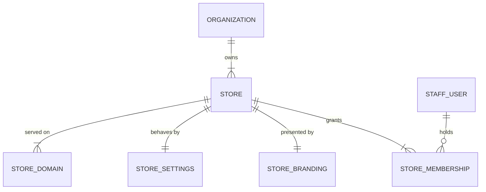
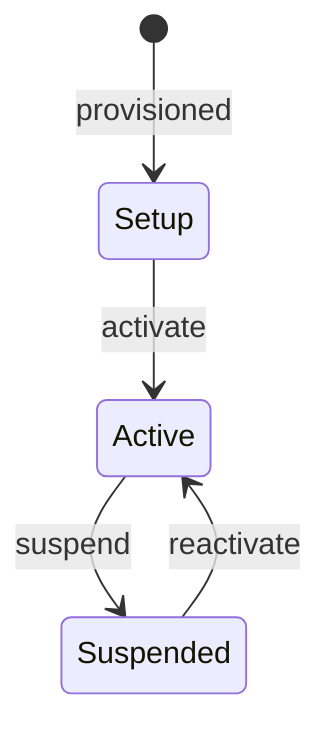
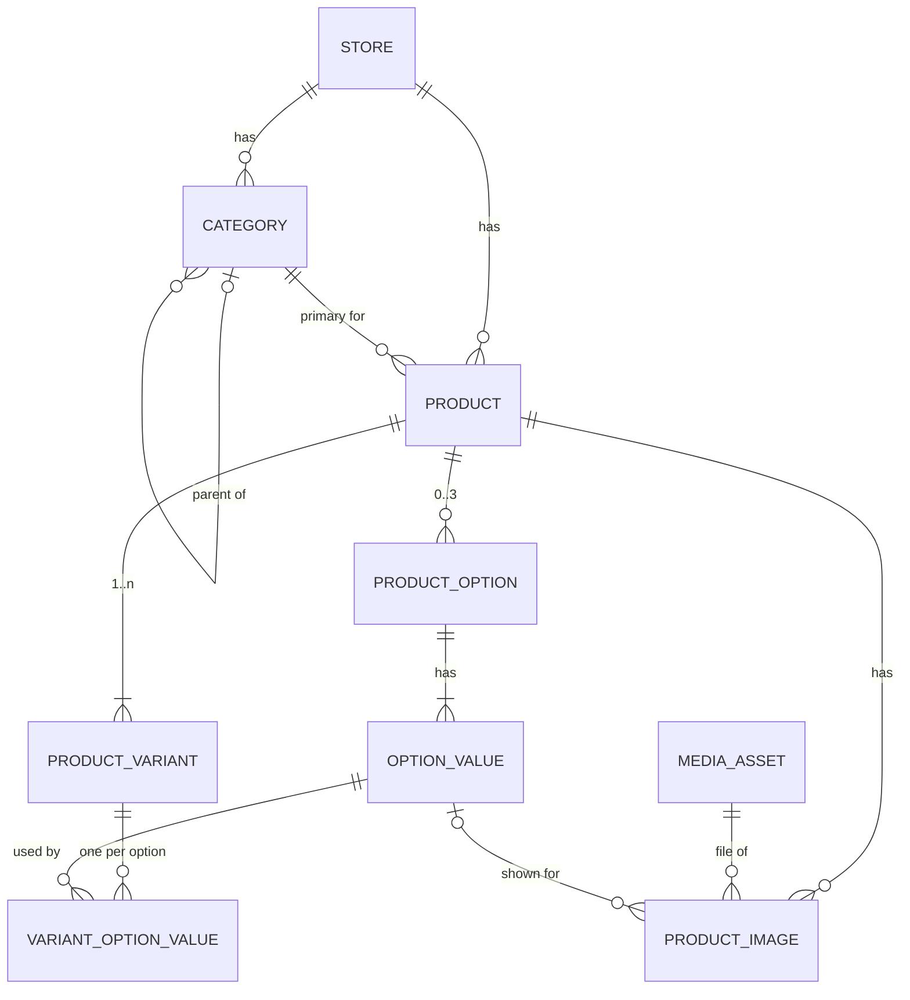
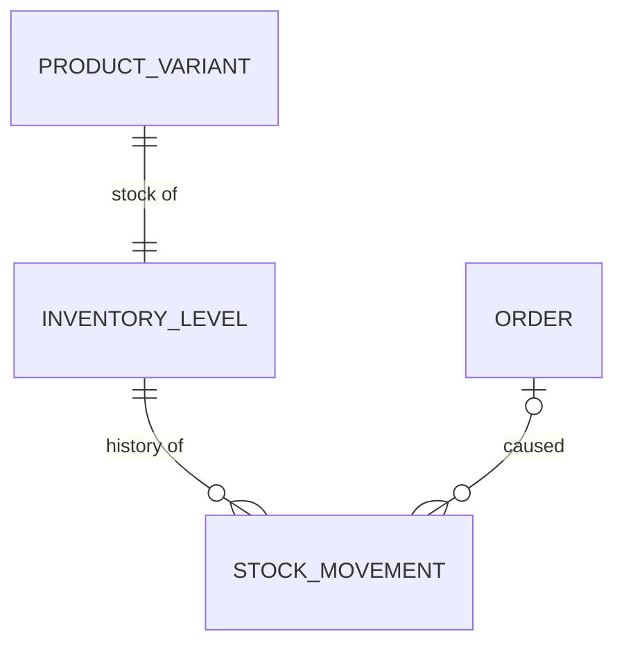
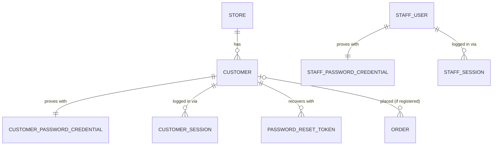
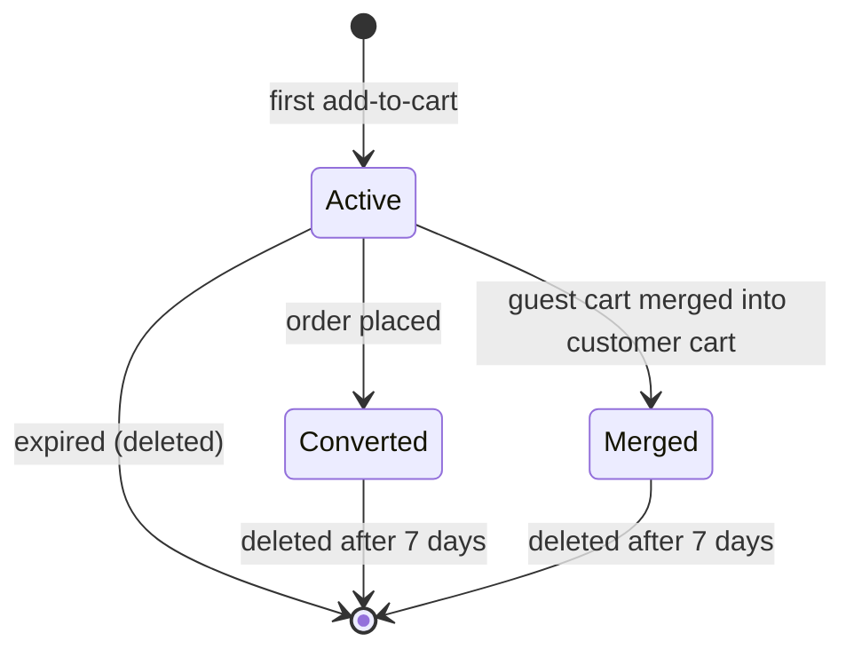
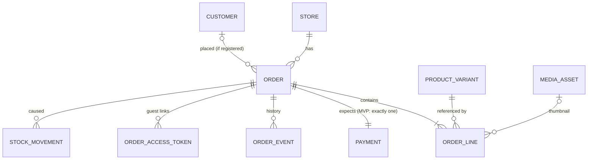
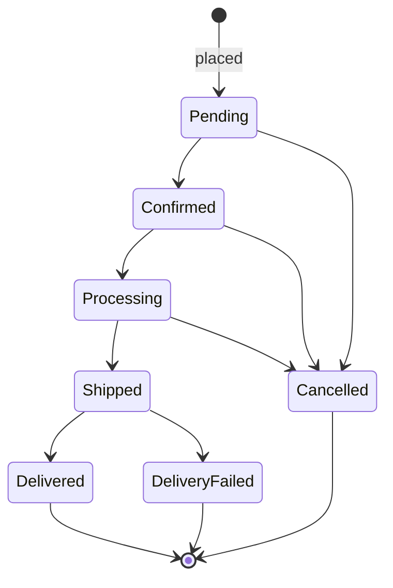

# White-Label E-commerce Platform — Domain Model

| | |
|---|---|
| **Status** | **Approved** — core domains (2026-10-18; Branding and Theme: Phase 5), including the architecture-review revisions (approved 2026-10-18) |
| **Last updated** | 2026-10-18 |
| **Based on** | [requirements.md](requirements.md) v1.9 (approved 2026-10-18) · Cross-domain behavior: [system-behavior.md](system-behavior.md) |

> **Revisions.** Sections marked *(revised/clarified 2026-10-18 — approved 2026-10-18)* contain changes from the architecture review; the replaced text is recorded in the [change record](proposed-doc-changes.md). The trusted-host **design** referenced in §1.8 is in [ADR-04](architecture-decisions.md#adr-04-request-topology-host-resolution-and-public-caching) revision 4, approved 2026-10-18.

> **How to use this document.** Each domain is analyzed separately and marked **Approved** or **Draft**. Approved domains are the basis for Phase 3 (relationships and workflows) and Phase 4 (architecture).
>
> This document describes the **conceptual model**: entities, responsibilities, relationships, rules, and contracts. It is **not** a database schema or TypeScript code. Three representations are deliberately kept distinct:
> - **Database model** — how the backend stores data (decided when the backend is built).
> - **API contracts (DTOs)** — what each consumer receives; shaped per consumer.
> - **Frontend models** — TypeScript interfaces matching the DTOs, never the database.

---

## Domain status

| # | Domain | Status |
|---|---|---|
| 0 | [Shared value types](#0-shared-value-types) | Approved |
| 1 | [Store and Tenant](#1-store-and-tenant) | **Approved** |
| 2 | [Catalog](#2-catalog) (Category, Product, Option, Variant, Images) | **Approved** |
| 3 | [Media](#3-media) | **Approved** |
| 4 | [Inventory](#4-inventory) | **Approved** |
| 5 | [Customer and Authentication](#5-customer-and-authentication) | **Approved** |
| 6 | [Cart](#6-cart) | **Approved** |
| 7 | [Order, Payment, and Fulfillment](#7-order-payment-and-fulfillment) | **Approved** |
| 8 | Branding and Theme | Phase 5 |

**General rule — where `storeId` lives:** every entity that **other domains reference directly** (Product, ProductVariant, Category, MediaAsset, …) carries its own `storeId`, so cross-store validation never requires joins. Internal child entities (options, values, product images) belong to their store through their parent.

---

## 0. Shared value types

Concepts reused across domains. Each one has a single meaning everywhere.

| Type | Meaning | Rules |
|---|---|---|
| **Id** | Entity identifier | Random UUID; never sequential or guessable |
| **Money** | `{ amount, currency }` | `amount` is an integer in minor units; `currency` is an ISO 4217 code (`EGP`). Amounts in different currencies are never combined. |
| **Locale** | `ar` or `en` | Platform-supported locales |
| **LocalizedText** | A map of locale → text, e.g. `{ ar: "…", en: "…" }` | Values are trimmed; empty means missing. Required/optional rules and fallback per [requirements §6](requirements.md#6-localization). |
| **Phone** | A phone number | Stored normalized (`+20…`). Accepts Arabic-Indic digits on input. Allowed kinds depend on use (see each field). |
| **Email** | An email address | Stored trimmed and lowercased for comparison |
| **Hostname** | A DNS host name | Lowercase, no port, no trailing dot |
| **Timestamp** | A point in time | Stored in UTC; displayed in the store's timezone |

---

## 1. Store and Tenant

**Status: Approved (2026-10-18)**

### 1.1 Purpose

This domain answers four questions that every other domain depends on:

1. **Which store is this?** — resolving the store for a request.
2. **Who owns it?** — the organization.
3. **How does it behave and present itself?** — settings and names (branding in Phase 5).
4. **Who may manage it, and what may they do?** — staff identity, membership, permissions.

It depends on no commerce domain; every commerce domain depends on it.

**Naming:** there is **no entity called `Tenant`**. *Tenant context* is a runtime concept meaning "the store this request operates on". In data, it is always `Store`.

### 1.2 Entities and responsibilities

| Entity | Responsibility | Scope |
|---|---|---|
| **Organization** | The business that is the platform's customer. Owns stores. Billing and legal details later. | Platform-wide |
| **Store** | Identity, names, and lifecycle of one storefront. **The data-isolation boundary.** | Belongs to an organization |
| **StoreDomain** | Maps a host name to a store; marks the store's primary host. | Host names unique platform-wide |
| **StoreSettings** | How the store **behaves**: locales, commerce, shipping, inventory, public support contacts. | Exactly one per store |
| **StoreBranding** | How the store **looks**: logo, favicon, theme tokens. Designed in Phase 5. | Exactly one per store |
| **StaffUser** | **Identity**: a person who can authenticate to the admin dashboard. Knows nothing about stores. | Platform-wide |
| **StoreMembership** | **Access**: grants one staff user access to one store, with a role. | Links staff user and store |
| **Role → permissions** | **Capability**: what a role may do. Platform-defined, not stored per store in the MVP. | Platform configuration |

### 1.3 Relationships

| Relationship | Cardinality | MVP constraint |
|---|---|---|
| Organization → Store | 1 to many | Exactly 1 store per organization (business rule) |
| Store → StoreDomain | 1 to many | Exactly 1 domain (platform subdomain), which is primary |
| Store → StoreSettings | 1 to 1 | — |
| Store → StoreBranding | 1 to 1 | — |
| StaffUser ↔ Store (via StoreMembership) | Many to many | Each store has ≥1 membership to be activated |

**Platform-wide vs. store-scoped data**

| Platform-wide (no `storeId`) | Store-scoped (`storeId`) |
|---|---|
| Organization, StaffUser, StoreDomain, reference data (governorates, locales, currencies), platform limits, role → permission definitions | StoreSettings, StoreBranding, StoreMembership, and **every commerce entity** in later domains |

The isolation rule *"every query is filtered by `storeId`"* applies to store-scoped data. Platform-wide data is accessed only through controlled paths: login, store resolution, and provisioning.

### 1.4 Store names

A store has **two different names**, used for different purposes. A third (legal) name belongs to the organization later.

| Name | Belongs to | Translatable | Used for |
|---|---|---|---|
| **Brand name** (`brandName`) | Store | **No** — one canonical commercial name, e.g. "Zara" | Admin UI, platform operations, provisioning, copyright line, and the default for the display name |
| **Display name** (`displayName`) | Store | **Yes** — `LocalizedText` | What shoppers see: storefront header, page titles, Open Graph site name, emails |
| Legal name | Organization | No | Invoices and contracts (deferred) |

**Display name rules**
- Required in the store's **default locale**; optional for other supported locales.
- At provisioning, the default-locale display name is **prefilled from the brand name**, so a brand that is written the same way in every language needs no translation work.
- Fallback per [requirements §6](requirements.md#6-localization): requested locale → default locale. Never empty.
- Example: brand name `Zara`; display name `{ en: "Zara", ar: "زارا" }`. A brand that does not translate its name simply keeps `{ en: "Nike" }` and Arabic pages fall back to "Nike".

### 1.5 Entity definitions

These are conceptual fields, not database columns.

**Organization**

| Field | Required | Rules / why |
|---|---|---|
| `id` | ✅ | Id |
| `name` | ✅ | Internal name for platform operations; 1–150 chars |
| `status` | ✅ | `Active` or `Suspended`. Suspending an organization suspends all its stores. |
| `createdAt` | ✅ | |

**Store**

| Field | Required | Rules / why |
|---|---|---|
| `id` | ✅ | Id |
| `organizationId` | ✅ | Owner |
| `handle` | ✅ | Stable slug used for the default subdomain and scripts. 3–40 chars, `a-z`, `0-9`, `-`; cannot start or end with `-`. Unique platform-wide. Reserved words blocked (`admin`, `api`, `www`, `mail`, `static`, `app`, …). **Immutable after first activation.** |
| `brandName` | ✅ | 1–100 chars; not translated (1.4) |
| `displayName` | ✅ | `LocalizedText`; default-locale value required, 1–100 chars (1.4) |
| `status` | ✅ | `Setup`, `Active`, `Suspended` (1.6) |
| `createdAt` | ✅ | |
| `activatedAt` | — | Set on first activation; makes `handle` immutable |

**StoreDomain**

| Field | Required | Rules / why |
|---|---|---|
| `hostname` | ✅ | Hostname; **unique platform-wide** |
| `storeId` | ✅ | |
| `kind` | ✅ | `PlatformSubdomain` in the MVP; `Custom` later |
| `isPrimary` | ✅ | Exactly one primary per store. Used for canonical URLs and links in emails. |

*Why a table when each store has one domain:* store resolution has **one path from day one** (host → store). Custom domains later add rows, not a second resolution mechanism.

**StoreSettings** — grouped as the admin saves them; each group is saved independently.

| Group | Field | Required | Rules |
|---|---|---|---|
| Localization | `supportedLocales` | ✅ | Non-empty subset of `{ar, en}` |
| | `defaultLocale` | ✅ | Must be in `supportedLocales`; change rules per [requirements §6](requirements.md#6-localization) |
| Commerce | `baseCurrency` | ✅ | `EGP`; read-only in the MVP; cannot change once the store has orders |
| | `pricesIncludeTax` | ✅ | `true`; read-only in the MVP |
| | `timezone` | ✅ | `Africa/Cairo`; read-only in the MVP |
| Shipping | `flatShippingFee` | ✅ | Money ≥ 0, in base currency |
| | `freeShippingThreshold` | — | Money > 0 if set; absent = never free |
| Inventory | `lowStockThreshold` | ✅ | Integer ≥ 0; default 5 |
| Support contacts | `supportPhone` | ✅ | Phone. Accepts Egyptian mobile, landline, or 5-digit hotline (e.g., `19xxx`). |
| | `supportEmail` | — | Email |
| | `supportWhatsApp` | — | Phone; Egyptian mobile only (used to build a WhatsApp link) |
| — | `version` | ✅ | Optimistic concurrency for admin edits |

Commerce fields are **stored, not hardcoded**, so new markets need configuration rather than code changes.

**Support contacts are store data, not customer data.** They are separate from customer contact details and from order recipient details, and they are **not snapshotted** on orders: an old order page always shows the store's **current** support contacts, because their purpose is reaching the store now.

**StoreBranding** — placeholder; designed in Phase 5. Will contain at least the logo (PNG, WebP, or JPEG; **no SVG uploads** in the MVP because SVG can carry scripts) and theme tokens.

**StaffUser** (identity only)

| Field | Required | Rules / why |
|---|---|---|
| `id` | ✅ | Id |
| `email` | ✅ | Email; **unique platform-wide** — login happens on the admin host before any store is known |
| `name` | ✅ | 1–100 chars |
| `status` | ✅ | `Active` or `Disabled`. Disabled users cannot authenticate; their sessions are revoked. |
| `createdAt` | ✅ | |
| `lastLoginAt` | — | |

> **Revised 2026-10-18 (Customer and Authentication domain):** `passwordHash` and `mustChangePassword` moved from StaffUser to **StaffPasswordCredential** ([§5.4](#54-credentials)). StaffUser now holds identity only. Sessions are defined in [§5.5](#55-sessions).

**StoreMembership** (access)

| Field | Required | Rules / why |
|---|---|---|
| `staffUserId` | ✅ | |
| `storeId` | ✅ | |
| `role` | ✅ | `StoreAdmin` in the MVP |
| `createdAt` | ✅ | |

Unique on `(staffUserId, storeId)`. Removing access deletes the membership; the next request is denied.

### 1.6 Store lifecycle

All transitions are performed by the **platform operator** (scripts in the MVP).

**Activation preconditions:** valid settings, a primary domain, ≥1 membership, a brand name, a default-locale display name, and a support phone.

**Effective status:** if the organization is `Suspended`, all its stores behave as `Suspended` regardless of their own status.

#### Behavior by status

| Capability | Setup | Active | Suspended |
|---|---|---|---|
| **Storefront catalog pages** (home, category, product, search) | "Coming soon" page, not indexed | ✅ | "Temporarily unavailable" page (see below) |
| Add to cart / update cart | ❌ | ✅ | ❌ |
| **Place order** | ❌ | ✅ | ❌ |
| Customer registration | ❌ | ✅ | ❌ |
| Customer login, logout, password reset | ❌ | ✅ | ✅ — so customers can reach their history |
| **Customer order history and order details** | — | ✅ | ✅ read-only |
| **Guest order status lookup** | — | ✅ | ✅ read-only |
| Customer self-cancel (account or secret link) | — | ✅ (`Pending` only) | ❌ — customers are shown the support contacts instead |
| Admin: view everything | ✅ | ✅ | ✅ |
| Admin: order status transitions (confirm, process, ship, deliver, delivery failed, cancel where allowed) | — | ✅ | ✅ |
| Admin: mark as paid, record return | — | ✅ | ✅ |
| Admin: stock adjustments (incl. discrepancy workflow) | ✅ | ✅ | ✅ — needed to fulfill and process returns |
| Admin: **edit order items** | — | ✅ | ❌ — could add new sales; cancel instead |
| Admin: create/edit/publish products and categories | ✅ | ✅ | ❌ read-only |
| Admin: change settings or branding | ✅ | ✅ | ❌ read-only |

#### Storefront behavior while suspended
- Catalog pages return HTTP **503** with a `Retry-After` header, rendered as a branded "temporarily unavailable" page showing the store's display name, logo, and **support contacts**. A 503 tells search engines the outage is temporary.
- The page links to **"Track an order"** and **"My orders"**, which remain available read-only.
- Existing carts are kept (not deleted) so they resume if the store is reactivated; normal cart expiry still applies.
- Public pages reflect a status change within **60 seconds** (time-based cache expiry; **no on-demand invalidation** in the MVP — [system-behavior §4.5](system-behavior.md#45-invalidation-approved)). The suspended `503` page itself is not cached. *(Revised 2026-10-18 — approved 2026-10-18.)*

#### Enforcement
- **The backend is the authority.** Every business operation checks the **current** effective status in the database — never a cached value. Cart writes and order placement are rejected with a `STORE_NOT_ACTIVE` error when the effective status is not `Active`.
- Order placement, order item-edit apply, and customer/guest cancellation check the store status **inside their transaction**, under a shared lock on the organization and store rows ([system-behavior §5.1](system-behavior.md#51-lock-scope)). An operation committed before the suspension is valid; none can commit after. *(Item edits and customer cancellation added 2026-10-18 — RA-6, approved 2026-10-18.)*
- **Every other operation prohibited while suspended** — cart writes (including the login merge), customer registration, and staff catalog, media, settings, and branding writes — is held to the **same rule: it must never commit after a suspension commits.** There is no millisecond-race exception. It takes the same **shared** organization/store locks and checks the status from that lock's result inside its transaction ([system-behavior §5.1](system-behavior.md#51-lock-scope), P4-1, approved 2026-10-18). *(RA-6 second review, approved 2026-10-18.)*
- **D8 is preserved.** Operations that stay **allowed** while suspended (fulfillment transitions, staff cancellation, mark as paid, payment correction, return recording, delivery-detail edits, stock adjustments — table above) remain available, subject to permissions, workflow rules, stock invariants, and audit logging; they are unaffected by suspension and need no synchronization with it. *(RA-6 narrow interpretation, approved 2026-10-18; unchanged by the second review.)*
- The frontend reads the status from the store configuration to show the right pages and banners — UX only.

### 1.7 Identity, membership, and permissions

Three separate layers answer three separate questions:

| Layer | Question | Model |
|---|---|---|
| **Identity** | Who are you? | `StaffUser` — authentication only; no store, no role |
| **Membership** | Which stores can you access, in which role? | `StoreMembership` |
| **Permissions** | What may you do in this store, right now? | Role → permissions, then restricted by store status |

**Permissions are capabilities, not role names.** The backend checks *"does this user have `orders.transition` in store X?"* — never *"is this user a StoreAdmin?"*. When more roles arrive, only the role → permission mapping changes; endpoints do not.

**MVP permissions**

| Permission | Covers |
|---|---|
| `dashboard.read` | Overview metrics |
| `catalog.read` / `catalog.write` / `catalog.publish` | Products, categories, images. `catalog.publish` covers publish, unpublish, archive, and restore of **products** and archive/restore of **variants**; category archive/restore uses `catalog.write` (§2.11). *(Clarified 2026-10-18 — approved 2026-10-18.)* |
| `inventory.read` / `inventory.adjust` | Stock levels, adjustments, discrepancy workflow |
| `orders.read` | Orders, details, event log |
| `orders.transition` | Status transitions except cancellation |
| `orders.cancel` | Cancellation |
| `orders.edit` | Order item editing |
| `orders.editDelivery` | Recipient, address, delivery notes; courier details *(added 2026-10-18)* |
| `orders.markPaid` / `orders.recordReturn` | Payment and return actions |
| `orders.correctPayment` | Audited payment correction procedure *(added 2026-10-18)* |
| `settings.read` / `settings.write` | Store settings and branding |

- **Role mapping (MVP):** `StoreAdmin` → all permissions.
- **Store status filter:**
  - `Suspended` allows only: all `*.read`, `inventory.adjust`, `orders.transition`, `orders.cancel`, `orders.editDelivery`, `orders.markPaid`, `orders.correctPayment`, `orders.recordReturn`.
  - `Setup` and `Active` allow all.

**Effective permissions = permissions of the membership's role ∩ permissions allowed by the store's effective status.**

**Enforcement**
- Every admin endpoint declares the permission it requires. On every request the backend:
  1. resolves the **staff session** ([§5.5](#55-sessions)) and rejects missing, expired, or revoked sessions and `Disabled` users;
  2. if the credential requires a password change, allows **only** the password-change endpoint;
  3. loads the membership for the store in the route — **no membership → 404**;
  4. computes effective permissions — **missing permission → 403**.
- Membership and permissions are **never cached in the session**; they are evaluated on every request, so removing a membership takes effect on the next request.
- The admin `/me` response includes each membership's effective permissions so the UI can hide or disable actions. This is **UX only**.

### 1.8 Store resolution

**Storefront**
1. Normalize the request's `Host` header → look up `StoreDomain` → store.
2. **Unknown host → platform 404 page. There is never a fallback to a default store.**
3. Resolve the effective status and apply 1.6.
4. Resolution results are cached per host for **at most 60 seconds**; business operations never use this cache ([system-behavior §4.5](system-behavior.md#45-invalidation-approved)). *(Revised 2026-10-18 — approved 2026-10-18.)*
5. The host comes **only** from the trusted edge (`X-Platform-Host`, accepted only with a valid route-specific credential over the expected network path — design in [architecture ADR-04](architecture-decisions.md#adr-04-request-topology-host-resolution-and-public-caching) revision 4, approved 2026-10-18); client-supplied forwarded-host headers are never used.

**Admin**
1. The store comes from the route (`/stores/:storeId/...`).
2. Access is decided by 1.7 on every request.

**Local development:** browsers resolve `*.localhost` to the local machine, so `brand-a.localhost` and `brand-b.localhost` can simulate subdomains.

### 1.9 Contracts (one entity, three views)

| Data | Database | Storefront: store config | Admin: settings |
|---|---|---|---|
| `organizationId` | ✅ | ❌ | ❌ |
| `brandName` | ✅ | ✅ (copyright line) | ✅ |
| `displayName` | All translations | **One resolved string** + its locale | All translations |
| Effective status | Derived | ✅ (drives pages and banners) | ✅ |
| Locales, currency, tax mode, timezone | ✅ | ✅ | ✅ (commerce read-only) |
| Shipping rule | ✅ | ✅ (UI estimates only) | ✅ |
| Support contacts | ✅ | ✅ | ✅ |
| `lowStockThreshold` | ✅ | ❌ | ✅ |
| Platform limits (line max, cart max, image max) | Platform config | ✅ (merged in) | ✅ (read-only) |
| `version` | ✅ | ❌ | ✅ |
| Caching | — | Public, per host | Never cached |

### 1.10 API operations

| Consumer | Operation | Notes |
|---|---|---|
| Storefront | `GET /api/storefront/config` | Store resolved from host; returns the storefront view (1.9) |
| Admin | `GET /api/admin/me` | Staff profile + memberships: store id, brand name, effective status, role, effective permissions |
| Admin | `GET /api/admin/stores/:storeId/settings` | Requires `settings.read` |
| Admin | `PATCH /api/admin/stores/:storeId/settings/{group}` | Groups: `names`, `localization`, `shipping`, `inventory`, `support-contacts`. Requires `settings.write`; includes `version`. |
| Admin | Logo and theme | Phase 5 |
| Provisioning (script; no public API) | Create organization, store, domain, staff user, membership; activate, suspend, reactivate store; disable staff user | Platform operator only |

### 1.11 Edge cases

| Situation | Behavior |
|---|---|
| Settings change during a shopper's checkout | Safe: orders snapshot the shipping rule; checkout rejects a changed total |
| Store suspended during a shopper's checkout | Placement fails with `STORE_NOT_ACTIVE`; the shopper sees the unavailable page |
| Membership removed while the staff user is logged in | Denied on the next request (authorization is per request) |
| Staff user disabled | Sessions revoked; cannot log in |
| Organization suspended | All its stores behave as suspended |
| Request for a host that maps to no store | Platform 404; no data from any store |
| Request to another store's admin route | 404 |

### 1.12 Future evolution

| Need | Change |
|---|---|
| Custom domains | `StoreDomain` rows of kind `Custom`, with verification status and TLS; non-primary hosts redirect to primary |
| Multiple stores per organization | Remove the business rule; admin store switcher (memberships already per store) |
| Staff roles | New roles in the role → permission mapping |
| Organization-level permissions (billing, owners) | New `OrganizationMembership`; additive |
| New markets | New values for currency, timezone, locales; currency per store already modeled |

### 1.13 Decisions

| # | Decision | Reason |
|---|---|---|
| D1 | No `Tenant` entity; tenant context = store | One meaning for "tenant"; avoids confusion between organization and store |
| D2 | Staff identity is platform-wide; access only through store memberships | Staff log in before a store is known; supports one person managing several brands later |
| D3 | Identity, membership, and permissions are separate layers; checks are permission-based | Adding roles later changes a mapping, not endpoints |
| D4 | Store, StoreSettings, StoreBranding are separate concepts | Different change frequency, validation, permissions, and caching |
| D5 | Platform limits are platform configuration, delivered via the store config API | Stores cannot edit them; frontend never hardcodes them |
| D6 | `StoreDomain` table from day one | One resolution path for subdomains and future custom domains |
| D7 | Brand name (canonical) separate from display name (localized) | Not every brand translates its name; shoppers see localized names where they exist |
| D8 | Suspension keeps order fulfillment and customer order access; blocks new business | Customers who already ordered are still owed their goods and information |
| D9 | Support contacts are store settings and are not snapshotted on orders | They exist to reach the store now |
| D10 | *(Added 2026-10-18)* StaffUser holds identity only; credentials and sessions live in the Customer and Authentication domain | Keeps secrets out of profile data; see §5 |
| D11 | *(Added 2026-10-18)* Sensitive operator actions are recorded as PlatformAuditEvents (1.14) | Operator actions need the same accountability as staff actions |
| D12 | *(Added 2026-10-18)* Provisioning reuses an existing staff identity and grants an explicit store-scoped membership (1.15) | No duplicate identities; no implicit permissions |

### 1.14 PlatformAuditEvent

A minimal, **append-only**, platform-wide record of sensitive **platform-operator** actions. Brand staff never see it.

| Field | Required | Rules |
|---|---|---|
| `id` | ✅ | |
| `occurredAt` | ✅ | Timestamp |
| `actor` | ✅ | Operator name or ID supplied to the command (no operator accounts in the MVP — [system-behavior RA-1](system-behavior.md#72-assumptions-ra-1-to-ra-8)). It is a **declared identity, not independently authenticated proof of identity**, and **not** a replacement for authentication or authorization; accountability relies on controlling who can run operator commands. |
| `action` | ✅ | See below |
| `outcome` | ✅ | `Succeeded`, `Refused`, or `Failed` *(added 2026-10-18 — RA-1 second review)* |
| `reasonCode` | — | For `Refused` / `Failed`, e.g., `StaffUserDisabled`, `ActivationPreconditionMissing`, `ValidationFailed` — never sensitive values |
| `targetType`, `targetId` | ✅ | e.g., `Store`, `Organization`, `StaffUser`, `StoreMembership` |
| `storeId` | — | When the action concerns a store |
| `details` | — | **Non-sensitive** before/after context (e.g., status before/after, role granted) |
| `reason` | — | Free text where relevant (e.g., suspension) |

**Actions:** `OrganizationCreated`, `StoreProvisioned`, `StoreActivated`, `StoreSuspended`, `StoreReactivated`, `OrganizationSuspended`, `OrganizationReactivated`, `StaffUserCreated`, `StaffMembershipGranted`, `StaffPasswordReset`, `StaffUserDisabled`, `StaffUserEnabled`, `ReconciliationTriggered`.

**Rules**
- **Successful** actions (`outcome = Succeeded`) are written **in the same transaction** as the action they record.
- **Refused or failed** operator commands are recorded too (`Refused` / `Failed` with a reason code). Because the business transaction rolls back, this record is written separately; the mechanism is decided in the architecture phase ([system-behavior §7.4](system-behavior.md#74-items-deferred-to-the-architecture-phase), P4-2). *(Added 2026-10-18 — RA-1 second review.)*
- **Never** contains passwords, password hashes, temporary passwords, session or reset tokens, or other secrets.
- Never updated or deleted.

### 1.15 Provisioning and existing staff identities

| Admin email at provisioning | Behavior |
|---|---|
| Not found | New StaffUser + StaffPasswordCredential with a random temporary password and `mustChangePassword` |
| Found, `Active` | **Reuse the identity.** No duplicate identity, **no credential change, no temporary password generated or revealed** |
| Found, `Disabled` | **Refused**; re-enabling is a separate, audited action ([system-behavior RA-2](system-behavior.md#72-assumptions-ra-1-to-ra-8)) |

- The new StoreMembership carries an **explicitly assigned role for this store**. Memberships in other stores grant nothing here, and are not changed.
- **Temporary passwords** are **generated** with a cryptographically secure generator (never supplied by the operator), displayed once to the operator **only after the provisioning transaction commits**, are **never logged or persisted** in plaintext, and force a change at first login.
- **Staff password reset** is a separate operator command, never a side effect of provisioning: new generated temporary password (shown once), `mustChangePassword` set, **all of the staff user's sessions revoked**, `StaffPasswordReset` audit event. *(Clarified 2026-10-18 — approved 2026-10-18.)*

---

## 2. Catalog

**Status: Approved (2026-10-18)**

### 2.1 Purpose and boundaries

The Catalog defines **what a store sells, and how it is described, organized, and priced**.

| Concern | Owner | Why not the Catalog |
|---|---|---|
| Stock quantities and stock states | **Inventory** (§4) | Stock changes on every order; content changes rarely (decision C1) |
| Cart and order totals, shipping | **Ordering** (backend) | The catalog provides list prices (tax-inclusive; tax not itemized in the MVP); totals are per order |
| Files and their storage | **Media** (§3) | Shared with store logos |
| Discounts, reviews, wishlist | Deferred | — |

### 2.2 Entities and responsibilities

| Entity | Responsibility |
|---|---|
| **Category** | Groups products for navigation; two levels |
| **Product** | What shoppers browse: content, slug, primary category, base price, publication status. **Not purchasable by itself.** |
| **ProductOption** | One variant dimension of a product (Size); 0–3, ordered |
| **OptionValue** | One value of an option (M); stable identity |
| **ProductVariant** | **The purchasable unit**: one combination of values, with SKU and optional price |
| **VariantOptionValue** | Assigns a variant exactly one value per option of its product |
| **ProductImage** | An ordered image of a product, pointing to a media asset; optionally linked to an option value |

### 2.3 Relationships

Other domains reference the catalog **only through the variant id** (inventory level, cart lines, order lines) — order lines additionally keep text snapshots.

### 2.4 Key decisions

| # | Decision | Reason |
|---|---|---|
| C1 | **Stock is not stored on the variant**; it lives in Inventory | Stock changes on every order; product content is version-protected for admin edits. Combined, every checkout would conflict with admin edits. |
| C2 | **The product is one consistency unit**: product, options, values, variants, and image links are validated and saved together with one version | The key rules span all of them (one value per option, unique combinations, image links, publish rules). Stock, file uploads, and publish/archive actions are separate operations. |
| C3 | **Combination key**: each variant has a backend-computed key of its sorted option value ids; unique per product | Enforces "no duplicate combinations" simply. The default variant has key `""`, which guarantees a single default variant. |
| C4 | **Translatable fields use `LocalizedText` in contracts**; storage (JSON or translation tables) is a backend decision | The frontend contract does not depend on storage |
| C5 | **Three status concepts**: product publication, variant status, availability (computed) | They are owned by different actors and change for different reasons |
| C6 | **Latin slugs**, unique per store, **locked after first publication** | Clean, shareable URLs (Arabic slugs become percent-encoded when shared); stable links |
| C7 | **Plain-text descriptions** with preserved line breaks | No HTML sanitization or rich-text editor needed in the MVP |
| C8 | **Public stock indicators are states, never quantities** | Business data stays private; indicators are informational only |
| C9 | **Option dimensions lock after first publication** ([requirements §7.3](requirements.md#73-options-and-variants)) | Existing carts, orders, and images reference combinations |

### 2.5 Entity definitions

Conceptual fields, not database columns. All entities also have `createdAt` / `updatedAt`.

**Category**

| Field | Required | Rules |
|---|---|---|
| `id`, `storeId` | ✅ | |
| `parentId` | — | Must be a top-level, same-store category; max two levels |
| `name` | ✅ | LocalizedText; default locale required; 1–100 chars |
| `slug` | ✅ | Slug rules (2.6) |
| `position` | ✅ | Order among siblings |
| `status` | ✅ | `Active` or `Archived` |
| `firstPublishedAt` | — | Set the first time the category becomes publicly reachable (2.6); locks the slug |
| `version` | ✅ | Optimistic concurrency |

**Product**

| Field | Required | Rules |
|---|---|---|
| `id`, `storeId` | ✅ | |
| `primaryCategoryId` | ✅ | Same store; not archived to publish |
| `name` | ✅ | LocalizedText; default locale required; 1–150 chars |
| `description` | — | LocalizedText; plain text; up to 5,000 chars per locale (2.7) |
| `slug` | ✅ | Slug rules (2.6) |
| `basePrice` | ✅ | Money > 0 in the store's base currency |
| `status` | ✅ | `Draft`, `Published`, `Archived` |
| `firstPublishedAt` | — | Set on first publication; locks slug and option dimensions |
| `version` | ✅ | Covers the whole product unit (C2) |

**ProductOption** — `id`, `productId`, `name` (LocalizedText, required; unique within the product), `position`.

**OptionValue** — `id`, `optionId`, `label` (LocalizedText, required; unique within the option), `position`. 1–30 values per option.

**ProductVariant**

| Field | Required | Rules |
|---|---|---|
| `id`, `storeId`, `productId` | ✅ | `storeId` because other domains reference variants directly |
| `sku` | ✅ | Letters, digits, `-`, `_`, `.`; up to 64 chars; unique per store, case-insensitive, **including archived variants** |
| `price` | — | Money > 0 if set; absent = inherits `basePrice` |
| `status` | ✅ | `Active` or `Archived` |
| `combinationKey` | ✅ | Computed by the backend (C3); never sent by clients |
| `position` | ✅ | Display order |

1–100 variants per product. *[DEFAULT]*

**VariantOptionValue** — `variantId`, `optionId`, `optionValueId`. Unique per `(variantId, optionId)`; the value must belong to that option, and the option to the variant's product.

**ProductImage** — `id`, `productId`, `mediaId` (same-store media of purpose `ProductImage`), `position`, `altText` (LocalizedText, optional), `optionValueId` (optional; must belong to this product). Up to 10 per product. The image at position 0 is the **primary image** (listing cards, Open Graph, order thumbnails).

### 2.6 Slugs

**Format:** lowercase Latin letters, digits, and single hyphens; 2–80 chars; no leading or trailing hyphen.

**Uniqueness:** unique **within a store**, separately for products and for categories (they live under different URL paths). Uniqueness **includes archived** records, so restoring a product never collides and an old link never points to a different product.

**Suggestions** (the admin can always edit before the lock):

| Entity | Suggested from | If not possible |
|---|---|---|
| Product | English name, if present | The SKU of the first variant |
| Category | English name, if present | No suggestion; the admin enters the slug. *(Arabic transliteration is deferred.)* |

Collisions are resolved by appending `-2`, `-3`, ….

**Locking:**
- **Product:** locked at first publication (`firstPublishedAt`).
- **Category:** locked when it first becomes publicly reachable, i.e., the first time a `Published` product is assigned to it or to one of its subcategories (by publishing or by moving a product). This sets `firstPublishedAt` on the category and, for a subcategory, on its parent.

**Deferred:** changing locked slugs and redirecting old slugs to new ones.

### 2.7 Descriptions

- Plain text only. Line breaks are preserved when displayed; text is **never** rendered as HTML.
- Translatable and optional; per-field fallback to the default locale ([requirements §6](requirements.md#6-localization)). If absent in both, the description section is omitted.
- Deferred: rich text, HTML, automatic links.

### 2.8 Lifecycles

**Product**

| From | To | Rules |
|---|---|---|
| — | `Draft` | Created |
| `Draft` | `Published` | Publishing rules ([requirements §7.2](requirements.md#72-publishing-rules)); first time sets `firstPublishedAt` |
| `Published` | `Draft` | Unpublish: hidden from shoppers; cart lines become unavailable |
| `Draft` / `Published` | `Archived` | Hidden from the storefront; open orders still fulfilled |
| `Archived` | `Draft` | Restore; must pass the publishing rules again |

**Variant:** `Active ⇄ Archived`. The **last active variant of a `Published` product cannot be archived** — unpublish first.

**Category:** `Active ⇄ Archived`, per [requirements §7.7](requirements.md#77-categories).

**Option changes before first publication:** adding an option requires assigning one of its values to **every existing variant**, including the default variant (e.g., "add Size, assign the existing variant to M").

### 2.9 Storefront visibility and purchasability

| Rule | Condition |
|---|---|
| **Product visible** | `Published` and ≥1 `Active` variant |
| **Variant purchasable** | Product `Published`, variant `Active`, stock state not `SoldOut` (and confirmed by the backend on cart writes and placement) |
| **Product sold out** | Visible, but every active variant is `SoldOut` → shown with a **Sold out** state; it cannot be added to the cart |
| **Category in navigation** | `Active` and has ≥1 visible product, directly or through a subcategory |
| **Category page reachable** | `Active` and `firstPublishedAt` set; shows an empty state if it currently has no visible products |

**Stock indicators** (states only, computed by the backend from Inventory):

| State | Condition (per variant) |
|---|---|
| `InStock` | `available > lowStockThreshold` |
| `LowStock` | `0 < available ≤ lowStockThreshold` |
| `SoldOut` | `available = 0` |

- `lowStockThreshold` is the store setting (default 5). A threshold of 0 disables `LowStock`.
- Exact quantities are **never** exposed publicly.
- Indicators are **informational**. Cached pages may show a slightly stale state; the backend revalidates stock on every cart write and at order placement.
- *Accepted limitation:* a determined shopper can infer approximate stock by requesting increasing quantities; this is acceptable for the MVP.

### 2.10 Contracts (one product, three views)

| Data | Database | Storefront: product details | Admin: product |
|---|---|---|---|
| Name, description, labels | All translations | **Resolved** strings + source locale | All translations |
| Slug | ✅ | ✅ (URL) | ✅ + `slugLocked` |
| Base price / variant price | Raw values | **Effective price per variant only**; "From" price | Raw values + effective price + `inheritsBasePrice` |
| SKU | ✅ | ❌ | ✅ |
| Status, `firstPublishedAt`, `version` | ✅ | ❌ | ✅ |
| Combination | Key + value links | `optionValueIds` per variant | `optionValueIds` per variant |
| Stock | ❌ (Inventory) | **State only** per variant; product-level sold-out flag | Quantities (read-only, from Inventory) |
| Images | Media references | URL, dimensions, alt text, linked value | Media id, URL, dimensions, alt translations, linked value |

### 2.11 API operations

**Storefront** (store resolved from host; published content only)

| Operation | Notes |
|---|---|
| Category tree | Resolved names, slugs, order; navigation rules (2.9) |
| List products | By category (parent includes subcategories) or search text; sort by newest or price; paginated. Card: name, slug, primary image, "From" price, sold-out flag. |
| Product details by slug | Resolved content, options and values, variants with effective price and stock state, images |

**Admin** (`/api/admin/stores/:storeId/...`)

| Operation | Permission |
|---|---|
| List/search products (name, SKU); filter by status or category | `catalog.read` |
| Get product | `catalog.read` |
| Create product; save product unit (C2) | `catalog.write` |
| Publish, unpublish, archive, restore product; archive/restore variant | `catalog.publish` |
| Categories: list, create, edit, reorder | `catalog.read` / `catalog.write` |
| Categories: archive, restore | `catalog.write` |

Image uploads go through Media (§3).

### 2.12 Edge cases

| Situation | Behavior |
|---|---|
| Price changed while in carts | Carts are repriced on read; checkout rejects a changed total |
| Option value renamed | Ids and links unchanged; existing orders keep their snapshot text |
| Product moved to another category | Allowed if the target is not archived; may set the target's `firstPublishedAt` (2.6) |
| Variant in open orders archived | Allowed; open orders fulfilled; no new purchases |
| All variants sold out | Product visible with **Sold out**; not addable to cart |
| New variant created | Starts with no stock (Inventory), so it is `SoldOut` until stocked |
| Default locale changed with missing content | Blocked ([requirements §6](requirements.md#6-localization)) |
| Two products with the same name | Allowed; slugs and SKUs must differ |
| Product archived | Its images stay referenced; its slug stays reserved |

### 2.13 Future evolution

| Need | Change |
|---|---|
| Multiple categories per product | Product ↔ Category link entity with a primary flag; one-time migration |
| Slug changes | Slug history with redirects |
| Rich descriptions | Sanitized rich text; editor component |
| Compare-at prices | Optional field on variant (with product default) |
| Color swatches | Optional swatch attribute on option values |
| Arabic slug suggestions | Transliteration helper |

---

## 3. Media

**Status: Approved (2026-10-18)**

### 3.1 Purpose

A minimal, store-scoped record of uploaded files, reused by product images and store logos. It is **not** a digital asset management system: no folders, tags, editing, or library browsing in the MVP.

### 3.2 MediaAsset

| Field | Required | Rules |
|---|---|---|
| `id`, `storeId` | ✅ | |
| `purpose` | ✅ | `ProductImage` or `StoreLogo`; decides validation limits and which permission may upload |
| `mimeType` | ✅ | `image/jpeg`, `image/png`, or `image/webp`, **detected from the file content**, not the extension or the client's header |
| `byteSize` | ✅ | ≤ 5 MB for product images; ≤ 1 MB for logos *[DEFAULT]* |
| `width`, `height` | ✅ | Pixels, read from the file. Max 6000 × 6000 (protects against oversized "decompression bomb" images). |
| `originalFileName` | — | Sanitized; for display in the admin only |
| `storageKey` | ✅ | **Backend only**; random, never derived from the file name |
| `url` | ✅ | Public URL derived from the storage key |
| `renditions` | ✅ | *(Added 2026-10-18 — ADR-10, approved.)* Resized WebP versions generated at upload: for each, width, height, byte size, storage key, and URL. Fixed widths (e.g., 320–1920), never upscaled; logos use a smaller set. Contracts expose them for `srcset`. |
| `createdBy` | ✅ | Staff user |
| `createdAt` | ✅ | |
| `firstReferencedAt` | — | Set the first time anything references the asset; never cleared |
| `unreferencedSince` | — | Set when the **last** reference is removed; **cleared** when the asset is referenced again *(added 2026-10-18)* |

`firstReferencedAt` and `unreferencedSince` are maintained **in the same transaction** as every change that adds or removes a reference (product save, branding update). References include product images, store branding, and **order lines**.

### 3.3 Rules

1. **Upload before use.** A file is uploaded first and returns a media id. Products (and the logo setting) then reference that id. This allows uploading images on the "create product" screen before the product exists.
2. **Same-store only.** A media asset can be referenced only by entities of **its own store** and only for its own purpose. The backend validates this on every save.
3. **Metadata stripping.** EXIF and other metadata (including GPS location) are removed on upload.
4. **Permissions.** Uploading `ProductImage` requires `catalog.write`; uploading `StoreLogo` requires `settings.write`. Uploads are blocked when the store's status forbids those permissions.
5. **Public by URL.** Media URLs are public but unguessable; an image of a draft product is not discoverable, but is not access-controlled either.
6. **No SVG** in the MVP.
7. **Multiple references** to the same asset are allowed (e.g., reused across products).

### 3.4 Cleanup policy

An asset is **in use** if referenced by any product image, store branding, **or order line snapshot**.

| Situation | Condition | Policy |
|---|---|---|
| Uploaded but never referenced | `firstReferencedAt` empty and `createdAt` older than 24 h | Deleted |
| No longer referenced (e.g., image removed, logo replaced) | `unreferencedSince` older than 30 days | Deleted |
| Referenced by an order line snapshot | Always referenced | **Never deleted** — order history stays accurate |
| Product archived | Its images remain referenced | Not deleted |

Cleanup is a backend job that removes both the stored file and the record. Before deleting, it **locks the asset and rechecks all references**; an asset that was reused in the meantime is skipped.

### 3.5 API operations

| Operation | Notes |
|---|---|
| `POST /api/admin/stores/:storeId/media` | Multipart upload with `purpose`; returns id, URL, type, size, dimensions |
| `GET /api/admin/stores/:storeId/media/:id` | Metadata |

There is no media library listing or deletion endpoint in the MVP; cleanup is automatic.

### 3.6 Image sizes (resolved in Phase 4)

Serving original files up to 5 MB to mobile shoppers conflicts with the performance target. **Resolved by ADR-10 (approved 2026-10-18):** renditions are generated with NetVips during upload (validation, auto-rotation, metadata stripping, WebP widths) and listed on the asset (§3.2). Order lines keep referencing the asset id.

### 3.7 Future evolution

Media library and reuse browser, storage quotas per store, image editing (cropping), video, and access-controlled media.

---

## 4. Inventory

**Status: Approved (2026-10-18)**

### 4.1 Purpose and boundaries

Inventory answers, per variant:
1. How many units physically exist? — `onHand`
2. How many are promised to open orders? — `committed`
3. Can a quantity be sold now? — `available = onHand − committed`

…and keeps an **auditable record of every quantity change**.

| Not Inventory's responsibility | Owner |
|---|---|
| Deciding *when* stock is committed, released, or deducted | **Ordering** — maps order events to inventory operations ([requirements §8.3](requirements.md#83-stock-effects-by-event)) |
| Prices, publication, visibility | Catalog |
| Shopper-facing stock states | Computed from `available` for the Catalog's storefront views (4.6) |

**Key decision (I1): Inventory is unaware of order statuses.** It exposes status-agnostic operations; Ordering decides which one each order event triggers. New order states (returns, online payments) therefore require no Inventory changes.

| Operation | Effect | Precondition |
|---|---|---|
| `commit(variant, qty)` | `committed += qty` | `available ≥ qty` at write time |
| `release(variant, qty)` | `committed −= qty` | `committed ≥ qty` |
| `deductShipped(variant, qty)` | `onHand −= qty`, `committed −= qty` | `committed ≥ qty` |
| `restock(variant, qty)` | `onHand += qty` | — |
| `receive` / `remove` / `count` | Admin adjustments (4.4) | See 4.4 |
| `containDiscrepancy(variant, counted)` | `onHand = committed`; sets the discrepancy marker | Count below `committed`; `onHand` still equals the value the admin saw |

These operations always run **inside the transaction of the operation that triggered them** ([requirements §11.4](requirements.md#114-atomicity-and-concurrency)). Separate domains do not mean separate transactions.

### 4.2 Entities and relationships

| Entity | Responsibility |
|---|---|
| **InventoryLevel** | Current stock of one variant: `onHand`, `committed`, discrepancy marker. *(No `version` field: Count and Contain use the expected `onHand` as their concurrency check; Receive/Remove are deltas — revised 2026-10-18, approved 2026-10-18.)* |
| **StockMovement** | One append-only record per quantity change of one variant |

- **Exactly one level per variant**, created in the **same transaction** as the variant, with `onHand = 0` unless an initial quantity is given (4.5).
- Levels are **never deleted**; archiving a variant or product does not affect its inventory.
- **Single stock location.** Multiple locations would change the key from variant to (variant, location) — a future migration.

### 4.3 Invariants and quantity rules

Enforced by the backend on every write:

1. `onHand ≥ 0`, `committed ≥ 0`, `committed ≤ onHand` — therefore `available ≥ 0`.
2. `committed` equals the sum of the variant's quantities across open orders (`Pending`, `Confirmed`, `Processing`).
3. **`available` is never stored**; it is always computed.
4. Quantities are **non-negative whole numbers**, at most 1,000,000. Fractional quantities and products sold by weight or length are out of scope (assumption R10).
5. **No operation may silently change `committed`** outside order operations, and no operation may make `available` negative.

**Reconciliation:** invariant 2 can be checked with a single query. A mismatch indicates a **bug**: it raises an alert and is **never auto-corrected**.

### 4.4 Admin adjustments

Three explicit operations — never a free-form "set quantity" field.

| Operation | Use | Input | Concurrency | Validation |
|---|---|---|---|---|
| **Receive (+N)** | New stock arrived | `N ≥ 1`; reason `Restock` (default) or `Other` + note | Delta update — always safe | Result ≤ 1,000,000 |
| **Remove (−N)** | Damaged, lost, other | `N ≥ 1`; reason `Damaged/lost` or `Other` + note — **reason required** | Conditional delta update | `onHand − N ≥ committed` |
| **Count (set X)** | Physical stock count | `X ≥ 0`; the `onHand` value the admin saw; optional note | Rejected (409) if `onHand` changed since it was read | `X ≥ committed` |

*Why three:* "+20 received" expressed as "set to 32" would silently overwrite a concurrent order commit. Deltas are always correct under concurrency; only a count needs the expected-value check.

**Contain** (discrepancy workflow) takes the counted value `X < committed` and the `onHand` value the admin saw; it is rejected (409) if `onHand` changed meanwhile.

**Idempotency** *(added 2026-10-18; extended to Count and Contain 2026-10-18 — RA-5; clarified in the second review, approved 2026-10-18)*: **all four** adjustments — Receive, Remove, Count, Contain — require a client-generated **request id** (one per intentional action, reused for retries). For Count and Contain the expected-`onHand` comparison is an optimistic-concurrency check, not duplicate detection, which is why they need the request id as well.
- It is stored on the resulting stock movement together with a **request fingerprint** (hash of operation, variant, quantities, expected `onHand`, reason, note), with a **unique `(storeId, requestId)` constraint**, inserted in the same transaction as the stock change.
- **Same id, same payload** → the **original result** (the movement's before/after values) is returned; nothing is applied and no second movement is created — even if `onHand` has changed since.
- **Same id, different payload** → rejected (`422 REQUEST_ID_CONFLICT`).
- A **rejected** adjustment (stale expected value, shortage, validation error) records nothing, so its request id stays unused and may be retried.
- **Separate protections:** the request id stops a retry from applying twice; the expected-`onHand` check (Count, Contain) stops a count based on stale data from overwriting newer stock. Neither replaces the other.
- **Stale read** (Count/Contain): `409` with the current `onHand` and `committed`; nothing written; the admin reloads.
- **Audit:** every applied adjustment writes exactly one stock movement; replays and rejected attempts change nothing and write no movement.
- Processing order, conflict responses, tests, and the remaining design choices: [system-behavior W8](system-behavior.md#w8-inventory-adjustments-and-discrepancies).

**When validation fails (Remove or Count below `committed`):**
- The adjustment is **rejected**; nothing changes.
- The response (409) reports: variant, `onHand`, `committed`, requested result, **shortage** (`committed − requested`), and the **affected open orders** (order number, status, quantity, placement date).
- The admin follows the discrepancy workflow ([requirements §8.5.1](requirements.md#851-inventory-discrepancy-workflow)): optionally **contain** (stop selling), **resolve** through order edits or cancellations, then **record the count** again.

**Discrepancy marker** (on InventoryLevel): counted quantity, detected at, detected by. Set by `containDiscrepancy`; updated if contained again; **cleared** by a successful Count. At most one open discrepancy per variant; history lives in movements.

### 4.5 Initial stock on variant creation

- When a variant is **created for the first time**, the product save (Catalog decision C2) may include an optional **initial quantity** for it.
- If provided, it is recorded as a **`Received`** movement (reason `Initial stock`).
- Variant creation, level creation, and the initial movement happen in the **same transaction as the whole product save**. If any part fails — validation, a constraint, media references, or the movement — **nothing is saved**.
- An initial quantity sent for an **existing** variant is **rejected** (not ignored).
- After creation, stock changes **only** through inventory operations. Product saves never write `onHand` or `committed`.

### 4.6 Stock classification

Let `T` = the store's `lowStockThreshold` (integer ≥ 0, default 5). Every variant falls into **exactly one** stock state:

| State | Condition |
|---|---|
| `SoldOut` | `available = 0` |
| `LowStock` | `1 ≤ available ≤ T` |
| `InStock` | `available > T` |

When `T = 0`, `LowStock` is empty by definition.

**Tracked variants** (used by admin filters and dashboard): variant `Active` **and** product not `Archived`. Draft products are included, since they may need stock before publishing.

| Use | Definition |
|---|---|
| Storefront indicator | The state above, per purchasable variant |
| Admin filter **Sold out** | Tracked variants in `SoldOut` |
| Admin filter **Low stock** | Tracked variants in `LowStock` (excludes sold out) |
| Admin filter **In stock** | Tracked variants in `InStock` |
| Admin filter **Discrepancy** | Tracked variants with an open discrepancy marker (independent of state; a contained variant is also `SoldOut`) |
| Dashboard **Needs replenishment** card | Count of **distinct products** with ≥1 tracked variant in `SoldOut` **or** `LowStock` (i.e., `available ≤ T`); the detail list shows the variants with their state |

The three state filters are **mutually exclusive and together cover every tracked variant**.

### 4.7 Stock movements

**Types**

| Type | Triggered by | Changes |
|---|---|---|
| `OrderCommitted` | Placement; edit increasing quantity or adding a line | `committed +` |
| `OrderReleased` | Cancellation; edit decreasing quantity or removing a line | `committed −` |
| `OrderShipped` | `Processing → Shipped` | `onHand −`, `committed −` |
| `ReturnRestocked` | Recording a return | `onHand +` |
| `Received` | Receive adjustment, initial stock | `onHand +` |
| `Removed` | Remove adjustment | `onHand −` |
| `Counted` | Count adjustment | `onHand` set |
| `DiscrepancyContained` | Containment | `onHand` set to `committed` |

**Each movement records:** variant, type, `onHand` before/after, `committed` before/after, quantity delta, counted value (counts and containment), reason and note, order id (if any), operation id, **request id and request fingerprint** (all admin adjustments — Receive, Remove, Count, Contain; unique per `(storeId, requestId)`), actor type (staff, customer, guest, system) and actor id, timestamp.

- One movement per variant changed; a multi-variant operation shares one **operation id**.
- Movements are written in the **same transaction** as the change.
- Returned units that are **written off** do not change stock, so they are recorded in the **order event log**, not as movements.

### 4.8 Contracts

| Data | Database | Storefront | Admin |
|---|---|---|---|
| `onHand`, `committed`, `available` | ✅ (`available` computed) | ❌ | ✅ |
| Stock state | Computed | ✅ per variant (inside catalog responses) | ✅ |
| Discrepancy marker | ✅ | ❌ | ✅ |
| Movements | ✅ | ❌ | ✅ |
| `onHand` as expected value | — | ❌ | ✅ sent back with Count and Contain |

### 4.9 API operations

**Admin** (`/api/admin/stores/:storeId/inventory/...`)

| Operation | Permission |
|---|---|
| List tracked variants; filters: In stock, Low stock, Sold out, Discrepancy; search by SKU or product name; paginated | `inventory.read` |
| Get one variant's level and movement history (paginated) | `inventory.read` |
| Receive, Remove, Count | `inventory.adjust` |
| Contain discrepancy | `inventory.adjust` |

**Storefront:** none — stock states arrive inside catalog responses.

**Internal (not HTTP):** `commit`, `release`, `deductShipped`, `restock`, called by Ordering inside its transactions.

### 4.10 Edge cases

| Situation | Behavior |
|---|---|
| Two shoppers check out the last unit simultaneously | Conditional commit: exactly one succeeds |
| Count submitted while a checkout commits stock | Count rejected (409); admin reloads |
| Receive during an open discrepancy | Succeeds; the marker remains until a Count clears it |
| Return restocked for an archived variant | Allowed |
| Order edit swaps to a variant without stock | Preview fails for that line; nothing saved |
| Store suspended | Adjustments allowed (`inventory.adjust` remains effective) |
| Product save with initial stock fails halfway | Whole save rolled back; no variant, level, or movement exists |
| Admin double-clicks Count (same request id) | Second request returns the first result; one `Counted` movement |
| Retry of a Count after its response was lost, while an order committed stock meanwhile | Same request id → original result returned (not rejected as stale) |
| Request id reused for a different variant or quantity | `422 REQUEST_ID_CONFLICT` |

### 4.11 Decisions

| # | Decision |
|---|---|
| I1 | Inventory exposes status-agnostic operations; Ordering maps order events to them |
| I2 | Three admin adjustments: Receive, Remove, Count |
| I3 | Optional initial stock only at variant creation, as a `Received` movement in the product-save transaction |
| I4 | Mutually exclusive stock states; dashboard "needs replenishment" = `SoldOut ∪ LowStock` |
| I5 | Whole-unit quantities only |
| I6 | Reconciliation mismatches alert; never auto-correct |
| I7 | *(Approved 2026-10-18)* All admin adjustments idempotent per `(storeId, requestId)`; Count/Contain additionally check the expected `onHand`; no inventory `version` |

---

## 5. Customer and Authentication

**Status: Approved (2026-10-18)**

### 5.1 Purpose and boundaries

This domain answers:
1. **Who is this shopper** within this store? — customer accounts
2. **How do they prove it?** — credentials
3. **How is that proof kept and revoked?** — sessions
4. **How do they regain access?** — password recovery

Staff use the **same authentication mechanics**; their identity, membership, and permissions are defined in the Store domain (§1.7).

| Not this domain's responsibility | Owner |
|---|---|
| Delivery addresses | **Ordering** — no address book in the MVP; addresses exist only as order snapshots; "prefill from latest order" is a query over orders |
| Guest identity | **Not an account** — a guest is identified only by a cart token (Cart) and an order access token (Ordering) |
| Order history | Ordering, filtered by `customerId` |
| Staff roles and permissions | Store domain (§1.7) |
| Customer management in the admin | Deferred — staff see customer details only through orders |

### 5.2 Identity model

Four kinds of "person" exist in the system. They are **deliberately separate**:

| Kind | Identified by | Scope | Linked to |
|---|---|---|---|
| **Customer** | Phone + password (email for recovery) | **One store** | Their orders (`customerId`), their cart, their credential and sessions |
| **Guest** | Secret cart token; secret order access token | **One cart / one order** | Nothing — no account |
| **Order contact and recipient** | Snapshot inside the order | **One order** | That order only |
| **Staff user** | Email + password | **Platform-wide** | Stores, via memberships (§1.7) |

**Rules**
1. The same person at two stores is **two unrelated customers**.
2. A guest who later registers with the same phone gets a new account; **past guest orders are not linked** (A4 — phones are unverified).
3. **Customer and staff identities never mix.** The same email may belong to a staff user and to a customer of some store; they are unrelated. They use different cookies on different hosts, and sharing the credential *concept* (5.4) implies **no** shared roles, permissions, sessions, or storage.
4. **Profile changes never alter orders**; orders hold snapshots.
5. **Login identifiers are stable:** customers cannot change phone or email in the MVP (profile editing = name only).

### 5.3 Entities and relationships

| Entity | Responsibility | Scope |
|---|---|---|
| **Customer** | Store-scoped profile and identity | Store |
| **CustomerPasswordCredential** | Proves a customer's identity | Store (via customer) |
| **StaffPasswordCredential** | Proves a staff user's identity | Platform |
| **CustomerSession** | A browser logged in as a customer | Store |
| **StaffSession** | A browser logged in as a staff user | Platform |
| **PasswordResetToken** | Single-use customer recovery token | Store |

**Why customer and staff credentials and sessions are stored separately:** they live in different scopes (store vs. platform), are resolved on different hosts, and have different lifetimes and rules. Separate storage gives real referential integrity and makes it impossible for a customer session to be interpreted as a staff session. The **rules and hashing mechanism** are shared; the **data** is not.

### 5.4 Credentials

**Cardinality**
- Each Customer has **exactly one** CustomerPasswordCredential; each StaffUser has **exactly one** StaffPasswordCredential.
- Each credential belongs to **exactly one** owner and is never shared or reassigned.

**Fields**

| Field | Customer credential | Staff credential | Rules |
|---|---|---|---|
| `ownerId` | `customerId` | `staffUserId` | Unique (1:1) |
| `passwordHash` | ✅ | ✅ | Self-describing hash string (algorithm, parameters, salt, hash) |
| `passwordChangedAt` | ✅ | ✅ | |
| `mustChangePassword` | — | ✅ | Set by provisioning and operator resets |

**Lifecycle**

| Event | Effect |
|---|---|
| Customer registers / staff provisioned | Credential created **in the same transaction** as its owner |
| Password changed (logged in) | Hash replaced; `passwordChangedAt` updated; other sessions revoked; current session rotated; notification email sent |
| Password reset (customer) | Hash replaced; all sessions revoked; reset tokens invalidated; notification email sent |
| Forced change completed (staff) | Hash replaced; `mustChangePassword` cleared; session rotated |
| Staff password reset by the operator (§1.15) | Hash replaced with a generated temporary password; `mustChangePassword` set; **all** staff sessions revoked; `StaffPasswordReset` audit event *(clarified 2026-10-18 — approved 2026-10-18)* |
| Login with an outdated hash algorithm or parameters | Transparently **re-hashed** with current settings after successful verification |
| Owner deleted | Credential deleted with it (account deletion is deferred) |

**Hashing rules**
- **Argon2id** (preferred) or bcrypt with cost ≥ 12, with a unique random salt per password.
- Passwords are Unicode-normalized consistently before hashing.
- Plaintext passwords are **never** stored, logged, returned, or shown to anyone.
- Credentials are never part of any DTO or profile query.

**Password policy:** 8–128 characters; rejected if found in a common or breached password list; no composition rules; paste and password managers allowed. *[DEFAULT]*

### 5.5 Sessions

**Decision A2: server-side sessions with opaque cookies, for customers and staff.** JWTs were rejected because the requirements demand immediate revocation (password reset, disabled staff), which stateless tokens cannot provide without rebuilding server-side sessions.

**Token**
- Opaque, ≥256 bits from a secure random generator. Only its **hash** is stored.
- Sent only in a cookie; never in URLs, response bodies, or local storage.

**Cookies**

| | Storefront (customer) | Admin (staff) |
|---|---|---|
| Name | `__Host-` prefixed | `__Host-` prefixed |
| `HttpOnly` | ✅ | ✅ |
| `Secure` | ✅ (production; `localhost` is a secure context in development) | ✅ |
| `SameSite` | **`Lax`** — keeps shoppers logged in when they arrive from an email or shared link | **`Strict`** — the admin is a client-rendered app whose API calls are same-origin, so `Strict` costs nothing and blocks all cross-site sending |
| `Path` / `Domain` | `/`, no `Domain` (host-only) | `/`, no `Domain` (host-only) |

Cookie attributes are environment configuration.

**Store binding:** a customer session stores its `storeId`. If it does not match the store resolved from the host, the request is treated as unauthenticated.

**Rotation** — a new session token (and a new CSRF token) is issued, and the old one invalidated:
- at login and at registration (prevents session fixation);
- after a password change;
- after a staff user completes a forced password change.

Membership changes do not require rotation because membership and permissions are evaluated on every request (§1.7).

**Expiration** *[DEFAULT]*

| | Idle timeout | Absolute lifetime |
|---|---|---|
| Customer | 30 days | 90 days |
| Staff | 8 hours | 7 days |

**Invalidation**

| Event | Sessions affected |
|---|---|
| Logout | The current session is **deleted on the server** and the cookie cleared |
| Password change | All **other** sessions revoked; current rotated |
| Password reset (customer self-service, or staff reset by the operator) | **All** sessions revoked |
| Staff user disabled | **All** their sessions revoked |
| Membership removed | No revocation needed; access denied on the next request |
| Idle or absolute expiry | Session rejected; removed by a cleanup job |

**CSRF:** every state-changing request is protected per [requirements §22.1](requirements.md#221-csrf-protection) — session-bound CSRF token, `Origin` check, JSON-only bodies, no state change via `GET`. Login and registration use a pre-session CSRF token.

### 5.6 Authentication rules

**Login**
- Customers: phone + password, on the store's host. Staff: email + password, on the admin host.
- One generic error: *"Invalid phone number or password"* (or email, for staff).
- When the identifier is unknown, a dummy hash verification still runs so response timing does not reveal account existence.
- Rate limits *[DEFAULT]*: 5 failures per identifier per store (customers) or per email (staff) in 15 minutes → temporary lock with increasing delay; 20 failures per IP in 15 minutes. Locks apply to unknown identifiers too.

**Registration (customers)**
- Name, phone, email, password. Phone and email unique per store.
- *Known trade-off:* "phone already registered" reveals that the number has an account. Without verification this cannot be fully avoided; it is mitigated by rate limiting and accepted for the MVP.
- On success: credential and session created, guest cart merged (Cart domain).
- Blocked while the store is `Setup` or `Suspended`; login and recovery remain available while `Suspended` (§1.6).

**Password change (logged in):** requires the current password.

**Password recovery (customers):** per [requirements §16.6](requirements.md#166-password-recovery). After a successful reset, the confirmation page shows the **masked login phone** (e.g., "ends in ••45").

**Staff forced change:** while `mustChangePassword` is set, only the password-change endpoint is allowed.

### 5.7 Logged-in checkout

| Order field | Source | Editable at checkout | Saved where |
|---|---|---|---|
| Contact name | Prefilled from profile | ✅ | Order snapshot only |
| Contact phone | Prefilled from profile | ✅ | Order snapshot only |
| Contact email | From profile | ❌ — it is the account's recovery identifier and where the confirmation is sent | Order snapshot |
| Recipient name and phone | Prefilled from the latest order (or the contact) | ✅ | Order snapshot |
| Delivery address | Prefilled from the latest order | ✅ | Order snapshot |

- Checkout edits apply **to that order only**; they never update the profile. The UI labels them "for this order".
- The order keeps `customerId`, so it appears in the account's history regardless of the contact phone used.
- *Cost assessment:* low. The only consequence is that an order's contact phone may differ from the account's login phone; the admin order view shows the contact snapshot and marks the order as placed by a registered customer.

### 5.8 Entity definitions

**Customer**

| Field | Required | Rules |
|---|---|---|
| `id`, `storeId` | ✅ | |
| `name` | ✅ | 1–100 chars; editable |
| `phone` | ✅ | Egyptian mobile, normalized; **unique per store**; not editable in the MVP |
| `email` | ✅ | Normalized; **unique per store**; not editable in the MVP |
| `createdAt` | ✅ | |
| `lastLoginAt` | — | |

**CustomerSession / StaffSession**

| Field | Rules |
|---|---|
| `id` | |
| `tokenHash` | Hash of the cookie token |
| `customerId` + `storeId` / `staffUserId` | Owner (and store binding for customers) |
| `createdAt`, `lastSeenAt` | |
| `idleExpiresAt`, `absoluteExpiresAt` | Per 5.5 |
| `revokedAt` | Set on revocation |

**PasswordResetToken** — `id`, `customerId`, `storeId`, `tokenHash`, `expiresAt` (30 minutes), `usedAt`, `createdAt`. Single use; all outstanding tokens invalidated on a successful reset.

Rate-limit counters and lockouts are **infrastructure** (typically a cache), not domain entities.

### 5.9 Contracts

| Data | Database | Storefront: `/account/me` | Admin |
|---|---|---|---|
| Customer name, phone, email | ✅ | ✅ (own account only) | Only through order snapshots |
| Password hash, credential data | ✅ | ❌ never | ❌ never |
| Session and reset tokens | Hashes only | ❌ never | ❌ never |

### 5.10 API operations

| Consumer | Operation | Notes |
|---|---|---|
| Storefront | `POST /api/auth/register`, `/login`, `/logout` | |
| Storefront | `POST /api/auth/password-reset/request`, `/password-reset/confirm` | Identical response whether or not the email exists |
| Storefront | `GET /api/account/me` | Name, phone, email |
| Storefront | `PATCH /api/account/profile` | Name only |
| Storefront | `POST /api/account/password` | Current + new password |
| Admin | `POST /api/admin/auth/login`, `/logout` | |
| Admin | `POST /api/admin/auth/password` | Also used for the forced change |
| Admin | `GET /api/admin/me` | Defined in §1.10 |

### 5.11 Notifications owned by this domain

| Email | Sent to | When |
|---|---|---|
| Password reset link | Customer | Reset requested for an existing account |
| **Password changed** | Customer (store-branded) or staff user (platform-branded) | After a successful password change **or** reset |

The password-changed email is **informational only**: store name (or platform name), date and time (Africa/Cairo), and what to do if it was not them (contact store support / use "forgot password"). It **never** contains the password or any token.

### 5.12 Edge cases

| Situation | Behavior |
|---|---|
| Two simultaneous registrations with the same phone | Uniqueness: one succeeds, one gets "already registered" |
| `01012345678` vs `+20 10 1234 5678` | Normalized to the same identity |
| Password reset on one device | All sessions, including other devices, revoked |
| Store suspended during a customer session | Session stays valid; read-only order access only |
| Staff user disabled during a session | All sessions revoked immediately |
| Customer cookie for one store sent to another | Impossible with host-only cookies; rejected by store binding anyway |
| Customer uses a different contact phone at checkout | Order snapshot holds it; account unchanged |

### 5.13 Decisions

| # | Decision |
|---|---|
| A1 | Credentials are separate from identities, with separate customer and staff storage |
| A2 | Server-side sessions with opaque `__Host-` cookies; `SameSite=Lax` (storefront), `Strict` (admin) |
| A3 | Session rotation at login, registration, password change, and forced-change completion |
| A4 | Logged-in checkout: contact name and phone editable per order; email from profile |
| A5 | Password-changed notification email for customers and staff |

**Session invalidation policy (confirmed 2026-10-18):** after a password **change**, all other sessions are revoked and the current one is rotated; after a password **reset**, all sessions are revoked. A previously authenticated attacker therefore cannot keep using an old session. CSRF protection and `Secure` cookies apply to both storefront and admin.

### 5.14 Changes to previously approved decisions

| Where | Before | After |
|---|---|---|
| Store domain §1.5 (StaffUser) | `passwordHash`, `mustChangePassword` on StaffUser | Moved to StaffPasswordCredential |
| Store domain §1.7 (enforcement) | "Authenticates the staff user" | Resolves the staff session; forced change restricts access |
| Requirements §10.1 | Contact email "prefilled for registered customers" | Contact name and phone prefilled and editable per order; email from profile |
| Requirements §16.2 | Session mechanism "decided in Phase 4" | Server-side sessions decided; only transport details remain for Phase 4 |
| Requirements §19 | Two email types | Three: order confirmation, password reset, password changed |
| Requirements §22 item 6 | All cookies `SameSite=Lax` | Storefront `Lax`; admin `Strict` |

---

## 6. Cart

**Status: Approved (2026-10-18)**

### 6.1 Purpose and boundaries

A cart records **what a shopper intends to buy right now**: which variants, how many, in which store. It is deliberately the opposite of an order:

| | Cart | Order |
|---|---|---|
| Mutability | Changes constantly | Immutable except controlled edits |
| Prices | **Not stored** — computed on every read | **Snapshotted** at placement |
| Stock | **Not reserved** | Reserved (`committed`) |
| Lifetime | Days or weeks, then deleted | Permanent |
| Record of agreement | No | Yes |

The cart stores **lines only**. Everything displayed with it — names, prices, totals, shipping, stock states — is computed on demand as the **quote** (6.6).

| Not the Cart's responsibility | Owner |
|---|---|
| Prices and purchasability | Catalog |
| Availability | Inventory |
| Creating orders, order snapshots, idempotency records | Ordering (§7) — the cart is the *input* to placement |

### 6.2 Identity and ownership

- **The cart id is internal.** It never appears in URLs and is never used for access. Shoppers always operate on **"my current cart"** (`/api/cart`), resolved from:
  - the **customer session** → (store, customer), or
  - the **guest cart cookie** → (hash of token, store).

  This rules out guessing another shopper's cart id.
- **Exactly one owner** per cart: one guest token **or** one customer.
- **At most one `Active` cart per owner per store.**

### 6.3 Lines

- A line is **variant + quantity**; **one line per variant** (adding an existing variant increases its quantity).
- Quantity: 1 to the platform maximum per line (10). Removing a line deletes it.
- Max 50 lines per cart (platform limit).
- `unitPriceWhenAdded` is kept **only** to show a "price changed" notice; refreshed whenever the shopper updates the line.
- Lines are **never removed silently**. A line whose variant becomes unavailable stays and is flagged (6.6). The only exception is a variant that **no longer exists in the store** (cannot happen for archived records; reserved for data errors), which is removed with a notice.
- Lines are addressed by **variant id** within the current cart.

### 6.4 Lifecycle

| State | Meaning |
|---|---|
| `Active` | Readable and changeable |
| `Converted` | Became an order; references it; **immutable** |
| `Merged` | Guest cart folded into a customer cart; references the target cart; **immutable** |

- **Expiry:** `expiresAt = lastActivityAt + 30 days` (guest) or `+ 90 days` (customer; applies from reassignment onward). An `Active` cart past `expiresAt` is treated as **non-existent** and deleted by a cleanup job.
- **`lastActivityAt` is updated only by successful mutations:** add, set quantity, remove, adjust to available, being a merge target, and reassignment to a customer. It is **not** updated by reading the cart, checkout quotes, rejected mutations, or replayed add requests.
- **Retention:** `Converted` and `Merged` carts are deleted **7 days after `closedAt`**. **Orders never depend on carts**: an order holds its own snapshots and its own idempotency key, so deleting a cart never affects order data.
- An empty `Active` cart remains `Active`.

**Add-to-cart idempotency** *(added 2026-10-18; contract clarified in the RA-4 second review)*: every add carries a client-generated **request id** — a **new** id per intentional add, the **same** id for every transport retry or duplicate submission of that add. The pair `(cartId, requestId)` and its payload are recorded with a uniqueness constraint in the **same transaction** as the increment; **this record is what guarantees idempotency** — the response shape does not. A repeat finds the record, does not increment again, and returns the **current cart**; two intentional adds with different ids both apply; the same id with a different payload is rejected; a rejected original records nothing. Records live as long as their cart and are carried over to the target cart on merge (approved 2026-10-18). Set quantity and remove are naturally repeatable. Full contract: [system-behavior §5.3.1](system-behavior.md#531-add-to-cart-contract-ra-4--clarified-2026-10-18).

### 6.5 Store scoping

1. A cart's `storeId` is set at creation from the resolved store and **never changes**.
2. **Guest carts:** token in an `HttpOnly`, `Secure`, `SameSite=Lax`, `__Host-` cookie, sent only to the exact host that set it. Lookup is by **token hash and current store**; a token from another store is treated as "no cart" without revealing anything.
3. **Customer carts:** looked up by (store, customer); the customer session is itself store-bound.
4. **Every line write validates that the variant belongs to the cart's store.** Foreign and non-existent variant ids receive the **same "not found"** response.
5. Quotes contain data from the cart's store only.
6. **Local development** uses `brand-a.localhost`, `brand-b.localhost`, … so each store has its own cookies, as in production.

**Ownership over time**

| Situation | Cart used |
|---|---|
| Guest | Guest cart from the cookie (created on first add-to-cart) |
| Login or registration | Guest cart merged into the customer cart (6.7); guest cookie cleared |
| Logged in | Customer cart only |
| Logout | Customer cart remains server-side; the browser has no cart |
| Order placed | Cart → `Converted`; guest cookie cleared; next add-to-cart creates a new cart |

### 6.6 The quote

**One backend calculation** produces the quote for the cart page, the mini-cart, the checkout page, and order placement (which recomputes it inside its transaction). The calculation accepts an **optional delivery context** (governorate). It has no effect in the MVP (flat shipping) but lets per-governorate shipping be added without changing the contract.

**Contents**

| Part | Content |
|---|---|
| Lines | Variant id; resolved product name and option labels; slug; primary image; quantity; **current unit price**; line total; stock state; issues |
| Subtotal | Sum of line totals of **available lines only** |
| Shipping | Fee charged; rule applied (`Flat` or `FreeOverThreshold`); **amount remaining for free shipping**, if a threshold exists |
| Tax | `pricesIncludeTax` (always `true`) so the UI can state that prices include tax. **No tax amount** is calculated or returned in the MVP *(revised 2026-10-18 — approved 2026-10-18; requirements §14)* |
| Grand total | Subtotal + shipping |
| Issues | Cart-level and line-level, each blocking or not |
| `canCheckout` | True only if the cart is not empty and has no blocking issue |
| Fingerprint | See below |
| Limits | Max quantity per line, max lines (platform configuration) |

All money values are integer minor units with a currency.

**Issues — reason and action shown for each**

| Code | Level | Blocking | Shown to shopper | Actions offered |
|---|---|---|---|---|
| `STORE_NOT_ACTIVE` | Cart | ✅ | "This store isn't accepting orders right now" + support contacts | — |
| `CART_EMPTY` | Cart | ✅ | Empty-cart state | Continue shopping |
| `VARIANT_UNAVAILABLE` | Line | ✅ | "No longer available" | Remove; view product (if still visible) |
| `SOLD_OUT` | Line | ✅ | "Sold out" | Remove; choose another option (product page) |
| `INSUFFICIENT_STOCK` | Line | ✅ | "Only **N** available" | **Adjust to available**; remove |
| `PRICE_CHANGED` | Line | ❌ | "Price changed from X to Y" | None required |

**Unavailable lines** (any blocking line issue) are **kept, shown, and excluded from totals**; checkout stays blocked until the shopper removes or corrects them.

**Exception to the stock-visibility rule (6.6.1).** `INSUFFICIENT_STOCK` is the **only** place where an exact available quantity is disclosed publicly, and only when `0 < available < requested quantity`. Product pages and listings continue to show stock **states** only.

#### 6.6.1 Adjust to available

- `POST /api/cart/lines/:variantId/adjust-to-available` — the **backend** sets the quantity to `min(available, line maximum)` **as of that moment**; the client never sends the number.
- If availability changed again: a smaller quantity is applied with a notice; if nothing is available, the line becomes `SOLD_OUT`.
- Availability is revalidated again at checkout (6.8).

#### 6.6.2 Fingerprint and revalidation

- Every quote carries a **fingerprint**: a hash of its lines, quantities, unit prices, shipping, and grand total.
- There is **no expiry time** and **no price holding**.
- **What the fingerprint is — and is not:** it lets the backend detect that *what the shopper reviewed* differs from the current calculation. It does **not** guarantee that prices or stock remain valid. Validity is established only by the backend's revalidation of prices, stock, shipping rules, and totals **inside the placement transaction**.
- **Checkout flow:**
  1. The checkout page requests a **final checkout quote** (with the delivery context) and shows it as the **final order summary**.
  2. Placement sends that quote's fingerprint.
  3. The backend recomputes inside the transaction. If anything relevant changed, placement is rejected with `409 QUOTE_CHANGED` and the new quote, which the shopper reviews before trying again.
- A fingerprint (not just the total) is used because offsetting changes can keep the total equal while the order differs.

### 6.7 Merge on login

- **Login never fails because of a merge.** The merge runs in its own transaction after login succeeds. If it fails, the guest cart is left intact and the merge is **retried** on the customer's next cart request. Merging is idempotent.
- Both carts are locked during the merge, so concurrent logins cannot merge twice.
- **Suspension:** a merge is a cart write and is prohibited while the store is suspended. Login still succeeds; the merge is skipped and retried once the store is `Active` (synchronized with status changes — RA-6, approved 2026-10-18).
- **Add-request records** of the guest cart are carried over to the target cart in the merge transaction, so a retried add that was applied before the merge is not applied twice (RA-4 clarification, approved 2026-10-18).

**Steps**
1. Guest cart absent, `Merged`, or `Converted` → nothing to do.
2. Customer has no `Active` cart → **reassign** the guest cart to the customer; clear its token.
3. Otherwise, for each guest line: same variant in both → keep the **higher** quantity; else add the line. If the result exceeds 50 lines, customer-cart lines are kept first, then the most recently added guest lines; dropped lines are reported.
4. Guest cart → `Merged`; guest cookie cleared.
5. **Revalidate** the resulting cart:

| Check | On failure |
|---|---|
| Variant exists in this store | Line removed; reported |
| Product `Published`, variant `Active` | Line kept, flagged `VARIANT_UNAVAILABLE` |
| Quantity ≤ line maximum | Capped; reported |
| Quantity ≤ available | Capped to available (reported), or flagged `SOLD_OUT` if none |
| Price | Recomputed; flagged `PRICE_CHANGED` if different |

The login (or registration) response includes the **list of adjustments** so the UI can inform the shopper.

### 6.8 Conversion to an order

Order placement is owned by Ordering ([§7](#7-order-payment-and-fulfillment)); from the cart's perspective, within **one transaction**:

1. **Idempotency:** an order with the same `(storeId, idempotencyKey)` already exists → return it (replay). Same key with a different cart → rejected. The unique constraint makes concurrent duplicates wait and receive the first result.
2. Store effective status must be `Active`.
3. The cart is **locked**; it must be `Active`, owned by the requester, and not empty. A `Converted` cart → `409 CART_ALREADY_ORDERED` with that order's number (second line of defense against duplicates).
4. Contact, recipient, and address validated.
5. Quote **recomputed**; no blocking issue; fingerprint must match → otherwise `409 QUOTE_CHANGED` with the new quote.
6. Stock **committed** for every line, in variant-id order; any failure → full rollback, `409 INSUFFICIENT_STOCK` with a fresh quote.
7. Order created with snapshots, payment, events, stock movements, and (for guests) an access token.
8. Cart → `Converted`.
9. Confirmation email queued in the **outbox** within the same transaction.
10. Commit.

**Failure handling**

| Situation | Result |
|---|---|
| Double submit | Same key → same order |
| Response lost after commit | Retry with the same key → same order |
| Page reloaded (new key) | Cart already `Converted` → `409 CART_ALREADY_ORDERED` with the order number |
| Quote changed / stock taken / store suspended | Rejected; **nothing written**; fresh quote returned |
| Crash during the transaction | Rolled back; retry is safe |
| Email provider down | Order unaffected; outbox retries |
| Guest replay | A **new** order access token is issued for the replayed response (only hashes are stored). Earlier tokens remain valid under the same rules. **No duplicate order is ever created.** |

**Idempotency key:** a UUID generated by Angular when the checkout page loads, reused for every retry of that submission, and kept in session storage so a reload reuses it. It is trusted only for duplicate detection.

### 6.9 Authoritative vs. displayed

| Value or decision | Backend (authoritative) | Angular (display and UX) |
|---|---|---|
| Cart ownership and store scope | ✅ | Never sends a cart id |
| Purchasability, stock checks, quantity caps | ✅ enforced on every write and at placement | Shows states and issues; quantity selector bounds come from the quote's limits |
| Unit prices, line totals, subtotal, shipping, grand total | ✅ | Formats money only (`ar-EG` / `en-EG`, Western digits); shows "prices include tax" |
| Free-shipping progress | ✅ (amount remaining) | Displays it |
| Issues, `canCheckout` | ✅ | Enables/disables actions, shows reasons |
| Adjust-to-available quantity | ✅ computed at submit time | Triggers the action |
| Fingerprint | ✅ creates and verifies | Stores and returns it unchanged |
| Idempotency key | ✅ enforces uniqueness | Generates and reuses it |
| Form validation | ✅ final | Same rules for immediate feedback |
| Cart badge count | ✅ (in the quote) | Displays it |

Angular may update a **quantity** on screen optimistically, but every derived **money** value is replaced only by the backend response. Angular never calculates money.

### 6.10 Entities

**Cart**

| Field | Rules |
|---|---|
| `id` | Internal only |
| `storeId` | Immutable |
| `ownerType` | `Guest` or `Customer` |
| `customerId` / `guestTokenHash` | Exactly one is set |
| `status` | `Active`, `Converted`, `Merged` |
| `convertedOrderId` / `mergedIntoCartId` | Set with the corresponding status |
| `createdAt`, `lastActivityAt` | Expiry derived from `lastActivityAt` and owner type (6.4) |
| `closedAt` | Set when the cart becomes `Converted` or `Merged`; drives the 7-day retention |
| `version` | Concurrency |

Constraints: unique `Active` cart per (store, customer); unique `guestTokenHash`.

**CartLine** — `cartId`, `variantId` (unique within the cart), `quantity` (1–10), `unitPriceWhenAdded` (Money), `addedAt`, `updatedAt`.

**CartAddRequest** — `cartId`, `requestId` (unique per cart), `variantId`, `quantity`, `createdAt`. Records processed add requests for idempotency; deleted together with its cart.

**Not entities:** the quote (computed value); the outbox (infrastructure); the idempotency key (stored on the order).

### 6.11 API operations

| Operation | Notes |
|---|---|
| `GET /api/cart` | Current cart + quote; creates nothing |
| `POST /api/cart/lines` | Add variant + quantity + **request id** (creates the cart and guest cookie if needed; idempotent per request id). **Response contract:** always the **current** cart and quote. A replayed request (same request id, same payload) does **not** increment again — guaranteed by the server-side request record, not by the response — and returns the current cart, which may include changes made after the original add, not a stored copy of the original response; same request id with a different payload → `422`. Retry, duplicate, and concurrency rules: [system-behavior §5.3.1](system-behavior.md#531-add-to-cart-contract-ra-4--clarified-2026-10-18). *(RA-4 — approved 2026-10-18; clarified in the second review)* |
| `PATCH /api/cart/lines/:variantId` | Set quantity |
| `DELETE /api/cart/lines/:variantId` | Remove line |
| `POST /api/cart/lines/:variantId/adjust-to-available` | 6.6.1 |
| `POST /api/checkout/quote` | Final checkout quote with delivery context; the final order summary |
| `POST /api/checkout/orders` | Placement (§7) |

All writes are rejected with `STORE_NOT_ACTIVE` unless the store's effective status is `Active`.

### 6.12 Decisions

| # | Decision |
|---|---|
| K1 | Carts store intent (lines) only; all values computed as a quote |
| K2 | No cart ids in URLs; "current cart" resolved from session or cookie |
| K3 | Unavailable lines kept, excluded from totals, block checkout; never removed silently |
| K4 | Fingerprint-based revalidation; no expiry; no price holding; backend revalidates at placement |
| K5 | Exact available quantity disclosed only for `INSUFFICIENT_STOCK`; adjust-to-available computed by the backend |
| K6 | Merge never blocks login; idempotent with retry |
| K7 | Converted/merged carts deleted after 7 days; orders independent of carts |
| K8 | Placement idempotent via key + cart state; guest replay issues an additional access token |
| K9 | Order-number gaps acceptable |

---

## 7. Order, Payment, and Fulfillment

**Status: Approved (2026-10-18)**

### 7.1 Purpose and boundaries

| Concept | Question it answers | Changes when |
|---|---|---|
| **Order** | What was agreed: items, prices, delivery details | Placement; controlled edits |
| **Fulfillment** | Where the goods physically are | Staff move the order through its statuses |
| **Payment** | What money is expected, and whether it was collected | Delivery and collection, or cancellation |

| Not this domain's responsibility | Owner |
|---|---|
| Stock arithmetic | Inventory — Ordering calls its operations (§4.1) |
| Prices and the quote calculation | Catalog + quote (§6.6) — Ordering snapshots the result |
| Store status and permissions | Store domain |
| Sending email | Outbox worker — Ordering only enqueues |

**Decisions**
- **O1 — No Shipment entity in the MVP.** One shipment per order, by the brand's own courier; fulfillment progress *is* the order status. Optional courier details live on the order (7.5). A Shipment entity arrives with split shipments or courier integrations.
- **O2 — Payment is its own entity**, because online payments will bring several attempts per order. In the MVP each order has **exactly one** Payment.

### 7.2 Entities and relationships

| Entity | Responsibility |
|---|---|
| **Order** | The agreement: number, statuses, snapshots, totals, courier details, idempotency key, version |
| **OrderLine** | One purchased variant: snapshot, quantity, line total, return quantities |
| **Payment** | Expected money and its collection |
| **OrderEvent** | Append-only history with actor and before/after details |
| **OrderAccessToken** | A guest cancellation link (hash only); several per order allowed |
| **OrderNumberSequence** | Per-store counter for display numbers |

Order lines keep `variantId` for operations (stock, reporting) but **display only snapshot data** ([requirements §10.4](requirements.md#104-historical-accuracy)).

### 7.3 Order status

| Transition | Actor | Permission | Notes |
|---|---|---|---|
| → `Pending` | Shopper | — | Placement (§6.8) |
| `Pending → Confirmed` | Staff | `orders.transition` | Usually after a confirmation call |
| `Confirmed → Processing` | Staff | `orders.transition` | **Items locked** from here on |
| `Processing → Shipped` | Staff | `orders.transition` | Optional `courierName`, `trackingNumber`; sets `shippedAt` |
| `Shipped → Delivered` | Staff | `orders.transition` | Sets `deliveredAt` |
| `Shipped → DeliveryFailed` | Staff | `orders.transition` | Reason required |
| `Pending → Cancelled` | Customer, guest (valid link), staff | `orders.cancel` (staff) | Reason required |
| `Confirmed`/`Processing → Cancelled` | Staff | `orders.cancel` | Reason required |

**Rules**
- No skipping, no backward transitions; `Delivered`, `Cancelled`, `DeliveryFailed` are terminal.
- **A failed delivery attempt is not a status.** During courier retries the order stays `Shipped` and remains eligible for further attempts; stock and payment are unchanged. Staff record an attempt, if they wish, as an internal note (`NoteAdded`) — [requirements OQ4](requirements.md#26-open-questions), resolved 2026-10-18 (U-1).
- **`DeliveryFailed` is terminal**: set only when the store abandons delivery; it cannot be retried or reversed (no undo in the MVP). A customer who still wants the goods places a new order. *(Clarified 2026-10-18 — approved 2026-10-18.)*
- Every transition is **compare-and-set** on the expected current status, carries the order **version**, and runs in **one transaction** with its inventory and payment effects and its event ([requirements §11.4](requirements.md#114-atomicity-and-concurrency)).
- **No automatic cancellation** of old `Pending` orders. The admin has a **"Pending for more than 48 hours"** filter (`status = Pending` and `placedAt` older than 48 hours). Their stock remains committed until the order is cancelled or otherwise transitions.

### 7.4 Inventory effects

Ordering maps events to Inventory's status-agnostic operations, inside the same transaction:

| Order event | Inventory operation (per line) |
|---|---|
| Placement | `commit(qty)` |
| Edit: quantity up / down | `commit(diff)` / `release(diff)` |
| Edit: line added / removed | `commit(qty)` / `release(qty)` |
| Edit: variant V1 → V2 | `release` V1, `commit` V2 |
| Cancel (from `Pending`, `Confirmed`, `Processing`) | `release(qty)` |
| `Processing → Shipped` | `deductShipped(qty)` |
| `Shipped → Delivered` | — |
| `Shipped → DeliveryFailed` | — (goods are with the courier) |
| Record return | `restock(restockedQty)` |
| Delivery-detail or courier-detail edits | — |

This mapping keeps Inventory invariant 2 true: `committed` = sum of open-order quantities.

**When stock moves, in one line:** committed stock is **released** only by cancellation (before `Shipped`); at `Shipped` it leaves the warehouse (`onHand` and `committed` both reduced); failed attempts and `DeliveryFailed` change nothing; stock is **restored** only by recording the return, for the units actually restocked.

### 7.5 Fulfillment details

**Courier details**
- `courierName` (optional, ≤ 100 chars) and `trackingNumber` (optional, ≤ 100 chars), entered on `Processing → Shipped`.
- Staff with `orders.editDelivery` may **correct** them while the order is `Shipped`, `Delivered`, or `DeliveryFailed`; each correction is an `ShippingDetailsUpdated` event with before/after values.
- Shown to customers on the **account order page** and the **guest status lookup**, so shoppers can follow up with the courier.
- Courier integrations remain deferred.

**Delivery-detail edits**
- Fields: recipient name, recipient phone, delivery address (all structured fields), delivery notes.
- Allowed while the order is `Pending`, `Confirmed`, or `Processing` (before `Shipped`); permission `orders.editDelivery`; allowed while the store is suspended (fulfillment continues).
- Uses the order version (optimistic concurrency); recorded as a `DeliveryDetailsEdited` event with before/after values and the staff user.
- **Contact details** (who ordered) are **never** changed.
- **Shipping is not recalculated** under the flat-fee rule. When governorate-based fees arrive, a governorate change will go through the preview-then-apply flow of item edits.

### 7.6 Cancellation

| Who | From | How | Store status |
|---|---|---|---|
| Registered customer | `Pending` | Account order page | `Active` |
| Guest | `Pending` | Valid secret link | `Active` |
| Staff | `Pending`, `Confirmed`, `Processing` | Admin, reason required | `Active` or `Suspended` |

**Effects (one transaction):** status → `Cancelled`; `release` on every line; payment → `Voided`; `Cancelled` event with reason and actor; all access tokens become unusable (order no longer `Pending`).

**Reasons** — customer or guest: changed my mind, ordered by mistake, other. Staff: customer request, unreachable for confirmation, out of stock, duplicate order, other. **A note is required for "other"** (1–500 characters *[DEFAULT]*), optional otherwise; a reason outside the actor's list is rejected. *(Aligned with requirements §11.1 v1.9 — approved 2026-10-18.)*

**Synchronization with suspension:** customer and guest cancellation take a **shared** lock on the organization and store rows and check that the store is `Active` inside the transaction, so no customer cancellation commits after a suspension commits (system-behavior §5.1, RA-6). Staff cancellation is allowed while suspended and needs no such lock.

**Race:** a customer cancel and a staff confirm at the same moment — compare-and-set lets exactly one win; the loser sees the current state.

Cancellation after `Shipped` is impossible; undeliverable goods end as `DeliveryFailed`.

### 7.7 Failed delivery and return recording

0. Before this, any number of failed attempts may occur while the order stays `Shipped` (§7.3).
1. `Shipped → DeliveryFailed` — **terminal** (reason: refused, unreachable, wrong address, other with note). Payment → `Voided`. Stock unchanged (the goods are with the courier).
2. When goods physically return, staff **record the return** once per order (`orders.recordReturn`): per line, `restockedQty` in `0..quantity`; the remainder is `writtenOffQty`.
   - Restocked units → `restock` → `ReturnRestocked` stock movements.
   - Written-off units → recorded only in the `ReturnRecorded` order event (no stock change).
3. Admin filter: **"Failed delivery, return not recorded"**.
4. A customer who still wants the goods places a new order.

A dedicated Return entity (customer-initiated returns, refunds) is deferred; it will be additive.

### 7.8 Payment

**Source of truth:** `Payment.status` is authoritative. `Order.paymentStatus` is a **copy** maintained **in the same transaction** as every payment change, used for filtering and reporting. Nothing writes `Order.paymentStatus` directly. A reconciliation check (as for inventory) raises an alert on mismatch; it never auto-corrects.

**States and transitions**

| Transition | Actor | Condition |
|---|---|---|
| `Pending → Paid` | Staff, `orders.markPaid` | Order is `Delivered` |
| `Pending → Voided` | System | Order becomes `Cancelled` or `DeliveryFailed` (same transaction) |
| Correction (7.8.2) | Staff, `orders.correctPayment` | Audited procedure |

**Allowed combinations**

| Order status | Payment status |
|---|---|
| `Pending`, `Confirmed`, `Processing`, `Shipped` | `Pending` |
| `Delivered` | `Pending` ("delivered, cash not collected") or `Paid` |
| `Cancelled`, `DeliveryFailed` | `Voided` |

Any other combination is a bug.

**Amount:** equals the order's `grandTotal`. While payment is `Pending`, item edits update it in the same transaction; it is never edited directly. Partial collection is deferred.

#### 7.8.1 Recording COD collection

| Field | Type | Meaning |
|---|---|---|
| `deliveredAt` (on Order) | Timestamp | When the order was marked delivered |
| `collectedAt` | **Business date** (calendar date in the store's timezone, no time) | The date the store considers the cash collected; **defaults to today** |
| `recordedAt` | Timestamp | When staff performed "Mark as paid" (audit) |
| `recordedBy` | Staff user | Who performed it (audit) |
| `note` | Text, optional | e.g., courier settlement reference |

**Validation:** `collectedAt` ≥ the delivery date (`deliveredAt` converted to the store's timezone) and ≤ today (store timezone).

Reporting dates (`collectedAt`) and audit timestamps (`recordedAt`) are never confused: reports use the business date; audits use the timestamp and actor.

**Admin filter:** "Delivered, cash not collected" (`Delivered` + payment `Pending`).

#### 7.8.2 Payment correction procedure

There is **no ordinary Undo** for "Mark as paid". Mistakes are fixed through a separate, deliberate correction procedure:

| Aspect | Rule |
|---|---|
| Corrections allowed | (a) **Revert** `Paid → Pending` (marked paid on the wrong order, or cash not actually received); (b) **Change `collectedAt`** (wrong date) |
| Permission | `orders.correctPayment` — separate from `orders.markPaid` so future roles can restrict it (granted to `StoreAdmin` in the MVP) |
| Re-authentication | The staff user must **re-enter their password** for the request |
| Reason | **Required** (free text) |
| Validation | A changed `collectedAt` follows 7.8.1; a revert clears `collectedAt`, `recordedAt`, `recordedBy` (they remain in the event history) |
| Audit | `PaymentCorrected` event: correction type, before/after values, reason, staff user, timestamp |
| Concurrency | Order version; one transaction updating Payment, the order's payment-status copy, and the event |
| Visibility | The order page shows a **"payment corrected"** marker linking to the event |

`Voided` payments cannot be corrected (they follow order cancellation or failed delivery, which are terminal).

#### 7.8.3 Sales reporting

| Rule | Detail |
|---|---|
| Metric | **Delivered & paid sales** = sum of `grandTotal` of orders with status `Delivered` **and** payment `Paid` whose **`collectedAt` falls in the selected date range** (inclusive, store timezone) |
| Granularity | Days; `collectedAt` has no time part, so no timezone conversion is needed at report time |
| Computation | **Live from current data** — reports are not stored snapshots |
| Corrections | Reflected **immediately**: a reverted payment leaves the metric; a changed `collectedAt` moves the amount to the new date. Totals of past periods can therefore change after a correction (restatement). |
| Traceability | Every restatement is explainable through `PaymentCorrected` events |
| Stability | Item edits require payment `Pending`, so a `Paid` order's `grandTotal` cannot change |
| Double counting | One payment per order in the MVP; sums are per order, never per payment record ([requirements §20.3](requirements.md#203-no-double-counting)) |

Closing accounting periods and exporting immutable reports are deferred.

### 7.9 Order edits

Item edits per [requirements §12](requirements.md#12-order-editing), made unambiguous:

| Rule | Detail |
|---|---|
| When | Order `Pending` or `Confirmed`; payment `Pending`; store `Active` — checked inside the apply transaction under a **shared** lock on the organization and store rows, so no edit commits after a suspension commits *(RA-6 — approved 2026-10-18)* |
| Permission | `orders.edit` |
| Operations | Change quantity; swap variant; add line; remove line; ≥1 line must remain |
| Limits | 1–10 per line; ≤ 50 lines |
| Pricing | Untouched lines and quantity changes keep the snapshot unit price; swapped/added lines use the current price, with names snapshotted at edit time |
| Swap to a variant already in the order | **Rejected** — change the existing line's quantity instead (prevents one variant with two prices) |
| New or swapped variant | Same store; purchasable (product `Published`, variant `Active`); sufficient stock |
| Shipping | Recalculated with the order's **snapshotted rule** |
| Flow | **Preview** (computed, nothing saved; returns lines, totals, fingerprint) → **Apply** (with order version and preview fingerprint; rejected if anything changed) |
| Atomicity | Lines, stock, totals, payment amount, and the `ItemsEdited` event (before/after) in one transaction |

### 7.10 Order events

Append-only. Each records: type, actor type (staff, customer, guest, system) and id, timestamp, details (before/after), optional reason.

| Type | When |
|---|---|
| `Placed` | Placement |
| `StatusChanged` | Any transition except cancellation |
| `Cancelled` | Cancellation (with reason) |
| `ItemsEdited` | Item edit applied |
| `DeliveryDetailsEdited` | Recipient/address/notes changed |
| `ShippingDetailsUpdated` | Courier name/tracking number corrected |
| `PaymentMarkedPaid` | COD collection recorded |
| `PaymentVoided` | Automatic void |
| `PaymentCorrected` | Correction procedure |
| `ReturnRecorded` | Return recorded (restocked and written-off quantities) |
| `NoteAdded` | Internal staff note |
| `AccessLinkIssued` | Guest access token issued (placement or replay) |

**Shopper-facing timeline:** status changes with dates, plus courier details. Never staff identities, internal notes, edit details, or corrections.

### 7.11 Access and views

| Viewer | Access rule | Sees |
|---|---|---|
| Registered customer | Store-bound session; `order.customerId` matches | Full details of own orders, courier details; cancel while `Pending` |
| Guest — number + phone lookup | Rate-limited; both must match | Masked view ([requirements §17.1](requirements.md#171-status-lookup-read-only)) + courier details |
| Guest — secret link | Valid token | Masked view + cancel |
| Staff | Membership + `orders.read` | Everything, including events and internal notes |

### 7.12 Entities

**Order**

| Group | Fields |
|---|---|
| Identity | `id`, `storeId`, `orderNumber` (unique per store), `idempotencyKey` (unique per store), `customerId?`, `locale` |
| Status | `status`, `paymentStatus` (copy), `placedAt`, `confirmedAt?`, `processingAt?`, `shippedAt?`, `deliveredAt?`, `cancelledAt?`, `deliveryFailedAt?` |
| Reasons | `cancellationReason?` + `cancelledBy`, `deliveryFailureReason?` |
| Snapshots | Contact (name, phone, email?) — immutable; recipient (name, phone) and address and delivery notes — editable via 7.5; shipping rule (flat fee, threshold) |
| Totals | `subtotal`, `shippingFee`, `grandTotal`, `currency`. **No tax field in the MVP** — prices include tax and tax is not itemized; a future tax engine adds per-line tax snapshots for new orders only *(revised 2026-10-18 — approved 2026-10-18; replaces `taxIncluded`)* |
| Fulfillment | `courierName?`, `trackingNumber?`, `returnRecordedAt?` |
| Concurrency | `version` |

**OrderLine** — `id`, `orderId`, `variantId`; snapshot: product name and option labels (order locale and store default locale), SKU, `primaryImageMediaId?`, `unitPrice`; `quantity`, `lineTotal`; `restockedQty?`, `writtenOffQty?`.

**Payment** — `id`, `orderId` (unique in the MVP), `method` (`COD`), `amount`, `status`, `collectedAt?` (date), `recordedAt?`, `recordedBy?`, `note?`, `voidedAt?`.

**OrderEvent** — `id`, `orderId`, `type`, `actorType`, `actorId?`, `occurredAt`, `details`, `reason?`.

**OrderAccessToken** — `id`, `orderId`, `tokenHash`, `createdAt`, `expiresAt` (placement + 7 days); usable only while the order is `Pending`.

**OrderNumberSequence** — `storeId`, `nextValue`.

### 7.13 API operations

**Storefront**

| Operation | Notes |
|---|---|
| `POST /api/checkout/orders` | Placement (§6.8) |
| `GET /api/account/orders`, `GET /api/account/orders/:orderNumber` | Own orders only |
| `POST /api/account/orders/:orderNumber/cancel` | `Pending` only; reason |
| `POST /api/orders/lookup` | Number + phone in the body; masked view |
| `GET /api/orders/access/:token`, `POST /api/orders/access/:token/cancel` | Guest link; masked view; cancel |

**Admin** (`/api/admin/stores/:storeId/orders/...`)

| Operation | Permission |
|---|---|
| List/search (number, name, phone); filters: status, payment status, "Pending > 48 h", "Delivered, cash not collected", "Failed delivery, return not recorded" | `orders.read` |
| Get order with events | `orders.read` |
| Transition (with courier details for `Shipped`) | `orders.transition` |
| Cancel | `orders.cancel` |
| Preview / apply item edit | `orders.edit` |
| Edit delivery details; correct courier details | `orders.editDelivery` |
| Mark as paid | `orders.markPaid` |
| Correct payment (re-authentication required) | `orders.correctPayment` |
| Record return | `orders.recordReturn` |
| Add internal note | `orders.transition` |

### 7.14 Edge cases

| Situation | Behavior |
|---|---|
| Customer cancels while staff confirm | Exactly one succeeds (compare-and-set) |
| Two staff edit the same order | Version check; the second is rejected and reloads |
| Staff swap a line to a variant already in the order | Rejected |
| Order marked paid by mistake | Correction procedure (7.8.2); sales restated |
| Product archived while order is open | Order fulfilled from its snapshot; stock still deducted on shipping |
| Store suspended with open orders | Fulfillment, cancellation, delivery edits, payment recording and correction, and returns continue; item edits blocked |
| `Pending` order untouched for days | Remains committed; visible in the "> 48 h" filter |
| `DeliveryFailed` but goods never return | Return not recorded; stays in the filter; no stock change |
| Courier attempt fails, will retry tomorrow | Order stays `Shipped`; staff may add an internal note (U-1); no stock or payment change |
| `DeliveryFailed` set by mistake | Not reversible in the MVP; the customer places a new order |
| Customer cancels at the moment the store is suspended | Serialized with the suspension: either the cancel commits first, or it fails with `STORE_NOT_ACTIVE` |

### 7.15 Decisions

| # | Decision |
|---|---|
| O1 | No Shipment entity; optional courier details on the order |
| O2 | Payment entity, one per order in the MVP; `Payment.status` authoritative, order copy updated in the same transaction |
| O3 | `collectedAt` business date separate from `deliveredAt` and audit fields; sales reported by `collectedAt`, live, restated on correction |
| O4 | No ordinary undo for payments; audited correction procedure with re-authentication |
| O5 | Delivery details editable before `Shipped`; contact snapshot immutable |
| O6 | Swap to an existing variant rejected |
| O7 | Return quantities on order lines; Return entity deferred |
| O8 | No automatic cancellation; "Pending > 48 h" filter |
