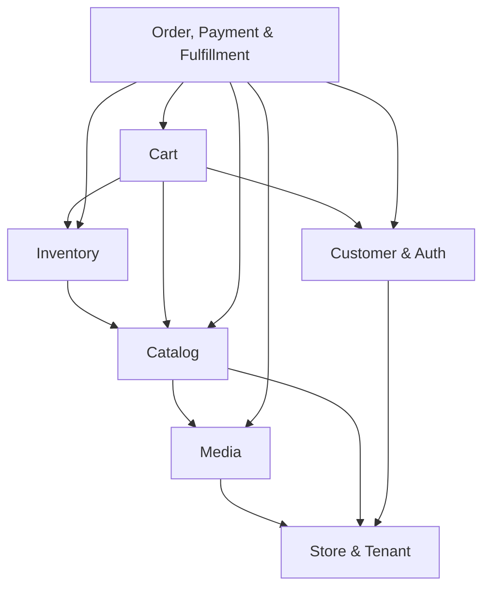
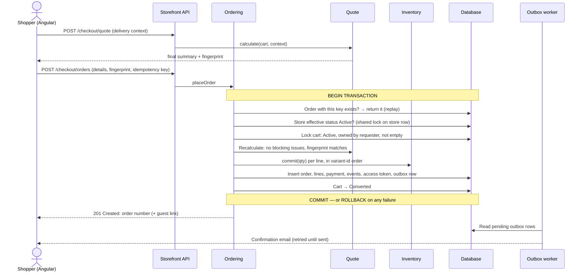

# White-Label E-commerce Platform — System Behavior

| | |
|---|---|
| **Status** | **Phase 3 approved (2026-10-18).** RA-1–RA-8 approved after the second review of 2026-10-18 (RA-5 and RA-6 as revised; the four second-review clarifications included) — §7.2. R1–R4, U-1–U-4, U-6 approved; ADR-04 revision 4 approved 2026-10-18. **Still open:** U-5 (production edge capability) and the implementation items deferred to the architecture phase (§7.4: P4-1 and P4-3–P4-7; P4-2 decided 2026-10-19). |
| **Last updated** | 2026-10-18 |
| **Phase** | 3 — Cross-domain relationships and end-to-end workflows |
| **Based on** | [requirements.md](requirements.md) v1.9 (approved 2026-10-18), [domain-model.md](domain-model.md) (approved) |

> **How to read this document.** Phase 2 described each domain in isolation. This document describes **how the domains work together**: which depends on which, which rules span several domains, and what happens — step by step, transaction by transaction — in every important workflow.
>
> It is documentation only. Endpoint names and fields refer to the contracts in the domain model; nothing here prescribes code structure (Phase 4).
>
> Earlier open decisions are resolved; the [decision record](#7-decision-record) lists them, together with the **assumptions** (marked **[RA-n]** in the text; status per item in §7.2), the **unresolved decisions** (§7.3), and the **items deferred to the architecture phase** (§7.4).

---

## Table of contents

1. [Domain dependencies](#1-domain-dependencies)
2. [Cross-domain invariants](#2-cross-domain-invariants)
3. [Reconciliation](#3-reconciliation)
4. [Caching](#4-caching)
5. [Concurrency, locking, and idempotency](#5-concurrency-locking-and-idempotency)
6. [Workflows](#6-workflows)
   - [W1 Store provisioning and activation](#w1-store-provisioning-and-activation)
   - [W2 Storefront request](#w2-storefront-request)
   - [W3 Cart changes and quotes](#w3-cart-changes-and-quotes)
   - [W4 Login, registration, and cart merge](#w4-login-registration-and-cart-merge)
   - [W5 Checkout and order placement](#w5-checkout-and-order-placement)
   - [W6 Order lifecycle](#w6-order-lifecycle)
   - [W7 Order item edits and delivery-detail edits](#w7-order-item-edits-and-delivery-detail-edits)
   - [W8 Inventory adjustments and discrepancies](#w8-inventory-adjustments-and-discrepancies)
   - [W9 Ripple effects of catalog and settings changes](#w9-ripple-effects-of-catalog-and-settings-changes)
   - [W10 Password change, reset, and session revocation](#w10-password-change-reset-and-session-revocation)
   - [W11 Store suspension and reactivation](#w11-store-suspension-and-reactivation)
   - [W12 Background jobs](#w12-background-jobs)
7. [Decision record](#7-decision-record)

---

## 1. Domain dependencies

An arrow means **"depends on"** (may reference or call).

**Rules (approved)**
1. **Dependencies are acyclic.** Store depends on nothing; Ordering is at the top. A domain may reference or call only domains below it.
2. **Combined display views live in a read layer.** Views that combine domains (e.g., a product page with stock states from Inventory) are assembled by a read layer. The read layer **queries and presents** combined data only: it owns **no business rules** and **never changes domain state**.
3. **Business decisions and state transitions** stay in the owning domain's workflows (Section 6).

**Ownership of data across the tenant boundary**

| Platform-wide (no `storeId`) | Store-scoped (`storeId`) |
|---|---|
| Organization, StaffUser, StaffPasswordCredential, StaffSession, StoreDomain, reference data, platform limits, role → permission definitions | Everything else: settings, branding, memberships, catalog, media, inventory, customers, customer credentials and sessions, carts, orders, payments, events, movements |

---

## 2. Cross-domain invariants

Rules no single domain can guarantee alone. Three enforcement mechanisms are used:

| Mechanism | Purpose | Example |
|---|---|---|
| **Constraint** | Makes invalid data structurally impossible | Unique `(storeId, idempotencyKey)` |
| **Transactional guard** | Checks and changes together in one transaction | Conditional stock commit |
| **Reconciliation** | **Detects** violations caused by bugs; never corrects | Daily `committed` check |

Reconciliation **never replaces** transactional guards: every workflow enforces its invariants on its own.

| # | Invariant | Domains | Enforcement | Reconciled |
|---|---|---|---|---|
| INV-1 | **Same store:** every reference between store-scoped records stays within one store | All | Guard on every write; tenant-isolation tests | — |
| INV-2 | **Stock:** `0 ≤ committed ≤ onHand`; `committed` = sum of quantities in open orders (`Pending`, `Confirmed`, `Processing`) | Inventory, Ordering | Conditional updates in the same transaction | ✅ |
| INV-3 | **Payment:** order copy = `Payment.status`; `Paid ⇒ Delivered`; `Cancelled`/`DeliveryFailed ⇒ Voided`; `amount = grandTotal` | Ordering | Same transaction | ✅ |
| INV-4 | **Totals:** `lineTotal = unitPrice × quantity`; `subtotal = Σ lineTotal`; shipping = snapshotted rule applied to subtotal; `grandTotal = subtotal + shippingFee` | Ordering | One backend calculation | ✅ |
| INV-5 | **Snapshot immutability:** contact never changes; lines only via item edits; recipient/address/notes only via delivery edits; all changes logged | Ordering | Only specific operations write them | — |
| INV-6 | **One active cart** per owner per store | Cart | Constraint | — |
| INV-7 | **At most one order** per `(storeId, idempotencyKey)` | Ordering | Constraint | — |
| INV-8 | **Published product is valid:** default-locale name, active category, ≥1 active variant, prices > 0 | Catalog | Guarded **from both sides** (publish checks; archiving the last active variant or a category with published products is blocked) | — |
| INV-9 | **Access:** admin requests need a valid session, membership, and permission; customer sessions match the store | Store, Customer | Per request | — |
| INV-10 | **Audit completeness:** every stock change has a movement; every order change has an event | Inventory, Ordering | Same transaction | — |
| INV-11 | **Media retention:** media referenced by order lines is never deleted | Media, Ordering | Cleanup job condition | — |
| INV-12 | **No operation prohibited while suspended commits after a suspension commits:** order placement, item-edit apply, customer/guest cancellation, cart writes (including merge), registrations, catalog/media/settings/branding writes | Store, Cart, Ordering, Customer, Catalog, Media | Checked inside the operation's transaction against the current database status **and synchronized with status changes** (§5.1); placement, item-edit apply, and customer/guest cancellation hold shared organization/store locks; the mechanism for the remaining prohibited writes is finalized in the architecture phase (§7.4) | — |
| INV-13 | **Content completeness:** non-archived products and categories have required default-locale content | Store, Catalog | Default-locale change blocked while content is missing | — |

---

## 3. Reconciliation

**Purpose:** detect invariant violations that indicate a **bug**. It is a detection mechanism, not a safety net.

| Aspect | Rule |
|---|---|
| Schedule | **Daily**; also **manually triggerable** by the platform operator, for one store or all stores |
| Checks | **INV-2** (stock), **INV-3** (payment), **INV-4** (order totals) |
| Access | **Read-only.** It never changes inventory, payments, totals, or order state, and never auto-corrects. |
| Consistency | Each store is checked inside a **read-only transaction with a consistent snapshot**, so in-flight operations cannot cause false positives |
| Output per mismatch | Store; invariant; entity ids (variant / order / payment); expected vs. actual values; ids and timestamps of the most recent related stock movements or order events; detection time |
| Alerting | Mismatches are logged and **alert the platform operator** — never brand staff |
| Result when clean | A summary log entry (stores checked, entities checked, duration) |
| Follow-up | Fixing data is a deliberate, separately audited operator action (outside the MVP's scope) |

**Checks in detail**

| Check | Compares |
|---|---|
| INV-2 | Per variant: `committed` vs. Σ quantities of that variant in open orders; `0 ≤ committed ≤ onHand` |
| INV-3 | Per order: `Order.paymentStatus` vs. `Payment.status`; status combination allowed (domain-model §7.8); `Payment.amount` vs. `Order.grandTotal` |
| INV-4 | Per order: line totals, subtotal, shipping (from the snapshotted rule), grand total |

---

## 4. Caching

### 4.1 Principles (approved)

1. Public, server-rendered **catalog** pages may show prices and stock states **up to 60 seconds** old.
2. Cart, checkout, account, order, and all other user-specific pages and APIs are **never publicly cached**.
3. Cache entries are isolated **by store and locale**.
4. **A cached price or stock state is never authoritative for a transaction.** The backend revalidates on add-to-cart, when preparing checkout, and inside order placement. If the final price or availability differs from what the shopper saw, the shopper receives the updated summary and confirms it before placing the order (W5).

### 4.2 Cache scope

| Content | Cacheable | Rule |
|---|---|---|
| Public catalog HTML (home, category, product, search) — SSR | ✅ Shared cache, TTL ≤ 60 s | Must contain **no user-specific content** (see 4.3) |
| Public catalog APIs (category tree, product list, product details, storefront config) | ✅ Shared cache, TTL ≤ 60 s | Same rule |
| Static assets (JS, CSS, fonts) | ✅ Long TTL | Content-hashed file names |
| Media files | ✅ Long TTL | URLs are immutable per asset |
| Cart, checkout, account, order lookup, order access link, auth endpoints | ❌ | `Cache-Control: private, no-store` |
| All admin pages and APIs | ❌ | `Cache-Control: private, no-store` |
| Error responses (404 for unknown hosts, 5xx) | ❌ | `Cache-Control: no-store` |
| "Coming soon" page (`Setup`, HTTP 200, `noindex`) | ✅ TTL ≤ 60 s | `public, max-age=0, s-maxage=60`; same keying rules |
| **"Temporarily unavailable" page (`Suspended`, HTTP 503)** | ❌ | `Cache-Control: no-store` and `Retry-After: 3600` *[DEFAULT]*. A 5xx is never cached, so a stored suspension page can never outlive a reactivation (only the backend's ≤ 60 s resolution cache bounds the delay — §4.5). *(Revised 2026-10-18 — previously listed as cacheable, which contradicted the 5xx rule above; approved 2026-10-18.)* |
| Any response not explicitly marked public | ❌ | `private, no-store` by default — an endpoint is publicly cacheable only if it opts in |

### 4.3 Locale in URLs (approved)

- Every storefront page URL starts with its locale: `/ar/...` or `/en/...`. **This applies to single-locale stores too**, so routing and caching are uniform. [RA-3]
- `/` redirects to the store's **default locale** (e.g., `/ar/`). The redirect does **not** depend on `Accept-Language`, so it is deterministic and cacheable. [RA-3]
- A locale prefix the store does not support → redirect to the same path in the default locale.
- **Canonical URL:** each page's canonical is its own locale URL on the store's **primary host**.
- **`hreflang`:** each page lists its alternates for every supported locale, plus `x-default` pointing to the default locale. Single-locale stores emit no alternates.
- The language switcher links to the **same page** in the other locale.
- **Deterministic behavior** [RA-3, clarified 2026-10-18]: the redirect target depends **only** on the resolved store's default locale and the requested path — never on `Accept-Language`, cookies, or any other per-visitor input. Two requests for the same store and URL always receive the same redirect or page. Because a store's default locale can change, a locale redirect must **not** be cacheable as permanent by browsers; its exact status code and cache headers are fixed in the architecture phase (§7.4, P4-4).

### 4.4 Safety rules

1. **Cache key components** [RA-3, RA-7 — clarified 2026-10-18]. Every publicly cached response is keyed by **all** of the following, and by nothing that is per-visitor:

   | Component | Source | Purpose |
   |---|---|---|
   | **Store identity** | The normalized host received by the trusted edge ([ADR-04](architecture-decisions.md#adr-04-request-topology-host-resolution-and-public-caching)); each host resolves to **exactly one** store | Tenant isolation |
   | **Locale** | First path segment (`/ar/`, `/en/`) | Language isolation |
   | **Path** | Remainder of the URL path | The page itself |
   | **Allow-listed query parameters** | Only parameters that change the response (e.g., `page`, `sort`, `q`); tracking parameters (e.g., `utm_*`, `fbclid`) are ignored | Fewer variants; resists cache poisoning |
   | **Any other response-affecting context** | None in the MVP | See the rule below |

   - **Rule:** a public response may vary **only** on these components. If a response would ever depend on anything else (a header, a cookie, a per-visitor value), that input must either be added to the cache key **or** the response must not be publicly cached.
   - **Tenant isolation:** one store's cached response is never served for another store. A store reachable on several hosts (e.g., future custom domains) has separate entries per host; this duplication is safe, while sharing entries across hosts is not allowed.
   - *Timing:* the allow-list is configured on the shared cache (introduced with hosting) and first matters for catalog pages (M4). Until then, public responses must **not depend on query parameters** — the rule M1 tests.
2. **Public cached responses never set cookies.** Guest cart cookies, session cookies, and pre-session CSRF tokens are issued only by non-cached endpoints. *(Otherwise one visitor's cookie could be cached and served to everyone.)*
3. **Public HTML is identical for every visitor** of the same store and locale. User-specific parts (mini-cart count, "Hello, Name", account menu) are rendered **in the browser** from non-cached API calls.
4. **Only the host as received by the trusted edge** is used for store resolution; forwarded-host headers from clients are ignored (prevents cache poisoning and store spoofing). The full flow — edge, SSR, API, separate route-specific credentials, network paths, and tests — is defined in [architecture ADR-04](architecture-decisions.md#adr-04-request-topology-host-resolution-and-public-caching) (revision 4, approved 2026-10-18).
5. **Unknown hosts** return a platform 404 that is not cached and contains no store data.

### 4.5 Invalidation (approved)

**Time-based expiry only:** a maximum TTL of **60 seconds** for public catalog content; **no on-demand invalidation** in the MVP. Cached values are never authoritative for cart or checkout transactions.

| Change | Visible on public pages within |
|---|---|
| Price, stock, publication, content, image | ≤ 60 s |
| Store settings, branding, locales, support contacts | ≤ 60 s |
| Store suspension | Catalog pages switch to the `503` page within ≤ 60 s (cached catalog pages expire); the `503` page itself is never cached. Transactions are blocked **immediately**. |
| Store reactivation | Catalog pages return within ≤ 60 s (bounded only by the backend's resolution cache; the `503` page itself is never cached); new business resumes immediately on the backend |

The backend's own **in-process cache of store resolution** (host → store, effective status) also expires within 60 s and is used **only for rendering decisions**. **Every business operation** — cart writes, registration, placement, item edits, customer cancellation, catalog and settings writes — reads the **current** store and organization status from the database inside its transaction, never from a cache. Suspended stores therefore cannot accept new orders or perform prohibited writes, whatever any cache says.

---

## 5. Concurrency, locking, and idempotency

### 5.1 Lock scope

Principle: **the narrowest lock that protects a specific invariant**, acquired in a consistent order (§5.2). No operation is serialized through the store row unless the invariant requires it — but no operation prohibited while suspended may bypass suspension (INV-12).

| Operation | Locks | Mode | Protects |
|---|---|---|---|
| **Order placement** | Organization row, then store row | **Shared** | INV-12 — no order commits after a suspension commits |
| | The cart | Exclusive | A cart converts into at most one order |
| | Inventory levels of the cart's variants | Exclusive (conditional update), ascending variant id | INV-2 |
| **Store activation / suspension / reactivation** | Store row | **Exclusive** | INV-12 |
| **Organization suspension / reactivation** | Organization row | **Exclusive** | INV-12 for all its stores |
| **Item-edit apply; customer/guest cancellation** *(added 2026-10-18 — RA-6, approved 2026-10-18)* | Organization row, then store row | **Shared** | INV-12 — no item edit or customer cancellation commits after a suspension commits (both are forbidden while suspended and change stock and payment) |
| **Other operations prohibited while suspended** (cart writes incl. merge, registrations, staff catalog/media/settings/branding writes) *(RA-6 second review, approved 2026-10-18)* | Synchronized with status changes — mechanism per P4-1 (§7.4) | — | INV-12 — none commits after a suspension commits; must not serialize non-conflicting operations against each other |
| Order transition, item edit, delivery edit, payment action, return, cancellation | The order (version check) | Exclusive | One concurrent change wins; INV-3, INV-5 |
| | Inventory levels touched | Exclusive, ascending variant id | INV-2 |
| Inventory adjustment (Receive, Remove, Count, Contain) | That inventory level | Exclusive | INV-2; serializes same-variant retries before the request-id lookup (W8) |
| Cart write | The cart | Exclusive | INV-6; line consistency |
| Cart merge | Both carts, ascending cart id | Exclusive | A guest cart merges once |
| Reset-token use | Conditional update on the token | — | Single use |
| Media cleanup | The media asset | Exclusive | INV-11 |

**Why shared locks for placement:** shared locks do **not** block each other, so concurrent placements in the same store run in parallel. They wait only while an operator's status change holds the exclusive lock — a rare, operator-initiated event.

**Suspension enforcement boundary** [RA-6 — revised after the second review, approved 2026-10-18; **D8 preserved**]

The rule: **an operation that is prohibited while a store is suspended must never commit after the suspension commits** — there is **no** millisecond-race exception for any prohibited operation (an earlier wording that accepted such races for cart writes, registrations, and catalog/settings writes is withdrawn). Operations that D8 permits while suspended are unaffected.

| Operation | Allowed while suspended? | Enforcement |
|---|---|---|
| Order placement | ❌ | Status checked in the transaction; **shared** organization/store locks (approved) |
| Order item-edit apply | ❌ | Same — **shared** organization/store locks (approved) |
| Customer/guest cancellation | ❌ | Same — **shared** organization/store locks (approved) |
| Cart writes (add, set quantity, remove, adjust to available, **merge**) | ❌ | Status checked in the transaction **and synchronized with status changes**, so none commits after a suspension commits. Mechanism finalized in the architecture phase (§7.4, P4-1). |
| Customer registration | ❌ | Same as cart writes (P4-1) |
| Staff catalog, media, settings, and branding writes (incl. publish) | ❌ | Same as cart writes (P4-1). The store-status part of the staff permission check is **re-evaluated inside the transaction**, not only at the start of the request. |
| Fulfillment transitions, staff cancellation, mark as paid, payment correction, return recording, delivery edits, stock adjustments | ✅ (D8) | **No synchronization needed** — allowed in both states, subject to permissions, workflow rules, stock invariants, and audit logging (domain-model §1.6) |
| Login, logout, password reset, order history, guest lookup | ✅ (read-only access) | Not synchronized |
| Catalog reads, quotes, storefront reads | read-only | No locks |

**Strategy requirements** (for the mechanism chosen in the architecture phase):
1. The status check and the operation's writes happen in the **same transaction**, and the check is **serialized with status changes**: either the operation commits before the suspension (and is valid), or it observes the suspension and is rejected (`STORE_NOT_ACTIVE` / `403`).
2. Operations that do **not** conflict with each other must **not** be serialized against each other (e.g., concurrent cart writes or placements in one store must still run in parallel); only status changes may block them, briefly.
3. The approved shared/exclusive organization-and-store lock pattern (placement, item-edit apply, customer/guest cancellation) is one acceptable mechanism; using it for the remaining prohibited writes, or an alternative with an equivalent guarantee, is decided in P4-1 with attention to hot paths (cart writes).
4. Organization status is part of the check (effective status), using the global lock order (§5.2).
5. Every prohibited-operation rejection is a normal business error with no side effects.

**Database:** PostgreSQL is the selected database ([ADR-02](architecture-decisions.md#adr-02-database-and-data-access), approved). The detailed concurrency design — transaction boundaries, optimistic concurrency, row-level locking, stock invariants and overselling prevention, and the suspension-race strategy above — is finalized in the architecture phase (§7.4) and verified by integration tests against real PostgreSQL. [RA-8]

### 5.2 Global lock order

Every operation acquires locks in this order, which prevents deadlocks:

**organization → store → cart(s) (ascending id) → order → inventory levels (ascending variant id) → media asset**

### 5.3 Business-operation idempotency

| Operation | Mechanism | Repeat with the same identity |
|---|---|---|
| Order placement | Idempotency key, unique per `(storeId, key)`; cart `Converted` | Returns the original order (guests: an additional access token) |
| **Add to cart** | **Request id** recorded with its payload, unique per `(cartId, requestId)`, in the same transaction as the increment (5.3.1) | Not applied again; the response is the current cart [RA-4] |
| **Inventory Receive / Remove / Count / Contain** | **Request id**, unique per `(storeId, requestId)`, stored with a request fingerprint on the stock movement. Count and Contain **additionally** use the expected `onHand` as an optimistic-concurrency check (a separate protection against stale data). Conflict responses and audit: W8. [RA-5 — revised after the second review, approved 2026-10-18] | Returns the **original result** (the movement's before/after values), even if `onHand` changed since; no second movement |
| Order transitions, payment actions, return recording | Compare-and-set + order version | Second attempt rejected as stale; UI shows the current state |
| Item edit (apply) | Order version + preview fingerprint | Rejected as stale |
| Cart merge | Guest cart already `Merged` | No-op |
| Password reset confirmation | Single-use token | Rejected (link already used) |
| Provisioning | Unique handle and host | Rejected (already exists) |

**Rules for request ids**
- Generated by the client (UUID) **per intentional action** and reused for retries of that action. Two intentional actions use two ids and both apply.
- The uniqueness constraint is enforced **in the same transaction** as the operation, so concurrent duplicates wait and then see the first result.
- The **same id with a different payload** (e.g., another variant or quantity) is rejected with `422`.
- A request id is bound to a payload only once an operation **succeeds**; a rejected operation records nothing, so its id may be reused.

#### 5.3.1 Add-to-cart contract [RA-4 — clarified 2026-10-18]

**What guarantees idempotency.** Idempotency comes from the **server-side record** of `(cartId, requestId)` and its payload, written in the **same transaction** as the quantity increment and protected by a uniqueness constraint. Returning the current cart is **only the response shape**; it does not by itself guarantee anything.

| Situation | Client obligation | Server behavior |
|---|---|---|
| A shopper's **intentional** add (one click or tap) | Generate a **new** request id | Applies the increment; records the request id |
| **Transport retry** of that add (timeout, lost response, automatic HTTP retry, reconnect) | **Reuse the same** request id and the same payload | Finds the record → **does not increment again**; returns the current cart and quote |
| **Duplicate submission** (double click, re-sent form) of the same action | Treated as a retry: the UI keeps the request id of the in-flight action and disables the control | Same as a retry |
| **Concurrent** duplicates (both in flight) | — | The cart lock (§5.1) serializes them; the second finds the record and does not increment |
| Same request id, **different payload** (variant or quantity) | Never do this | Rejected `422 REQUEST_ID_CONFLICT`; nothing changes |
| Two **different** intentional adds of the same variant | Two request ids | Both apply (quantity increases twice), within limits |
| The original add was **rejected** (e.g., insufficient stock, store not active) | May retry with the same id | Nothing was recorded, so the retry is evaluated afresh |

**Response:** the first application and a replay both return `200` with the **current** cart and quote — which may include changes made after the original add. A replay never updates `lastActivityAt`. Whether the response additionally signals that it was a replay is decided in the architecture phase (§7.4, P4-3).

**Scope of a request id.** Records live as long as their cart:
- **Reassignment** to a customer keeps the cart (and its records).
- **Merge:** the guest cart's add-request records are **carried over to the target cart** in the merge transaction, so a retry of an add that was applied before the merge is recognized and not applied twice. *(Clarification — approved 2026-10-18.)*
- After a cart is **converted** or **expires**, its records are gone; a request arriving then is treated as new. Transport retries happen within seconds, so this is outside the retry window.

### 5.4 Notification delivery is separate from business idempotency

| | Business operation | Notification |
|---|---|---|
| Guarantee | Exactly once (5.3) | **At least once** |
| Mechanism | Idempotency keys, request ids, compare-and-set, versions | **Transactional outbox**: the message row is written in the **same transaction** as the business change |
| Retry effect | Never re-executes | Re-sends **the message only** |
| Duplicates | Never | Rare duplicate emails are acceptable in the MVP |

Consequences:
- A message exists **if and only if** its business change committed.
- The outbox worker **never** executes or repeats business operations and never changes business data; it only updates the message's own delivery status.
- The outbox message id is passed to the email provider as an idempotency key where the provider supports it.

---

## 6. Workflows

Each workflow follows the same structure: **Trigger and preconditions → Steps and state transitions → Transactions → Effects → Idempotency and concurrency → Failures and recovery → Invariants and reconciliation.** Sections that do not apply are omitted.

---

### W1 Store provisioning and activation

**Trigger and preconditions**
- The platform operator runs the **provisioning script** with: operator identifier [RA-1], organization name, store handle, brand name, default locale, supported locales, flat shipping fee, free-shipping threshold (optional), support phone, initial admin email and name.
- **Operator identifier** [RA-1 — clarified 2026-10-18]: a **declared** identity, not independently authenticated proof of identity. It labels audit records only; it is **not** a substitute for authentication or authorization. Who may run operator commands is controlled by access to the operator environment (infrastructure access control), not by this value. There are no operator accounts in the MVP.
- Handle valid and unique; host name unique; locales valid.

**Steps — provisioning**
1. Validate all inputs.
2. Look up the admin email among staff users:
   - **Not found** → a new StaffUser and StaffPasswordCredential will be created with a temporary password **generated by a cryptographically secure generator** (never operator-supplied) and `mustChangePassword`.
   - **Found and `Active`** → the **existing identity is reused**: no new identity, **no credential change, no new temporary password**.
   - **Found and `Disabled`** → provisioning is **refused**; re-enabling an identity is a separate, deliberate operator action. [RA-2]
3. In **one transaction**, create: Organization (`Active`); Store (`Setup`); StoreDomain (`<handle>.<platform-domain>`, primary); StoreSettings (EGP, prices include tax, Africa/Cairo, low-stock threshold 5, given shipping and contacts); StoreBranding (platform defaults — Phase 5); display name (default locale, prefilled from the brand name); OrderNumberSequence (next value 1001); the staff identity per step 2 (new only); StoreMembership with an **explicitly assigned role** for this store (`StoreAdmin`); PlatformAuditEvents (`StoreProvisioned`, and `StaffUserCreated` or `StaffMembershipGranted`).
4. Commit.
5. **New identity only — after commit:** display the temporary password **once** to the operator console. It is **never logged or persisted** in plaintext (only its hash exists), and the first login forces a password change.

**Membership safeguards:** a membership grants exactly the role assigned for **this** store. Memberships of the same identity in other stores grant nothing here, and nothing here changes them.

**Audit outcome** [RA-1 — clarified 2026-10-18]: every operator command records the **operation, timestamp, outcome, and declared actor**:
- **Succeeded** — PlatformAuditEvents are written in the **same transaction** as the change (above).
- **Refused or failed** (e.g., `Disabled` staff identity — RA-2; activation precondition missing; validation error) — the business transaction writes nothing, so the refusal is recorded **separately**, with the reason code and no sensitive data.

**How refused and failed commands are recorded** *(P4-2, approved 2026-10-19 — Option A)*
- **Separate audit transaction:** after the business transaction has rolled back — or, for a refusal detected before it starts, instead of it — the command writes **exactly one** PlatformAuditEvent in a **new, separate transaction** with its own database context: outcome `Refused` or `Failed`, a reason code, the declared actor, and no sensitive data ([domain-model §1.14](domain-model.md#114-platformauditevent)). `Refused`: a business rule, precondition, or validation rejected the command. `Failed`: an unexpected error (database error, timeout). The audit transaction takes no organization or store lock.
- **Target:** recorded when the attempted target is known (e.g., the existing `Disabled` StaffUser, the store being activated); `targetId` is omitted only when no valid target can be identified (e.g., a refused provisioning that created no organization or store).
- **Unknown commit outcome** (connection lost during commit): recorded as `Failed` / `OutcomeUnknown`, and the operator is told to check the target's status. If the commit did succeed, its `Succeeded` events exist as well; nothing is corrected automatically.
- **Missing operator identifier:** refused before any database work; **no** PlatformAuditEvent is written (`actor` is required and is never invented); a warning is logged. CLI usage errors are handled the same way.
- **Audit-write failure:** if a required audit record cannot be persisted, the command logs the failure at error level (with the event's non-sensitive fields), prints a warning on the operator console, and exits with a **non-zero** code. It is never reported as success.
- **Temporary limitation (M1):** there is no dedicated alerting channel for audit-write failures; alerting is added when observability is available.

**Required tests** (real PostgreSQL; built with the M1 operator CLI — milestone-m0-m1 M1-13):

| # | Scenario | Expected |
|---|---|---|
| AU-1 | Provisioning with a `Disabled` staff identity | No business rows; exactly one event `Refused` / `StaffUserDisabled` with the operator as `actor` and that StaffUser as target; no email, password, or token in the event |
| AU-2 | Activation with a precondition missing | Store stays `Setup`; exactly one event `Refused` / `ActivationPreconditionMissing` targeting the store |
| AU-3 | Provisioning with a validation error (e.g., invalid handle) | No business rows; exactly one event `Refused` / `ValidationFailed` without `targetId`; no submitted values in `details` |
| AU-4 | Database failure injected inside the business transaction | Full rollback; exactly one event `Failed` / `UnexpectedError` |
| AU-5 | The audit insert itself fails | Error log entry, console warning, non-zero exit code; no business rows; not reported as success |
| AU-6 | Operator identifier missing | No business rows, no audit event, one warning log entry |

**Steps — activation** (separate operator command)
1. Check activation preconditions (domain-model §1.6).
2. Lock the store row (exclusive); compare-and-set `Setup → Active`; set `activatedAt` (handle becomes immutable).
3. Append a `StoreActivated` PlatformAuditEvent.
4. Commit.

**Idempotency and concurrency**
- Re-running provisioning with the same handle fails on the unique handle — no duplicates.
- A failed run leaves nothing behind (single transaction), so re-running is safe.
- Activation is compare-and-set: repeating it is rejected ("already active").

**Failures and recovery**

| Failure | Recovery |
|---|---|
| Validation or uniqueness error | Nothing created; refusal recorded (audit outcome); fix input and re-run |
| Existing staff user is `Disabled` | Refused; nothing created; refusal recorded. Re-enabling is a separate, explicit, audited command (`StaffUserEnabled`) — access is never restored implicitly [RA-2] |
| Crash before commit | Rolled back; no password was shown; re-run |
| Console output lost after commit (new identity) | Operator runs the **staff password reset command** (separate from provisioning): new generated temporary password shown once, `mustChangePassword` set, all of the user's sessions revoked, audited `StaffPasswordReset` |
| Activation precondition missing | Activation refused with the list of missing items |

**Invariants:** INV-1, INV-9, INV-13.

---

### W2 Storefront request

**Trigger:** any HTTP request to a store host — an SSR page or a storefront API call.

**Steps**
1. Take the host **only** from the trusted edge (`X-Platform-Host`, accepted only together with a valid API edge key from an edge address, or a valid SSR-to-API key from an SSR address on an allow-listed public `GET` — [ADR-04](architecture-decisions.md#adr-04-request-topology-host-resolution-and-public-caching) revision 4, approved 2026-10-18) and normalize it (lowercase, no port, no trailing dot).
2. Resolve host → store (cache ≤ 60 s, then `StoreDomain`). **Unknown host → platform 404** (`no-store`); never a fallback store.
3. Compute the **effective status** (store and organization).

   | Status | Behavior |
   |---|---|
   | `Setup` | "Coming soon" page, HTTP 200, `noindex`, `public, max-age=0, s-maxage=60` |
   | `Suspended` | Catalog routes → branded **503** with `Retry-After: 3600` *[DEFAULT]*, `Cache-Control: no-store`, and support contacts; account, order history, order lookup remain available read-only |
   | `Active` | Continue |
4. Resolve the locale from the URL's first path segment (Section 4.3); an unsupported or missing locale redirects to the default locale.
5. For catalog content, the **read layer** combines published Catalog data, resolved translations, effective prices, and stock **states** computed from Inventory.
6. Apply cache headers (Section 4).

**Transactions:** none — read-only. Every read is filtered by the resolved `storeId`.

**Concurrency:** public data may be up to 60 s stale; never used for decisions.

**Failures and recovery**

| Failure | Behavior |
|---|---|
| Store resolution unavailable (database down) | Generic platform 503, not cached; **never** another store's data |
| Read error while rendering | Error page, not cached |

**Invariants:** INV-1, INV-12, INV-13.

---

### W3 Cart changes and quotes

**Operations:** add line, set quantity, remove line, adjust to available, read cart (quote), checkout quote.

**Preconditions (all writes)**
- Store effective status `Active` (else `STORE_NOT_ACTIVE`).
- Valid CSRF token; `Origin` check.
- **Add / set quantity:** variant belongs to the store; product `Published`; variant `Active`; `1 ≤ quantity ≤ line maximum`; resulting quantity `≤ available` (read live); ≤ 50 lines.
- **Add:** a client-generated **request id** (one per intentional add action, reused for retries).

**Steps — write**
1. Resolve the current cart from the customer session or guest cookie. A cart past its expiry is treated as **non-existent**. If none and the operation adds a line: create a cart (guest: new token; the cookie is set on this **non-cached** response).
2. **Add only:** record `(cartId, requestId)`. If it already exists with the same payload → **replay**: return the current cart without changing it. Same id, different payload → `422`.
3. Apply the change:
   - **Add** = increase the line's quantity (or create the line), atomically, within limits.
   - **Set quantity** = absolute value (last write wins; naturally repeatable).
   - **Remove** = delete the line (naturally repeatable).
   - **Adjust to available** = backend sets `min(available, line maximum)` as of now; if 0, the line becomes `SOLD_OUT`.
4. Refresh `unitPriceWhenAdded` for the changed line; update `lastActivityAt` (see expiry below).
5. Commit; compute and return the quote.

**Steps — read / checkout quote:** compute the quote from current data (domain-model §6.6); **no writes**.

**Expiry (approved)**

| Updates `lastActivityAt` | Does **not** update it |
|---|---|
| Successful add, set quantity, remove, adjust to available | Reading the cart (`GET /api/cart`) |
| Being the target of a merge | Checkout quotes |
| Reassignment of a guest cart to a customer | Rejected or failed mutations |
| | Replayed add requests |

- `expiresAt = lastActivityAt + 30 days` (guest) or `+ 90 days` (customer); after reassignment the customer rule applies.
- An `Active` cart past `expiresAt` is treated as non-existent on every request and deleted by the cleanup job.
- `Converted` and `Merged` carts are deleted **7 days after `closedAt`**.

**Transactions:** one short transaction per write, covering the cart, its line, and (for add) the request record. Catalog and Inventory are **read, not locked**: no stock is reserved.

**Effects:** inventory — none; payment — none; totals — computed per quote, never stored.

**Idempotency and concurrency**
- **Add is idempotent per request id**, guaranteed by the server-side request record (Section 5.3.1 — the add-to-cart contract): a retried or duplicated request never increments twice; two intentional adds with different ids both apply. The UI also disables the button while a request is in flight.
- **Suspension:** all cart writes are prohibited while suspended and are synchronized with status changes (§5.1, RA-6).
- Two tabs changing the same line: add is an atomic increment; set quantity is last-write-wins. Both re-validate limits and availability.
- *Edge case:* if the very first add's response (carrying the new guest cookie) is lost, a retry arrives without the cookie and creates a second guest cart with that line; the first cart simply expires. No quantity is doubled within a cart.

**Failures and recovery**

| Failure | Response | Shopper sees |
|---|---|---|
| Variant unknown or from another store | 404 (identical) | "Product not available" |
| Not purchasable | 409 `VARIANT_UNAVAILABLE` | Reason + action |
| Quantity > available — **add from a product page** | 409 `INSUFFICIENT_STOCK` **without a number** | "Not enough stock for this quantity" (product pages show states only) |
| Quantity > available — **in the cart** | 409 `INSUFFICIENT_STOCK` with available quantity | "Only N available" + Adjust to available (revalidated on submit and at checkout) |
| Line or quantity limit exceeded | 422 | Limit message |
| Store not active | 409 `STORE_NOT_ACTIVE` | Unavailable message + support contacts |

**Invariants:** INV-1, INV-6, INV-12.

---

### W4 Login, registration, and cart merge

**Preconditions**
- Pre-session CSRF token; rate limits not exceeded.
- Login: store effective status `Active` or `Suspended`. Registration: `Active` only.

**Steps — login**
1. Verify phone + password (dummy verification for unknown phones; generic error).
2. **Transaction A:** create a new CustomerSession (rotation); update `lastLoginAt`; re-hash the password if parameters are outdated. Commit.
3. Set the session cookie and a new CSRF token.
4. **Transaction B — merge** (domain-model §6.7): check the store is `Active` (synchronized with status changes — §5.1, RA-6); lock the guest cart and the customer cart; reassign or merge (carrying over add-request records — §5.3.1); mark the guest cart `Merged`; revalidate lines. Commit.
5. Clear the guest cart cookie; return the list of cart adjustments.

**While the store is suspended:** login succeeds, but the merge is a cart write and is **not performed**. The guest cookie and guest cart are kept, and the merge is retried by the existing retry rule once the store is `Active` again. *(Clarification — approved 2026-10-18 with RA-6.)*

**Steps — registration:** as login, but transaction A also creates the Customer and CustomerPasswordCredential (unique phone and email per store). Registration is prohibited while suspended; its status check is synchronized with status changes (§5.1, RA-6).

**Idempotency and concurrency**
- Merge is idempotent: a `Merged` guest cart is skipped.
- Two simultaneous logins from different tabs: two sessions are created; the merge locks serialize — one merges, the other finds nothing to do.
- Simultaneous registrations with the same phone: the unique constraint lets one succeed.

**Failures and recovery**

| Failure | Behavior |
|---|---|
| Wrong credentials | Generic error; failure counted |
| Lockout | "Too many attempts, try later" (identical for unknown phones) |
| Registration conflict | 409 "already registered" (accepted trade-off) |
| **Merge (transaction B) fails** | **Login still succeeds.** The guest cookie is kept; the merge is retried on the next cart request. |
| Store suspended at login | Login succeeds; merge skipped and retried after reactivation |
| Store suspended during registration | `STORE_NOT_ACTIVE`; nothing created |

**Invariants:** INV-6, INV-9, INV-12.

---

### W5 Checkout and order placement

**Trigger:** the shopper submits the checkout form.

**Preconditions**
- Store effective status `Active`.
- CSRF and `Origin` valid.
- The checkout page has shown a **final order summary** from `POST /api/checkout/quote` (with the delivery context) and holds its fingerprint.
- Angular holds an **idempotency key** generated when the checkout page loaded (kept in session storage).

**Sequence**

**Steps (one transaction)**
1. **Idempotency:** an order with `(storeId, idempotencyKey)` exists → return it. Same key from a different cart → 422.
2. **Store status** checked under **shared** locks on the organization row and the store row (Section 5.1), so a concurrent suspension is serialized with the placement while concurrent placements do not block each other.
3. **Cart lock:** `Active`, owned by the requester, not empty. `Converted` → `409 CART_ALREADY_ORDERED` with that order's number.
4. **Validate** contact, recipient, address (Egyptian phone formats, required fields, governorate from the list).
5. **Recalculate the quote**; any blocking issue or fingerprint mismatch → rollback, `409 QUOTE_CHANGED` with the new summary.
6. **Commit stock** per line in variant-id order (conditional on `available ≥ qty`); any failure → rollback, `409 INSUFFICIENT_STOCK` with a fresh summary.
7. **Allocate** the order number from the store's sequence (gaps allowed).
8. **Create:** Order (`Pending`, payment copy `Pending`, all snapshots, shipping rule, totals, locale, idempotency key); OrderLines (snapshots incl. primary image media id); Payment (`COD`, `Pending`, amount = grand total); OrderEvents (`Placed`; `AccessLinkIssued` for guests); StockMovements (`OrderCommitted`, one operation id); OrderAccessToken (guests; hash only); outbox row (confirmation email if an email exists).
9. **Cart → `Converted`** with the order id.
10. **Commit.**
11. Respond with the order number and, for guests, the plaintext access link (shown once). Clear the guest cart cookie.

**Effects**

| | Effect |
|---|---|
| Inventory | `committed += qty` per line |
| Payment | Created `Pending`, `amount = grandTotal` |
| Totals | Computed once by the quote calculation, stored as the order snapshot |

**Idempotency and concurrency**

| Situation | Handling |
|---|---|
| Double submit | Same key → second request waits on the unique constraint, then receives the same order |
| Response lost after commit | Retry with the same key → same order (replay) |
| Page reloaded (new key) | Cart already `Converted` → `CART_ALREADY_ORDERED` with the order number |
| Guest replay | A **new** access token is issued and logged (`AccessLinkIssued`); earlier tokens stay valid while the order is cancellable |
| Two shoppers, last unit | Conditional commit: exactly one succeeds |
| Cart changed in another tab | Fingerprint mismatch → updated summary |
| Store suspended concurrently | Serialized by the shared/exclusive store-row locks: either the order commits before the suspension, or it fails with `STORE_NOT_ACTIVE` |
| Many shoppers placing orders at once | Shared locks do not block each other; only conflicting inventory rows serialize |

**Failures and recovery**

| Failure | Written | Shopper sees |
|---|---|---|
| Validation error | Nothing | Field errors |
| Quote changed | Nothing | Updated summary; must confirm again |
| Insufficient stock | Nothing | Updated summary with line issues |
| Store not active | Nothing | Unavailable message |
| Crash / timeout before commit | Nothing (rollback) | Retry with the same key is safe |
| Email provider down | Order committed; email pending in the outbox | Confirmation page (email arrives later) |

**Invariants:** INV-1, INV-2, INV-3, INV-4, INV-6, INV-7, INV-10, INV-12. **Reconciled:** INV-2, INV-3, INV-4.

---

### W6 Order lifecycle

**Common rules for every transition**
- **Preconditions:** staff session, membership, permission (or customer/guest access for cancellation); expected current status; order `version`; store status allows the permission.
- **Compare-and-set** on the expected status + version check.
- **One transaction** containing the status change, inventory effects, payment effects, the order event(s), and stock movements.
- **Stale request** (status or version changed) → `409` with the current order; the UI reloads. Nothing is written.

**Effects per step**

| Step | Order | Inventory | Payment | Events | Outbox |
|---|---|---|---|---|---|
| Place (W5) | → `Pending` | `commit` | Created `Pending` | `Placed` (+ `AccessLinkIssued`) | Confirmation |
| Confirm | → `Confirmed`, `confirmedAt` | — | — | `StatusChanged` | — |
| Process | → `Processing`, `processingAt` | — | — | `StatusChanged` | — |
| Ship | → `Shipped`, `shippedAt`, courier details | `deductShipped` | — | `StatusChanged` | — |
| Failed delivery attempt *(no transition)* | Stays `Shipped`; eligible for further attempts | — | — | Internal note, if staff record one (`NoteAdded`; U-1) | — |
| Deliver | → `Delivered`, `deliveredAt` | — | — | `StatusChanged` | — |
| Mark as paid | — | — | → `Paid`, `collectedAt`, `recordedAt/By`; order copy | `PaymentMarkedPaid` | — |
| Cancel | → `Cancelled`, reason, actor | `release` all lines | → `Voided`; order copy | `Cancelled`, `PaymentVoided` | — |
| Delivery failed | → `DeliveryFailed` (**terminal**; no retry), reason | — (goods with courier) | → `Voided`; order copy | `StatusChanged`, `PaymentVoided` | — |
| Record return | `returnRecordedAt`; line return quantities | `restock(restockedQty)` | — | `ReturnRecorded` | — |
| Payment correction | — | — | Revert to `Pending` or change `collectedAt`; order copy | `PaymentCorrected` | — |
| Courier-detail correction | Courier fields | — | — | `ShippingDetailsUpdated` | — |
| Internal note | — | — | — | `NoteAdded` | — |

Each row is one transaction and one future test case covering all five columns.

**Specific preconditions**

| Action | Additional precondition |
|---|---|
| Customer / guest cancel | Order `Pending`; store `Active` — checked under **shared** organization/store locks (§5.1); guest link valid (≤ 7 days, order `Pending`); reason from the customer list, note required for "other" |
| Staff cancel, delivery failed | Reason from the staff / delivery-failure list; note required for "other" |
| Mark as paid | Order `Delivered`; payment `Pending`; `deliveryDate ≤ collectedAt ≤ today` (store timezone) |
| Payment correction | Payment `Paid`; `orders.correctPayment`; **password re-entered**; reason |
| Record return | Order `DeliveryFailed`; not recorded yet; `0 ≤ restockedQty ≤ quantity` per line |
| Courier correction | Order `Shipped`, `Delivered`, or `DeliveryFailed` |

**Concurrency examples**

| Situation | Outcome |
|---|---|
| Customer cancels while staff confirm | Exactly one succeeds; the other gets the current state |
| Two staff mark as paid simultaneously | Version check: one succeeds |
| Record return submitted twice | Second fails: already recorded |

**Failures and recovery:** any failed precondition → nothing written; the response explains why. A crash mid-transaction rolls back; the action can be retried.

**Stock across fulfillment** *(clarified 2026-10-18 — approved 2026-10-18)*: committed stock is released only by cancellation (before `Shipped`); `Shipped` reduces `onHand` and `committed`; failed attempts and `DeliveryFailed` change nothing; stock is restored only by **Record return**, per line, for the restocked units.

**Invariants:** INV-2, INV-3, INV-5, INV-9, INV-10, INV-12 (customer cancellation). **Reconciled:** INV-2, INV-3.

---

### W7 Order item edits and delivery-detail edits

#### Item edit

**Preconditions:** `orders.edit`; order `Pending` or `Confirmed`; payment `Pending`; store `Active`.

**Steps — preview (no writes)**
1. Staff submit the proposed changes (quantities, swaps, additions, removals) with the order version.
2. The backend validates: ≥1 line remains; limits (1–10, ≤ 50 lines); swapped/added variants are same-store and purchasable; **no swap to a variant already in the order**; sufficient stock for **increases only** (`available ≥ difference`).
3. It computes new lines (untouched and quantity-changed lines keep snapshot prices; swapped/added lines use current prices and names), shipping with the **snapshotted rule**, grand total, and a **preview fingerprint**. (No tax amount — prices include tax; requirements §14.)

**Steps — apply (one transaction)**
1. Take **shared** locks on the organization and store rows and check the store is `Active` (§5.1, RA-6); lock the order; check version, status, payment status.
2. **Recompute** the preview; compare with the submitted preview fingerprint → mismatch: rollback, `409` with a new preview.
3. Inventory: `release` decreases/removals and `commit` increases/additions, in variant-id order (conditional).
4. Update lines (new snapshots for swapped/added lines), totals, `Payment.amount`.
5. Append `ItemsEdited` (before/after lines and totals, staff user) and stock movements (one operation id).
6. Increment order version; commit.

**Effects**

| | Effect |
|---|---|
| Inventory | Differences only (`commit`/`release`) |
| Payment | `amount` = new grand total (still `Pending`) |
| Totals | Recomputed; shipping per snapshotted rule (may add or remove free shipping) |

**Idempotency and concurrency:** the version check makes a repeated apply fail safely (the UI reloads and shows the already-applied change). Two staff editing simultaneously: one wins.

**Failures:** version/fingerprint mismatch → new preview; insufficient stock → line-level error; store suspended → `403` (permission filtered) or, if the suspension commits during the request, `409 STORE_NOT_ACTIVE` from the in-transaction check. Nothing is written on failure.

#### Delivery-detail edit

**Preconditions:** `orders.editDelivery`; order `Pending`, `Confirmed`, or `Processing`; valid recipient phone and address.

**Steps (one transaction):** check version and status → update recipient name/phone, address, delivery notes → append `DeliveryDetailsEdited` (before/after, staff user) → increment version → commit.

**Effects:** no inventory, payment, or total changes (flat shipping). **Contact details are never changed.**

**Concurrency:** version check.

**Invariants:** INV-2, INV-3, INV-4, INV-5, INV-10. **Reconciled:** INV-2, INV-3, INV-4.

---

### W8 Inventory adjustments and discrepancies

**Preconditions (all):** `inventory.adjust`; variant belongs to the store; quantities are whole numbers; reason rules (domain-model §4.4); a client-generated **request id** for **every** adjustment (Receive, Remove, Count, Contain — RA-5, second-review revision approved 2026-10-18). Count and Contain also carry the **expected `onHand`** the admin saw.

| Operation | Effect (after the idempotency step below) | Concurrency | Failure |
|---|---|---|---|
| **Receive (+N)** | Conditional `onHand += N` (result ≤ 1,000,000) → `Received` movement (before/after, reason, staff, request id, fingerprint) | **Delta**: safe with concurrent operations | Limit exceeded → 422 |
| **Remove (−N)** | Conditional `onHand −= N` **only if** `onHand − N ≥ committed` → `Removed` movement | **Delta**, conditional | Below `committed` → **409 shortage report** |
| **Count (set X)** | `onHand = X` **only if** `onHand` still equals the expected value **and** `X ≥ committed`; `Counted` movement with counted value; clears an open discrepancy marker | **Absolute**: expected-`onHand` check | Changed meanwhile → 409 reload; below `committed` → **409 shortage report** |
| **Contain discrepancy** | `onHand = committed` **only if** `onHand` still equals the expected value; marker (counted value, time, staff); `DiscrepancyContained` movement | Expected-`onHand` check | Changed meanwhile → 409 reload; counted value not below `committed` → 422 |

**Processing order inside the transaction (all four operations)**
1. Lock the variant's inventory level (`FOR UPDATE`). Concurrent requests for the same variant — including retries — are serialized here.
2. Look up a stock movement with `(storeId, requestId)`:
   - found, **same fingerprint** → return the original before/after values; **stop** (nothing applied, no movement written, no expected-value check — so a retry after a lost response succeeds even if stock has changed since);
   - found, **different fingerprint** → `422 REQUEST_ID_CONFLICT`; stop.
3. Validate: expected `onHand` (Count, Contain); `onHand < committed` never allowed (Remove, Count); limits.
4. Apply the change and insert the movement with request id and fingerprint. A unique-constraint violation on `(storeId, requestId)` here (same id used concurrently for a *different* variant) → rollback, `422 REQUEST_ID_CONFLICT`.
5. Commit.

**Shortage report (409):** variant, `onHand`, `committed`, requested result, shortage, and **affected open orders** (number, status, quantity, placement date) — produced by the read layer.

**Why Count and Contain also need a request id** [RA-5 — revised after the second review, approved 2026-10-18]. The expected-`onHand` comparison is an **optimistic-concurrency check**, not a duplicate-detection mechanism, so it is not relied on alone:
- After a **lost response**, a retried Count would fail the expected-value check (its own first application changed `onHand`) — a spurious `409` for an operation that actually succeeded.
- If `onHand` happens to be unchanged, a retry would **apply again** and write a **second** audit movement for one logical operation.

A request id is therefore required for these two operations as well; it is **not** required indiscriminately — operations with a demonstrably safe alternative keep it (e.g., order transitions use compare-and-set on status plus the order version; set-quantity in the cart is an absolute write).

**Duplicate detection, concurrency, and conflict responses** (evaluated in the processing order above):

| Situation | Detected by | Response | Stock / audit effect |
|---|---|---|---|
| First successful application | — | `200` with before/after values | Change applied; **one** stock movement (actor, reason, before/after, request id) |
| **Retry / duplicate submission** — same request id, same payload | Request-id record (step 2) | `200` with the **original** before/after values (even if `onHand` changed since) | Nothing applied; no new movement |
| Same request id, **different payload** | Request-id record + fingerprint | `422 REQUEST_ID_CONFLICT` | None |
| **Concurrent duplicates** (same id in flight twice) | Inventory-level lock, then uniqueness constraint | One applies; the other returns the first result (same payload) or `422` (different payload) | One movement |
| **Stale read** — Count/Contain whose expected `onHand` no longer matches | Optimistic-concurrency check (step 3) | `409` stale-stock conflict with the **current** `onHand` and `committed`; the admin reloads and recounts | None; request id stays unused |
| Result would be below `committed` (Remove, Count) | Invariant check (step 3) | `409` shortage report (above) | None; request id stays unused |
| Contain with counted value not below `committed`; limits exceeded | Validation (step 3) | `422` | None |

**Audit behavior**
- **Every applied adjustment** produces exactly one stock movement — the inventory audit record — written in the same transaction (INV-10).
- **Replays and rejected attempts** (stale, shortage, validation, payload conflict) **change nothing and write no movement**; the domain audit therefore reflects only what actually changed stock. Rejected attempts appear in application logs. Whether any of them must also enter a domain-level audit record is decided in the architecture phase (§7.4, P4-6).

**Remaining design choices** (architecture phase, §7.4, P4-5): exact composition of the request fingerprint; whether the expected `onHand` is a sufficient concurrency token for Count/Contain or a stronger token is needed (an `onHand` that changes and returns to the same value between read and write would not be detected); the exact error codes and response bodies.

**Discrepancy workflow:** detect (409) → optionally contain → resolve through order edits (W7) or cancellations (W6), each releasing `committed` → submit the Count again → marker cleared.

**Idempotency** *(Receive/Remove approved; extension to Count/Contain revised 2026-10-18 — RA-5; clarified after the second review, approved 2026-10-18)*
- **All four operations:** the request id and a request fingerprint are stored on the stock movement with a **uniqueness constraint `(storeId, requestId)`**, inserted in the **same transaction** as the stock change. Same id + same payload → **original result**, no duplicate movement. Same id + different payload → `422`.
- A **rejected** operation (shortage, stale expected value, validation) records nothing; the request id stays unused.
- **Separate protections:** the request id prevents double application of a retried request; the expected-`onHand` check prevents a count based on stale data from overwriting newer stock. Neither replaces the other.

**Required integration tests (real PostgreSQL — M5 gate)**

| # | Scenario | Expected |
|---|---|---|
| IN-1 | Receive, Remove, Count, Contain each retried with the same request id and payload | Original result returned; exactly one movement; stock changed once |
| IN-2 | Count retried with the same id **after** an order commit changed `onHand` | Original result returned (not 409) |
| IN-3 | Same request id, different payload (quantity, variant, expected value, reason) | `422 REQUEST_ID_CONFLICT`; nothing changed |
| IN-4 | Same request id sent concurrently (same variant; and different variants) | One applies; the other returns the first result (same payload) or `422` (different payload) |
| IN-5 | Count with a stale expected `onHand` | `409`; nothing written; request id remains unused |
| IN-6 | Remove or Count below `committed` | `409` shortage report with affected open orders; nothing written |
| IN-7 | Concurrent Receive + order commit + Remove on one variant | Final `onHand`/`committed` equal the sum of applied deltas; one movement per change |
| IN-8 | Random sequences of adjustments and order operations (property-based) | `0 ≤ committed ≤ onHand` always; `committed` = Σ open-order quantities (INV-2); every change has a movement (INV-10) |
| IN-9 | Request id from store A replayed in store B | Treated as a new request in store B (scope is per store); no data from store A returned |

**Effects:** inventory only; no payment or order-total effects.

**Invariants:** INV-2, INV-10. **Reconciled:** INV-2.

---

### W9 Ripple effects of catalog and settings changes

Catalog and settings changes are ordinary single-domain transactions; this table shows how they **propagate**.

| Change | Public pages | Carts | Open orders | Order history |
|---|---|---|---|---|
| Price changed | New price within ≤ 60 s | Repriced on next read; `PRICE_CHANGED`; mid-checkout → fingerprint mismatch → updated summary | **Unaffected** (snapshots); lines added by later edits use the new price | Unaffected |
| Product unpublished | Hidden within ≤ 60 s | Lines → `VARIANT_UNAVAILABLE` (blocking) | Unaffected; cannot be added by edits | Unaffected |
| Product archived | Hidden | Lines → `VARIANT_UNAVAILABLE` | Fulfilled; stock deducted on shipping | Unaffected; images retained |
| Variant archived | Combination unavailable | Line → `VARIANT_UNAVAILABLE` | Fulfilled | Unaffected |
| Name / translation changed | Updated within ≤ 60 s | Quote shows the new name | Snapshot keeps the old name | Unaffected |
| Stock to 0 (via adjustments) | Sold out within ≤ 60 s | `SOLD_OUT` | Protected: adjustments cannot go below `committed` | — |
| Image removed or replaced | Updated within ≤ 60 s | Quote image updates | Thumbnail retained (INV-11) | Retained |
| Category archived (only when it has no published products) | Hidden | — | — | — |
| Shipping fee / threshold changed | Updated within ≤ 60 s | Re-quoted on next read | **Unaffected** (rule snapshotted) | Unaffected |
| Default locale changed (only when content is complete) | Fallbacks change within ≤ 60 s | Quote names re-resolved | Snapshots keep both captured locales | Unaffected |
| Low-stock threshold changed | Stock states recomputed within ≤ 60 s | Line states recomputed | — | — |
| Store suspended | W11 | W11 | W11 | W11 |

**Principle:** carts **recompute**; orders **snapshot**. Together they explain every row.

**Invariants:** INV-4, INV-5, INV-8, INV-11, INV-13.

---

### W10 Password change, reset, and session revocation

#### Reset request (customer)

**Preconditions:** pre-session CSRF; rate limits (per email, per IP).

**Steps**
1. Look up the customer by `(storeId, email)`.
2. **If found — one transaction:** create a PasswordResetToken (hash only, expires in 30 min) and an outbox row with the reset link (store's **primary host**, never the request's `Host`).
3. **Always** return the same response.

#### Reset confirmation

**Steps (one transaction)**
1. Find the token by hash and store; it must be unused and unexpired — marked used with a conditional update (`usedAt` must still be empty).
2. Replace the password hash; update `passwordChangedAt`.
3. Invalidate all other outstanding reset tokens for the customer.
4. **Revoke all** of the customer's sessions.
5. Outbox row: password-changed email.
6. Commit; respond with success and the **masked login phone**. **No automatic login:** the customer logs in normally (approved).

#### Password change (logged in, customer or staff)

**Steps (one transaction):** verify the current password → replace the hash → **revoke all other sessions** → **rotate** the current session (new token; new CSRF token) → outbox row: password-changed email → commit.

#### Staff forced change

As password change; additionally clears `mustChangePassword`; rotation applies.

**Idempotency and concurrency**
- Reset tokens are single-use: two simultaneous confirmations with the same token → exactly one succeeds (conditional update).
- A second reset request issues another valid token; the first successful use invalidates all.

**Failures and recovery**

| Failure | Behavior |
|---|---|
| Expired or used token | "Link invalid or expired"; request a new one |
| Email provider down | Outbox retries; the reset email arrives later |
| Wrong current password (change) | Rejected; counted for rate limiting |

**Invariants:** INV-9. **Security:** no plaintext passwords or tokens stored or logged; old sessions cannot survive a change or reset.

---

### W11 Store suspension and reactivation

**Trigger:** the platform operator suspends or reactivates a store (or an organization).

**Steps (one transaction)**
1. Lock the store row **exclusively** (organization suspension: the organization row).
2. Compare-and-set `Active → Suspended` (or `Suspended → Active`).
3. Append a PlatformAuditEvent (`StoreSuspended` / `StoreReactivated`, or the organization equivalents) with the operator, reason, and before/after status.
4. Commit.

The exclusive lock waits for in-flight operations synchronized with suspension to finish, and blocks new ones only for the duration of this short transaction (Section 5.1).

**Effects**

| Area | Immediately | Within ≤ 60 s |
|---|---|---|
| Order placement, order item-edit apply, customer/guest cancellation | **Blocked** — status checked in each transaction and serialized with the status change by shared/exclusive organization-and-store locks (approved) | — |
| Cart writes (incl. merge), registrations, staff catalog/media/settings/branding writes | **Blocked** — status checked in each transaction and synchronized with the status change (mechanism per §7.4, P4-1); **no millisecond-race exception** [RA-6, approved 2026-10-18] | — |
| Admin permissions | Filtered on the next request (§1.7 of the domain model); for prohibited writes, the status part is re-checked inside the transaction | — |
| Public catalog pages | — | Branded "temporarily unavailable" (503, `no-store`, `Retry-After`) as cached catalog pages expire |
| Open orders | Fulfillment continues; item edits blocked | — |
| Carts | Kept; normal expiry continues | — |
| Customer sessions | Kept; read-only order access | — |

**Organization suspension:** all its stores behave as suspended (effective status) — no per-store writes needed.

**Concurrency:** any prohibited operation in flight either commits before the suspension (valid — e.g., an order that must be fulfilled) or fails with `STORE_NOT_ACTIVE` / `403`. Operations D8 permits continue throughout.

**Reactivation:** reverse; new business resumes immediately on the backend; catalog pages return within ≤ 60 s (the `503` page is never cached; only the backend's resolution cache bounds the delay).

**Invariants:** INV-12.

---

### W12 Background jobs

All jobs are **idempotent** (safe to re-run), process in batches, and **re-check their condition at write time** so they never act on records that changed after selection.

| Job | Frequency | Action | Safety rule |
|---|---|---|---|
| **Outbox worker** | Continuous | Sends pending emails; marks sent; retries with backoff | At-least-once delivery; **never** executes or repeats business operations (Section 5.4); after the maximum attempts the message is parked and the **operator is alerted**; payloads containing links are deleted after sending |
| **Cart cleanup** | Daily | Deletes `Active` carts past `expiresAt`; `Converted`/`Merged` carts 7 days after `closedAt`; their add-request records go with them | Expiry rechecked at delete time |
| **Session cleanup** | Daily | Deletes expired or revoked sessions | — |
| **Reset token cleanup** | Daily | Deletes used or expired reset tokens | — |
| **Order access token cleanup** | Daily | Deletes tokens past `expiresAt` | Validity is still enforced at use time |
| **Media cleanup** | Daily | Deletes **never-referenced** assets (`firstReferencedAt` empty) created more than 24 h ago, and **previously referenced** assets whose `unreferencedSince` is more than 30 days ago | Locks the asset and **rechecks all references** (product images, branding, order lines) at delete time; a reused asset is skipped. **Never** deletes media referenced by an order line. |
| **Reconciliation** | Daily + manual | Section 3 | Read-only; alerts the operator |

**Failures and recovery:** a failed batch leaves the remaining records for the next run; nothing is partially applied within one record.

---

## 7. Decision record

### 7.1 Resolved decisions (2026-10-18)

| # | Decision | Where |
|---|---|---|
| OPEN-1 | Locale as the first URL segment (`/ar/...`, `/en/...`); cache keys isolate store and locale; canonical and `hreflang` handling | 4.3, 4.4 |
| OPEN-2 | Public catalog TTL ≤ 60 s; no on-demand invalidation in the MVP; cached values never authoritative | 4.5 |
| OPEN-3 | Receive/Remove carry a client request id; unique `(storeId, requestId)` enforced in the same transaction; repeats return the original result | 5.3, W8 |
| OPEN-4 | Minimal append-only **PlatformAuditEvent** for sensitive operator actions; no credentials, secrets, or tokens | W1, W11; domain-model §1.14 |
| OPEN-5 | `unreferencedSince` (and `firstReferencedAt`) on media; cleanup rechecks references before deleting | W12; domain-model §3 |
| OPEN-6 | Product pages: states only; cart: exact available quantity when explaining an unfulfillable quantity; revalidated on adjustment and at checkout | W3 |
| OPEN-7 | No automatic login after a password reset | W10 |
| OPEN-8 | Existing staff identity reused; explicit store-scoped role; no new identity, no password reset, no implicit permissions from other stores | W1 |
| A-1 | Viewing the cart does not extend its expiry; exact rules documented | W3 |
| A-2 | **Revised:** add-to-cart is idempotent per client request id on the server; UI disabling is an extra safeguard only | 5.3, W3 |
| A-3 | Notifications are at-least-once via a transactional outbox; retries never repeat business operations | 5.4, W12 |
| A-4 | **Narrowed:** shared locks on organization and store rows for placement; exclusive for status changes; global lock order. *Revised (RA-6, approved 2026-10-18): item-edit apply and customer/guest cancellation also take the shared locks; D8 preserved. Second review (approved 2026-10-18): all other prohibited writes must also be synchronized with suspension (P4-1).* | 5.1, 5.2 |
| A-5 | Temporary password shown once after commit, never logged or persisted; forced change on first login; never generated for a reused identity | W1 |

### 7.2 Assumptions RA-1 to RA-8

All eight were first approved on 2026-10-18 (previous wording: [change record §4](proposed-doc-changes.md#4-ra-1-to-ra-8--approved-2026-10-18)). They were **re-reviewed on 2026-10-18 (second review)**; the wording below includes that review's clarifications and revisions ([change record §7](proposed-doc-changes.md#7-ra-1-to-ra-8--second-review-2026-10-18)).

| # | Assumption | Why it is needed | Where | Status |
|---|---|---|---|---|
| **RA-1** | **Operator identity:** there are no operator accounts in the MVP, and none are introduced. Operator commands require an operator name or ID, recorded as the actor of every relevant audit event. It is a **declared identity, not independently authenticated proof of identity**, and is **not** a replacement for authentication or authorization — who may run operator commands is controlled by access to the operator environment. Each command records the **operation, timestamp, outcome, and actor** where applicable: successes in the same transaction; refusals and failures separately (mechanism: P4-2). | Audit events need an actor; refused attempts must also be visible | W1, W11; domain-model §1.14 | Approved with clarification (second review, 2026-10-18) |
| **RA-2** | **Disabled staff identity during provisioning:** provisioning is refused; re-enabling the identity is a separate, explicit, audited operation. Access is never restored silently. | Reusing a disabled identity would silently re-grant access | W1; domain-model §1.15 | Approved (second review, 2026-10-18) |
| **RA-3** | **All stores, including single-locale stores, use the locale prefix**; `/` redirects to the store's default locale **without** inspecting the browser's language. Redirect and cache behavior are **deterministic**; cache keys include the store identity, locale, path, and any other response-affecting context (4.3, 4.4). | Uniform routing; deterministic, cacheable behavior | 4.3, 4.4; requirements §6 | Approved with clarification (second review, 2026-10-18) |
| **RA-4** | **A repeated add-to-cart request returns the current cart**, not a stored copy of the original response. Idempotency is guaranteed by the **server-side `(cartId, requestId)` record**, not by the response; the contract for intentional adds, transport retries, duplicate and concurrent submissions, payload conflicts, rejected originals, and merges is defined in 5.3.1. | The cart may have changed since; the response must not be mistaken for the guarantee | 5.3.1, W3; domain-model §6.4, §6.11 | Approved with clarification (second review, 2026-10-18), including the merge carry-over |
| **RA-5** | *(Revised after the second review.)* **Count and Contain require a request id** (`(storeId, requestId)`), because the expected-`onHand` comparison is an optimistic-concurrency check and cannot by itself tell a retry from a stale request. Replays return the original result; different payloads → `422`; stale expected value → `409` with current values; below `committed` → `409` shortage report; every applied adjustment writes exactly one movement; replays and rejections write none. Operations with a demonstrably safe alternative do not use request ids. Remaining choices: P4-5, P4-6. | Retries must not double-apply, fail spuriously, or duplicate audit records | 5.3, W8; domain-model §4.4; requirements §8.5 | **Approved as revised (second review, 2026-10-18)** |
| **RA-6** | *(Revised after the second review.)* **No operation prohibited while suspended may commit after a suspension commits** — no millisecond-race exception. Order placement, item-edit apply, and customer/guest cancellation keep their approved shared organization/store locks; **cart writes (incl. merge), registrations, and staff catalog/media/settings/branding writes** must be synchronized with status changes too (mechanism: P4-1). **D8 preserved:** existing-order fulfillment and the staff operations D8 permits remain available, subject to permissions, workflow rules, stock invariants, and audit logging, and need no synchronization. The earlier wording accepting races for cart writes, registrations, and catalog/settings writes is **withdrawn**. | Prohibited operations must not bypass suspension; permitted operations must not be blocked | 5.1, W4, W11; domain-model §1.6; requirements §22 item 16 | **Approved as revised (second review, 2026-10-18)** — D8 preserved |
| **RA-7** | **Cache keys use an allow-list of response-affecting query parameters** (`page`, `sort`, `q`, …); tracking parameters (`utm_*`, `fbclid`) are ignored. Keys also include the **store identity, locale, path, and any other response-affecting context**; one store's cached response is never served to another. Configured with the shared cache; first needed for catalog pages (M4). **Not an M1 prerequisite** — M1 only requires that public responses do not depend on query parameters. | Fewer cache variants; resists cache poisoning; strict tenant isolation | 4.4 | Approved with clarification (second review, 2026-10-18) |
| **RA-8** | **PostgreSQL is the selected database** ([ADR-02](architecture-decisions.md#adr-02-database-and-data-access), approved) — not an open question. Its primitives (shared/exclusive row locks, conditional updates, `ON CONFLICT`) underpin the guarantees here, and every concurrency guarantee is verified by integration tests against **real PostgreSQL** — never an in-memory provider or SQLite. The **detailed** concurrency design (transaction boundaries, optimistic concurrency, row-level locking, stock invariants and overselling prevention, suspension races) is finalized in the architecture phase (§7.4). | Behavior here relies on specific database semantics | 5.1; requirements §11.4 | Approved with clarification (second review, 2026-10-18) |

### 7.3 Review decisions and open items

| # | Decision | Outcome | Status | Needed by |
|---|---|---|---|---|
| U-1 | How staff record a **failed delivery attempt** while the order stays `Shipped` (requirements OQ4) | Existing internal note (`NoteAdded`); no new status or event type | **Approved** 2026-10-18 | M8a |
| U-2 | **Operator alert channel** for reconciliation mismatches and parked outbox messages | Error-level structured log **and** email to a configured operator address ([ADR-07](architecture-decisions.md#adr-07-background-jobs-and-the-outbox)) | **Approved** 2026-10-18 | M2 (outbox) |
| U-3 | `Retry-After` value on the suspended `503` page | 3600 seconds *[DEFAULT]*, configurable | **Approved** 2026-10-18 | M1 |
| U-4 | Note length for cancellation/delivery-failure reason "other" | 1–500 characters *[DEFAULT]* | **Approved** 2026-10-18 | M8a |
| U-5 | **Production edge capability** for the trusted-host flow: per-route header overwrite and secret headers, private origins, distinguishable source networks for credential binding | Verify with the hosting choice; fallback mutual TLS with a client certificate per caller ([ADR-04 §4g](architecture-decisions.md#adr-04-request-topology-host-resolution-and-public-caching)) | **Open** — not decided | Before the first shared environment (ADR-12) |
| U-6 | Tax and invoicing obligations (requirements OQ3) | **Commercial-launch gate**; the MVP calculates and itemizes no tax | **Approved** 2026-10-18 (gate) | Before commercial launch |

### 7.4 Items deferred to the architecture phase

Phase 3 fixes **what** must hold; these items decide **how**, on PostgreSQL (ADR-02). Each item is decided only by explicit approval.

| # | Item | Requirement it must satisfy | Source |
|---|---|---|---|
| **P4-1** | Synchronization mechanism for prohibited writes other than placement, item-edit apply, and customer/guest cancellation (cart writes incl. merge, registrations, staff catalog/media/settings/branding writes) | None commits after a suspension commits; non-conflicting operations are not serialized against each other; global lock order (5.1, 5.2) | RA-6 |
| **P4-2** | How refused or failed operator commands are recorded (the business transaction rolls back) — **Decided 2026-10-19:** one PlatformAuditEvent in a separate transaction after rollback; `targetId` optional when no valid target can be identified; audit-write failure → error log, console warning, non-zero exit (W1 *How refused and failed commands are recorded*; domain-model §1.14) | Operation, timestamp, outcome, reason code, declared actor; no secrets | RA-1 |
| **P4-3** | Whether the add-to-cart response signals that it was a replay | Idempotency guaranteed by the request record regardless (5.3.1) | RA-4 |
| **P4-4** | Status code and cache headers of locale redirects (`/` and unsupported prefixes) | Deterministic; not cacheable as permanent by browsers (4.3) | RA-3 |
| **P4-5** | Inventory: request-fingerprint composition; whether expected `onHand` is a sufficient concurrency token for Count/Contain (value changes and returns between read and write); exact error codes and bodies | W8 conflict table | RA-5 |
| **P4-6** | Whether rejected inventory adjustments (stale, shortage) need a domain-level audit record in addition to application logs | Applied adjustments: exactly one movement; replays and rejections change nothing (W8) | RA-5 |
| **P4-7** | Consolidated transaction boundaries, optimistic-concurrency tokens, and row-level locking per workflow, with the PostgreSQL integration tests that verify them | INV-2, INV-3, INV-12; 5.1–5.3 | RA-8 |

---

